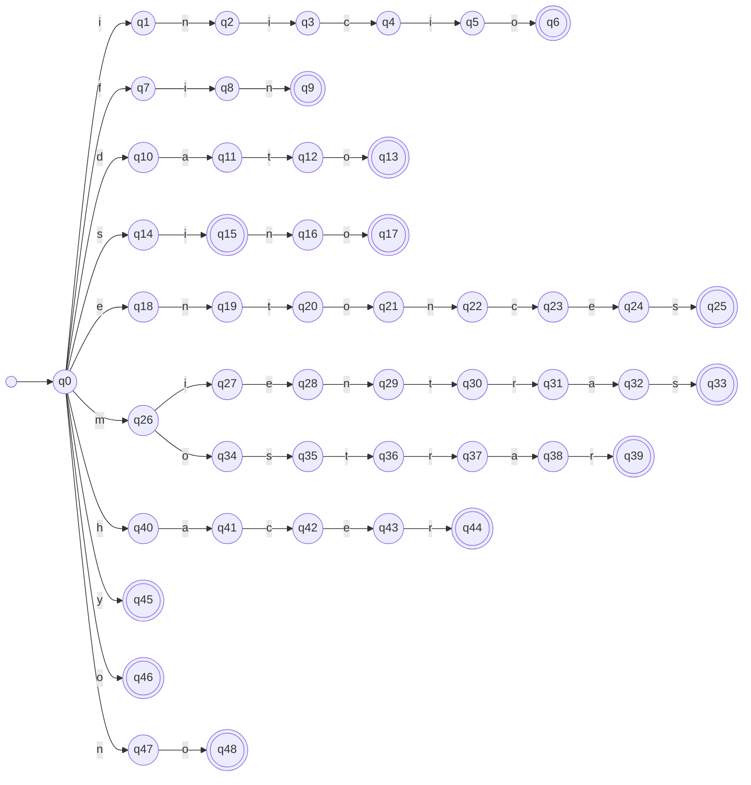
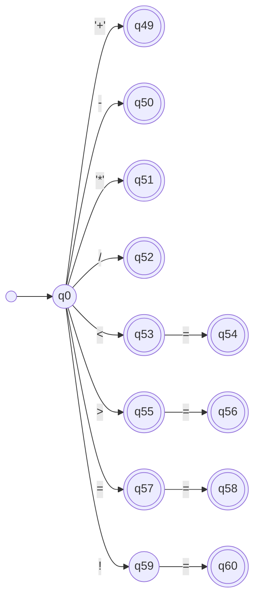
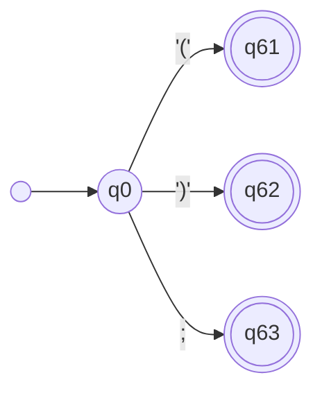

# Fase 1 — AFD parciales de los tokens fijos

Construidos a partir de las ER de ER-1 (er_tokens_fijos.md).

**Grafos:** `afd/afd1_tokens_fijos.drawio` (páginas: Palabras reservadas, Operadores, Delimitadores) y sus imágenes en `afd/img/`. Los diagramas Mermaid de este documento son una vista rápida para GitHub.

## Definición formal

M = (Q, Σ, δ, q0, F)

- Q = {q0, q1, ..., q63}  (|Q| = 64)
- Σ: el alfabeto definido en alfabeto.md
- q0: estado inicial, compartido por todos los tokens fijos
- F = {q6, q9, q13, q15, q17, q25, q33, q39, q44, q45, q46, q48,
  q49, q50, q51, q52, q53, q54, q55, q56, q57, q58, q60,
  q61, q62, q63}  (|F| = 26, un estado por token)
- δ: Q × Σ → Q es una **función parcial**.

**Convención (indicación de la profesora):** no se usa estado sumidero. Si δ(q, a)
no está definida, el autómata rechaza. En la matriz de transiciones esas celdas
quedan vacías.

## Construcción por prefijos compartidos

Todos los tokens parten de q0. Los tokens con prefijo común recorren los mismos
estados hasta el símbolo en que se diferencian, lo que corresponde a la
factorización de las ER:
- si(ε, no): q14 → q15 [SI] → q16 → q17 [SINO]
- m(ientras, ostrar): q26 se bifurca con i (mientras) u o (mostrar)
- <(ε, =), >(ε, =), =(ε, =): el estado tras el primer símbolo es de aceptación
  y tiene una transición con "=" hacia el token de dos símbolos.

## AFD parcial 1 — Palabras reservadas

| Token | Recorrido | Aceptación |
|---|---|---|
| INICIO | q0 -i→ q1 -n→ q2 -i→ q3 -c→ q4 -i→ q5 -o→ q6 | q6 |
| FIN | q0 -f→ q7 -i→ q8 -n→ q9 | q9 |
| DATO | q0 -d→ q10 -a→ q11 -t→ q12 -o→ q13 | q13 |
| SI | q0 -s→ q14 -i→ q15 | q15 |
| SINO | q0 -s→ q14 -i→ q15 -n→ q16 -o→ q17 | q17 |
| ENTONCES | q0 -e→ q18 -n→ q19 -t→ q20 -o→ q21 -n→ q22 -c→ q23 -e→ q24 -s→ q25 | q25 |
| MIENTRAS | q0 -m→ q26 -i→ q27 -e→ q28 -n→ q29 -t→ q30 -r→ q31 -a→ q32 -s→ q33 | q33 |
| MOSTRAR | q0 -m→ q26 -o→ q34 -s→ q35 -t→ q36 -r→ q37 -a→ q38 -r→ q39 | q39 |
| HACER | q0 -h→ q40 -a→ q41 -c→ q42 -e→ q43 -r→ q44 | q44 |
| Y | q0 -y→ q45 | q45 |
| O | q0 -o→ q46 | q46 |
| NO | q0 -n→ q47 -o→ q48 | q48 |

## AFD parcial 2 — Operadores

| Token | Recorrido | Aceptación |
|---|---|---|
| SUMA | q0 -'+'→ q49 | q49 |
| RESTA | q0 -(-)→ q50 | q50 |
| MULT | q0 -'*'→ q51 | q51 |
| DIV | q0 -/→ q52 | q52 |
| MENOR | q0 -<→ q53 | q53 |
| MENOR_IGUAL | q0 -<→ q53 -=→ q54 | q54 |
| MAYOR | q0 ->→ q55 | q55 |
| MAYOR_IGUAL | q0 ->→ q55 -=→ q56 | q56 |
| ASIGNACION | q0 -=→ q57 | q57 |
| IGUAL | q0 -=→ q57 -=→ q58 | q58 |
| DIFERENTE | q0 -!→ q59 -=→ q60 | q60 |

q59 **no** es de aceptación: "!" solo no es un token.

## AFD parcial 3 — Delimitadores

| Token | Recorrido | Aceptación |
|---|---|---|
| PAR_ABRE | q0 -'('→ q61 | q61 |
| PAR_CIERRA | q0 -')'→ q62 | q62 |
| PUNTO_COMA | q0 -;→ q63 | q63 |

## Justificación de aceptación y rechazo

- **Aceptación:** un estado está en F si y solo si la cadena leída desde q0 hasta
  él es exactamente el lexema de un token fijo.
- **Estados intermedios no finales** (q1–q5, q7, q8, q10–q12, q14, q16, q18–q24,
  q26–q32, q34–q38, q40–q43, q47, q59): la cadena leída es solo un prefijo propio
  de un token, por ejemplo "mie" o "!".
- **Rechazo:** ocurre cuando δ(q, a) no está definida y q ∉ F. No hay estado
  sumidero; la celda vacía de la matriz representa ese rechazo.
- **Fin de un token:** si δ(q, a) no está definida pero q ∈ F, el token termina
  ahí y se aplica la coincidencia más larga: el analizador emite el token de q y
  vuelve a q0 con el símbolo a.

## Trazas de verificación

| Entrada | Recorrido | Resultado |
|---|---|---|
| sino | q0 → q14 → q15 → q16 → q17 | q17 ∈ F → SINO |
| si␣ | q0 → q14 → q15; δ(q15, ␣) no definida | q15 ∈ F → SI |
| <= | q0 → q53 → q54 | q54 ∈ F → MENOR_IGUAL |
| <␣= | q0 → q53; δ(q53, ␣) no definida | MENOR; luego ASIG |
| !␣ | q0 → q59; δ(q59, ␣) no definida | q59 ∉ F → error léxico |
| mos␣ | q0 → q26 → q34 → q35; δ(q35, ␣) no definida | q35 ∉ F → rechazo en este AFD parcial |

**Nota:** al unir estos AFD con el de identificadores (siguiente tarea), los
estados intermedios de las palabras reservadas también serán de aceptación como
ID. Entonces "mos" será un identificador válido, y "si" seguirá siendo SI porque
la palabra reservada tiene prioridad cuando coincide con el lexema completo.