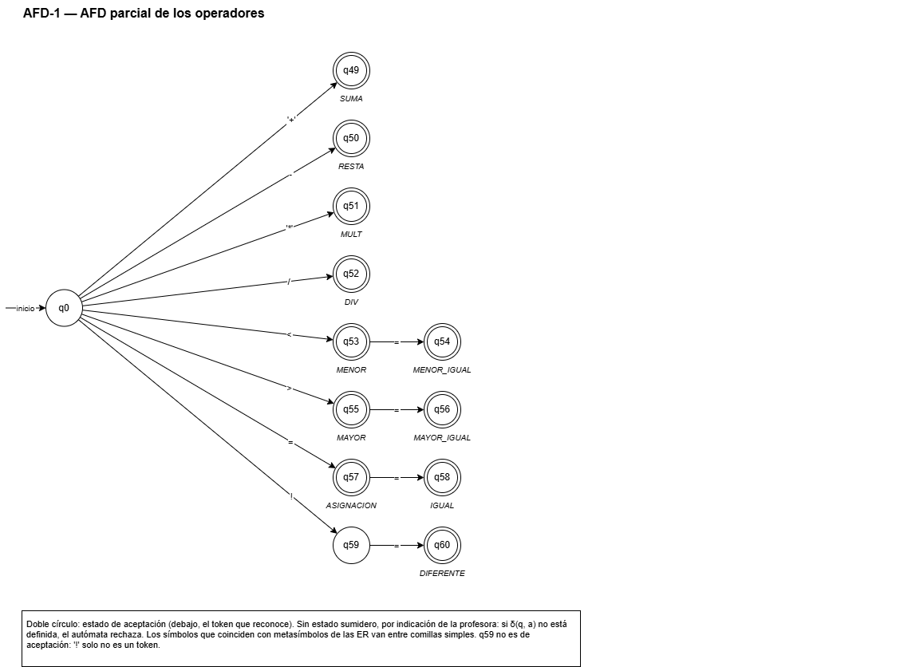
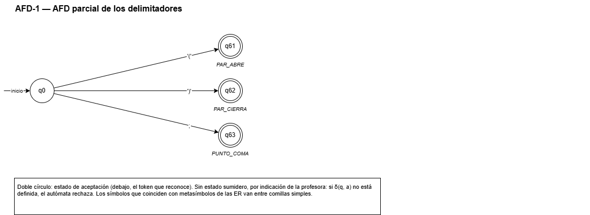
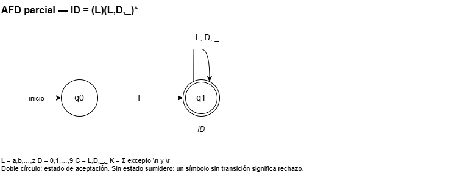
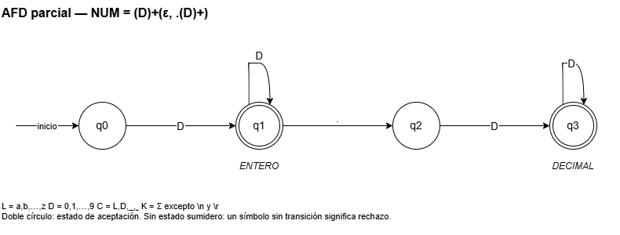
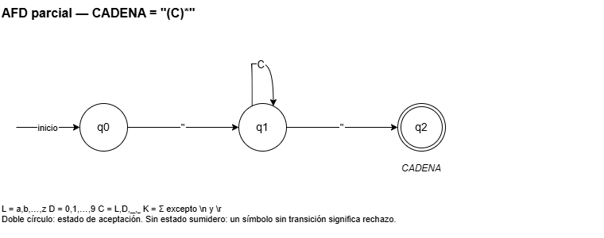
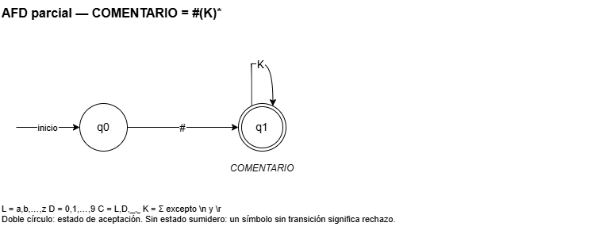
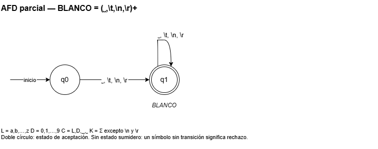
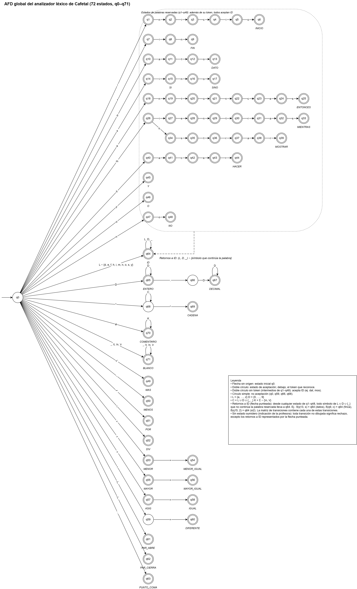

# Fase 1 — Formalismo léxico del lenguaje Cafetal

| | |
|---|---|
| **Universidad** | Universidad del Quindío — Facultad de Ingeniería |
| **Programa** | Ingeniería de Sistemas y Computación |
| **Curso** | Teoría de Lenguajes Formales, 2026-2 |
| **Docente** | Ana María Tamayo Ocampo |
| **Proyecto** | Diseño, Auditoría e Ingeniería Inversa de un Mini-Lenguaje de Programación de Dominio Específico (DSL), en Python |
| **Integrantes** | Daniel Josué Narváez Hincapié · Juan Diego García Albarracín |
| **Entrega** | Fase 1 — lunes 26 de octubre de 2026 |
| **Repositorio** | https://github.com/DanielJNarvaezH/dsl-lenguajes-formales-proyecto |

> Versión en PDF con portada: `Fase1_Cafetal.pdf`, en esta misma carpeta.

## 1. Introducción

Este documento presenta el formalismo léxico de **Cafetal**, el lenguaje de dominio específico diseñado por el equipo. La Fase 1 exige definir el alfabeto Σ, escribir una expresión regular para cada token válido y diseñar el autómata finito determinista (AFD) que los reconoce, con su grafo y su matriz de transiciones, justificando los estados de aceptación y rechazo.

El documento sigue ese mismo orden:

1. Descripción del lenguaje (sección 2).
2. Alfabeto Σ y sus subconjuntos (sección 3).
3. Tokens y sus expresiones regulares (sección 4).
4. AFD parciales y AFD global con su grafo (sección 5).
5. Matriz de transiciones (sección 6).
6. Justificación de los estados de aceptación y rechazo (sección 7).
7. Verificación con trazas y con los programas de ejemplo (sección 8).

**Convención de notación del curso.** Todas las expresiones regulares usan únicamente las operaciones primitivas vistas en clase: **unión** con coma (`a,b`), **concatenación** por yuxtaposición o con paréntesis (`ab`, `(a)(b)`) y **cerradura de Kleene** `( )*`. La única operación no primitiva usada es la **cerradura positiva** `( )+`, que equivale a `(X)(X)*`.

**Observación sobre el estado sumidero.** Por indicación de la profesora, el AFD **no incluye estado sumidero**. La función de transición δ es parcial: una celda vacía de la matriz, o una transición no dibujada en el grafo, significa **rechazo** (ver sección 7.1).

## 2. Descripción del DSL Cafetal

### 2.1 Dominio

**Cafetal** es un mini-lenguaje de programación para registrar y calcular la producción de una finca cafetera: kilos recogidos, días de secado, humedad, defectos y precios. Su vocabulario está tomado del contexto del Eje Cafetero. Funciona como un lenguaje imperativo básico: guarda números en variables, evalúa expresiones aritméticas y lógicas, toma decisiones, repite instrucciones y muestra resultados. Los archivos fuente usan la extensión `.cft`.

### 2.2 Construcciones

| Construcción | Sintaxis | Ejemplo |
|---|---|---|
| Programa | `inicio` sentencias `fin` | `inicio … fin` |
| Declaración | `dato` identificador `=` expresión `;` | `dato kilos = 250;` |
| Asignación | identificador `=` expresión `;` | `kilos = kilos + 30;` |
| Salida | `mostrar (` expresión o cadena `) ;` | `mostrar("cafe tipo exportacion");` |
| Condicional | `si (` condición `) entonces` sentencias `fin` | `si (defectos < 5) entonces … fin` |
| Condicional con alternativa | `si (` condición `) entonces` sentencias `sino` sentencias `fin` | `si (…) entonces … sino … fin` |
| Ciclo | `mientras (` condición `) hacer` sentencias `fin` | `mientras (humedad > 12) hacer … fin` |

Las expresiones admiten `+ - * /`, paréntesis, números enteros y decimales e identificadores. Las condiciones usan los relacionales `< > <= >= == !=` y los lógicos `y`, `o`, `no`. Precedencia, de mayor a menor: `( )`, `* /`, `+ -`, relacionales (no asociativos), `no`, `y`, `o`.

### 2.3 Decisiones de diseño relevantes para el análisis léxico

| Decisión | Motivo |
|---|---|
| Solo letras minúsculas, sin tildes ni `ñ` | Mantiene Σ pequeño y sin ambigüedades de codificación |
| Cadenas con solo minúsculas, dígitos, `_` y espacio | Reutiliza los conjuntos de los identificadores |
| Comentarios con cualquier símbolo de Σ hasta el fin de línea | Un `=` o `;` dentro de un comentario no lo corta ni genera tokens ocultos |
| Negación con la palabra `no`; `!` solo existe dentro de `!=` | Produce un estado de no aceptación justificable (`!` solo) |
| Todo bloque se cierra con `fin` | Elimina desde el diseño la ambigüedad del "else colgante" (útil en la Fase 2) |

### 2.4 Programa de ejemplo

```
# simula los dias de secado del grano
inicio
    dato dia = 1;
    dato humedad = 45;
    mientras (humedad > 12) hacer
        humedad = humedad - 6;   # pierde 6 puntos por dia
        si (dia == 5 o no (humedad > 20)) entonces
            mostrar("revisar el secador");
        fin
        dia = dia + 1;
    fin
    mostrar(dia);
fin
```

Cada día la humedad baja 6 puntos hasta quedar en 12 o menos. Cuando es el día 5 o la humedad ya no supera 20, el programa avisa que hay que revisar el secador. Los tres programas de ejemplo completos están en el Anexo A.

## 3. Alfabeto Σ

### 3.1 Convención de notación

- En las ER del curso, `( ) * +` y la coma son metasímbolos. Cuando `(`, `)`, `*` o `+` son **símbolos del lenguaje Cafetal**, se escriben entre comillas simples: `'('`, `')'`, `'*'`, `'+'`. Esta convención se usa desde Σ y en todas las fases.
- Cafetal no usa llaves `{ }` ni coma, por lo que no chocan con la notación de conjuntos.
- `␣` denota el espacio en blanco, `\t` la tabulación, `\n` el salto de línea y `\r` el retorno de carro.

### 3.2 Subconjuntos auxiliares

| Nombre | Definición por extensión | Cardinalidad |
|---|---|---|
| L (letras) | {a, b, c, d, e, f, g, h, i, j, k, l, m, n, o, p, q, r, s, t, u, v, w, x, y, z} | 26 |
| D (dígitos) | {0, 1, 2, 3, 4, 5, 6, 7, 8, 9} | 10 |
| O (operadores) | {'+', -, '*', /, <, >, =, !} | 8 |
| P (puntuación) | {'(', ')', ;, ., ", #, _} | 7 |
| B (blancos) | {␣, \t, \n, \r} | 4 |

### 3.3 Definición de Σ

Σ = L ∪ D ∪ O ∪ P ∪ B

Como los cinco subconjuntos son disjuntos dos a dos, |Σ| = 26 + 10 + 8 + 7 + 4 = **55**.

Σ = {a, b, c, d, e, f, g, h, i, j, k, l, m, n, o, p, q, r, s, t, u, v, w, x, y, z, 0, 1, 2, 3, 4, 5, 6, 7, 8, 9, '+', -, '*', /, <, >, =, !, '(', ')', ;, ., ", #, _, ␣, \t, \n, \r}

### 3.4 Subconjuntos para cadenas y comentarios

- **C = L ∪ D ∪ {_, ␣}**, |C| = 38: contenido permitido de una cadena. La comilla `"` no pertenece a C porque delimita la cadena, y los blancos distintos del espacio tampoco: una cadena no puede ocupar dos líneas.
- **K = Σ − {\n, \r}**, |K| = 53: contenido permitido de un comentario. El comentario termina al llegar `\n` o `\r`, los únicos símbolos de Σ que no están en K.

### 3.5 Símbolos que no pertenecen a Σ

Mayúsculas (A–Z), vocales con tilde, `ñ`, dos puntos, coma, llaves, corchetes, apóstrofo y cualquier otro carácter. Si un archivo `.cft` contiene un símbolo x ∉ Σ, el AFD no tiene transición para él y se produce un **error léxico**.

### 3.6 Separación entre alfabeto, léxico y gramática

| Nivel | Qué contiene | Ejemplos |
|---|---|---|
| Alfabeto Σ | Caracteres individuales, nada más | `m`, `7`, `<`, `=`, `;` |
| Tokens (léxico) | Cadenas de Σ* descritas por expresiones regulares | `mientras`, `<=`, `lote_norte`, `275.5` |
| Gramática (Fase 2) | Terminales (los tokens) y no terminales | `<sentencia>`, `<expresion>` |

Por eso `<=` **no** pertenece a Σ: es una cadena de longitud 2 de Σ* que el AFD reconoce como el token MENOR_IGUAL. Lo mismo ocurre con las palabras reservadas.

## 4. Tokens y expresiones regulares

### 4.1 Expresiones auxiliares

Cada nombre abrevia la unión escrita completa a su derecha. Cuando aparece dentro de otra ER, se reemplaza por esa unión entre paréntesis.

| Nombre | ER |
|---|---|
| L | a,b,c,d,e,f,g,h,i,j,k,l,m,n,o,p,q,r,s,t,u,v,w,x,y,z |
| D | 0,1,2,3,4,5,6,7,8,9 |
| C | L,D,_,␣ |
| K | L,D,'+',-,'*',/,<,>,=,!,'(',')',;,.,",#,_,␣,\t |

**Uso de ε.** Algunas ER factorizadas usan ε (cadena vacía). ε **no es un operador**: es una de las ER primitivas básicas, junto con ∅ y cada símbolo de Σ. Toda ER con ε de este documento tiene una equivalente sin ε (sección 4.3).

### 4.2 Tabla de tokens

El analizador léxico reconoce **32 categorías léxicas**: 30 tokens que se entregan al analizador sintáctico y 2 categorías descartables (COMENTARIO y BLANCO).

| Código | Token | ER | Lenguaje / descripción |
|---|---|---|---|
| 1 | INICIO | inicio | {inicio} |
| 2 | FIN | fin | {fin} |
| 3 | DATO | dato | {dato} |
| 4 | SI | si | {si} |
| 5 | ENTONCES | entonces | {entonces} |
| 6 | SINO | sino | {sino} |
| 7 | MIENTRAS | mientras | {mientras} |
| 8 | HACER | hacer | {hacer} |
| 9 | MOSTRAR | mostrar | {mostrar} |
| 10 | Y | y | {y} |
| 11 | O | o | {o} |
| 12 | NO | no | {no} |
| 20 | ID | (L)(L,D,_)* | Una letra seguida de cero o más letras, dígitos o guiones bajos |
| 21 | ENTERO | (D)+ | Uno o más dígitos |
| 22 | DECIMAL | (D)+.(D)+ | Dígitos, un punto y dígitos |
| 23 | CADENA | "(C)*" | Comilla, cero o más símbolos de C, comilla |
| 30 | SUMA | '+' | {+} |
| 31 | RESTA | - | {-} |
| 32 | MULT | '*' | {*} |
| 33 | DIV | / | {/} |
| 40 | MENOR | < | {<} |
| 41 | MAYOR | > | {>} |
| 42 | MENOR_IGUAL | <= | {<=} |
| 43 | MAYOR_IGUAL | >= | {>=} |
| 44 | IGUAL | == | {==} |
| 45 | DIFERENTE | != | {!=} |
| 50 | ASIGNACION | = | {=} |
| 60 | PAR_ABRE | '(' | {(} |
| 61 | PAR_CIERRA | ')' | {)} |
| 62 | PUNTO_COMA | ; | {;} |
| 90 | COMENTARIO | #(K)* | `#` seguido de cero o más símbolos de K (se descarta) |
| 91 | BLANCO | (␣,\t,\n,\r)+ | Uno o más blancos (se descarta) |

Además, el analizador léxico agrega al final el marcador `EOF` (código 99), que no corresponde a ningún lexema. Los 26 tokens de un único lexema (palabras reservadas, operadores, asignación y delimitadores) tienen ER formadas solo por concatenación; los 6 tokens variables usan cerraduras porque tienen infinitos lexemas.

### 4.3 Expresiones factorizadas por prefijos comunes

Cuando dos tokens comienzan igual, la ER se factoriza escribiendo el prefijo una sola vez. En el AFD, ese prefijo se convierte en un único camino compartido.

| Tokens | ER factorizada | Equivalente sin ε | Lenguaje |
|---|---|---|---|
| Palabras reservadas | inicio, fin, dato, si(ε,no), entonces, m(ientras,ostrar), hacer, y, o, no | inicio, fin, dato, si, sino, entonces, mientras, mostrar, hacer, y, o, no | Las 12 palabras |
| MENOR, MENOR_IGUAL | <(ε,=) | <, <= | {<, <=} |
| MAYOR, MAYOR_IGUAL | >(ε,=) | >, >= | {>, >=} |
| ASIGNACION, IGUAL | =(ε,=) | =, == | {=, ==} |
| ENTERO, DECIMAL | (D)+(ε,.(D)+) | (D)+, (D)+.(D)+ | ENTERO ∪ DECIMAL |

`!` pertenece a Σ, pero `!` solo **no** es un token: la única ER que lo contiene es `!=`.

### 4.4 Reglas de reconocimiento

1. **Lexema más largo.** El analizador consume la secuencia más larga que forme un token: `sino` es SINO (no SI y NO), `<=` es MENOR_IGUAL, `11.5` es DECIMAL, `finca` es ID.
2. **Prioridad de palabra reservada sobre identificador.** Las 12 palabras reservadas también pertenecen a L(ID). Si el lexema más largo coincide **exactamente** con una palabra reservada, se clasifica como palabra reservada; si continúa con letra, dígito o `_`, es ID (`si` → SI, `siembra` → ID, `dato_1` → ID).
3. **Descarte.** COMENTARIO y BLANCO se reconocen para avanzar en el texto y llevar línea y columna, pero no se entregan al analizador sintáctico.

### 4.5 Cadenas aceptadas y rechazadas (tokens variables)

| Token | Aceptadas | Rechazadas y motivo |
|---|---|---|
| ID | `kilos`, `lote_norte`, `promedio_2lotes` | `2kilos` y `_lote` (el primer símbolo debe estar en L); `kilos-norte` (`-` ∉ L,D,_) |
| ENTERO | `5`, `320`, `150000` | ε (`+` exige un dígito); `12a` (`a` ∉ D) |
| DECIMAL | `11.5`, `275.5`, `0.25` | `12.` y `.5` (falta un dígito a un lado del punto); `1.2.3` (un solo punto) |
| CADENA | `"secar de nuevo"`, `"lote_2"`, `""` | `"secar de nuevo` (sin cierre); `"kilos;"` (`;` ∉ C) |
| COMENTARIO | `# total = kilos * 2;`, `#` | `simula` (falta `#`); `# Revisar` (`R` ∉ Σ) |
| BLANCO | `␣`, `\r\n`, `\t␣␣` | ε (`+` exige un blanco); `␣a` (`a` no es blanco) |

## 5. Autómatas finitos deterministas

### 5.1 De la expresión regular al grafo

| Operador en la ER | Traducción en el AFD | Dónde se ve |
|---|---|---|
| Concatenación `ab` | Estados en serie | Cada palabra reservada; `"` seguido de `(C)*` en CADENA |
| Unión `a,b` | Varias transiciones que salen del mismo estado | `<(ε,=)`: el estado tras `<` acepta y además sale con `=` |
| Cerradura de Kleene `(X)*` | Lazo con X sobre el estado actual | `(L,D,_)*` en ID, `(C)*` en CADENA, `(K)*` en COMENTARIO |
| Cerradura positiva `(X)+` | Transición con X a un estado nuevo y lazo con X sobre él, porque `(X)+ = (X)(X)*` | `(D)+` en NUM, `(␣,\t,\n,\r)+` en BLANCO |

Que el estado del lazo sea de aceptación no depende del `*` o el `+`, sino de lo que sigue en la ER: en ID el lazo está al final, así que acepta; en CADENA todavía falta la comilla de cierre, así que no acepta.

### 5.2 AFD parciales de los tokens fijos

Todos los tokens fijos parten del mismo estado inicial q0, y los que comparten prefijo recorren los mismos estados hasta el símbolo en que se separan (árbol de prefijos). Resultado: 64 estados (q0–q63), 26 de aceptación, uno por token.






Puntos clave: q15 acepta SI y continúa con `n` hacia SINO; q26 se bifurca hacia `mientras` y `mostrar`; los estados tras `<`, `>` y `=` aceptan y continúan con `=`; el estado tras `!` (q59) **no** acepta.

### 5.3 AFD parciales de los tokens variables

| AFD | Estados | Aceptación | No aceptación | Lazos |
|---|---|---|---|---|
| ID: (L)(L,D,_)* | 2 | q1 (ID) | q0 | q1 con L, D, _ |
| NUM: (D)+(ε,.(D)+) | 4 | q1 (ENTERO), q3 (DECIMAL) | q0, q2 | q1 y q3 con D |
| CADENA: "(C)*" | 3 | q2 (CADENA) | q0, q1 | q1 con C |
| COMENTARIO: #(K)* | 2 | q1 (COMENTARIO) | q0 | q1 con K |
| BLANCO: (␣,\t,\n,\r)+ | 2 | q1 (BLANCO) | q0 | q1 con B |











### 5.4 Unificación en el AFD global

1. **Unión.** Los estados iniciales de los 8 AFD parciales se funden en un único q0. El resultado es no determinista solo con las **letras**: desde q0, la letra `i` lleva tanto al camino de INICIO como al estado de ID.
2. **Construcción de subconjuntos** (conversión AFN → AFD vista en clase). Cada estado del camino de una palabra reservada representa a la vez "voy leyendo la palabra reservada" y "voy leyendo un identificador". Por eso los estados intermedios aceptan ID, y toda letra, dígito o `_` que no continúe la palabra lleva al estado de ID.
3. **Numeración.** q0–q63 conservan la numeración de los AFD de tokens fijos; los estados de los tokens variables se renumeran como q64 (ID), q65 (ENTERO), q66 (punto sin dígitos), q67 (DECIMAL), q68 (cadena abierta), q69 (CADENA), q70 (COMENTARIO) y q71 (BLANCO).

### 5.5 Definición formal

M = (Q, Σ, δ, q0, F)

- Q = {q0, q1, …, q71}, |Q| = 72
- Σ: el alfabeto de la sección 3, |Σ| = 55
- q0: estado inicial único
- δ: Q × Σ → Q, **función parcial** (sección 6)
- F = Q − {q0, q59, q66, q68}, |F| = 68

| Estados de aceptación | Cantidad | Token |
|---|---|---|
| q6, q9, q13, q15, q17, q25, q33, q39, q44, q45, q46, q48 | 12 | La palabra reservada que completan |
| q1–q5, q7, q8, q10–q12, q14, q16, q18–q24, q26–q32, q34–q38, q40–q43, q47 | 36 | ID (prefijos de palabras reservadas) |
| q49–q58, q60–q63 | 14 | SUMA, RESTA, MULT, DIV, MENOR, MENOR_IGUAL, MAYOR, MAYOR_IGUAL, ASIGNACION, IGUAL, DIFERENTE, PAR_ABRE, PAR_CIERRA, PUNTO_COMA |
| q64, q65, q67, q69, q70, q71 | 6 | ID, ENTERO, DECIMAL, CADENA, COMENTARIO, BLANCO |

**Determinismo.** Para cada estado y cada símbolo existe a lo sumo una transición: las colisiones de letras se resolvieron en la construcción de subconjuntos, y los demás AFD parciales empiezan con símbolos distintos entre sí.

### 5.6 Grafo del AFD global

<div class="grafo">



</div>

**Leyenda.** Flecha sin origen: estado inicial q0. Doble círculo: estado de aceptación, con el token debajo; los dobles círculos sin token (intermedios de q1–q48) aceptan ID. Círculo simple: no aceptación (q0, q59, q66, q68). **Retornos a ID:** desde cualquier estado de q1–q48, todo símbolo de L ∪ D ∪ {_} que no continúa la palabra reservada lleva a q64; dibujar cada uno daría 1 738 flechas, así que se representan con la flecha punteada que sale del rectángulo. **Sin estado sumidero:** toda transición no dibujada significa rechazo, excepto los retornos a ID representados por esa flecha punteada.

Archivos: `afd/afd3_global.drawio` (editable), `afd/img/afd_global.drawio.png` y `afd/img/afd_global.drawio.svg` (versión vectorial).

## 6. Matriz de transiciones

### 6.1 Observación y convenciones

- **Sin estado sumidero** (indicación de la profesora): las celdas vacías indican que δ(q, a) no está definida y significan **rechazo**. De las 72 × 55 = 3 960 celdas posibles, 1 997 tienen transición.
- **→** marca el estado inicial y **\*** los estados de aceptación. El token de cada estado está en la última columna de la parte B.
- `'+'`, `'*'`, `'('` y `')'` van entre comillas simples porque coinciden con metasímbolos de las ER.
- La tabla completa sin agrupar (72 filas × 55 símbolos) está en `src/lexer/tabla_afd.csv`, que usará el analizador léxico en Python.

### 6.2 Agrupación de columnas

Se agrupan en una sola columna los símbolos que tienen la misma transición en **todos** los estados. Cada grupo es la unión que lo define, y los 55 símbolos de Σ quedan en **34 columnas** disjuntas.

Se agrupan en una sola columna los símbolos que tienen **la misma transición en todos los estados**.
Cada grupo es la unión que lo define:

| Columna | Símbolos (unión) | Motivo |
|---|---|---|
| a, c, d, e, f, h, i, m, n, o, r, s, t, y | una columna por letra | aparecen en alguna palabra reservada, por lo que se comportan distinto según el estado |
| L₁ | b, g, j, k, l, p, q, u, v, w, x, z | L − {a, c, d, e, f, h, i, m, n, o, r, s, t, y}: no aparecen en ninguna palabra reservada; siempre llevan a ID, cadena o comentario |
| D | 0, 1, 2, 3, 4, 5, 6, 7, 8, 9 | todos los dígitos se comportan igual |
| \n, \r | \n, \r | ambos solo forman BLANCO y cierran comentarios |
| resto | una columna por símbolo | cada uno tiene un comportamiento propio |

En total: 34 columnas que cubren los 55 símbolos de Σ.

Subconjuntos usados en la definición: L = {a, …, z}, D = {0, …, 9}, C = L ∪ D ∪ {_, ␣}, K = Σ − {\n, \r}.

<div class="landscape">

### 6.3 Parte A — letras, dígitos y guion bajo

| Estado | `a` | `c` | `d` | `e` | `f` | `h` | `i` | `m` | `n` | `o` | `r` | `s` | `t` | `y` | L₁ | D | `_` |
|---|---|---|---|---|---|---|---|---|---|---|---|---|---|---|---|---|---|
| →q0 | q64 | q64 | q10 | q18 | q7 | q40 | q1 | q26 | q47 | q46 | q64 | q14 | q64 | q45 | q64 | q65 |  |
| \*q1 | q64 | q64 | q64 | q64 | q64 | q64 | q64 | q64 | q2 | q64 | q64 | q64 | q64 | q64 | q64 | q64 | q64 |
| \*q2 | q64 | q64 | q64 | q64 | q64 | q64 | q3 | q64 | q64 | q64 | q64 | q64 | q64 | q64 | q64 | q64 | q64 |
| \*q3 | q64 | q4 | q64 | q64 | q64 | q64 | q64 | q64 | q64 | q64 | q64 | q64 | q64 | q64 | q64 | q64 | q64 |
| \*q4 | q64 | q64 | q64 | q64 | q64 | q64 | q5 | q64 | q64 | q64 | q64 | q64 | q64 | q64 | q64 | q64 | q64 |
| \*q5 | q64 | q64 | q64 | q64 | q64 | q64 | q64 | q64 | q64 | q6 | q64 | q64 | q64 | q64 | q64 | q64 | q64 |
| \*q6 | q64 | q64 | q64 | q64 | q64 | q64 | q64 | q64 | q64 | q64 | q64 | q64 | q64 | q64 | q64 | q64 | q64 |
| \*q7 | q64 | q64 | q64 | q64 | q64 | q64 | q8 | q64 | q64 | q64 | q64 | q64 | q64 | q64 | q64 | q64 | q64 |
| \*q8 | q64 | q64 | q64 | q64 | q64 | q64 | q64 | q64 | q9 | q64 | q64 | q64 | q64 | q64 | q64 | q64 | q64 |
| \*q9 | q64 | q64 | q64 | q64 | q64 | q64 | q64 | q64 | q64 | q64 | q64 | q64 | q64 | q64 | q64 | q64 | q64 |
| \*q10 | q11 | q64 | q64 | q64 | q64 | q64 | q64 | q64 | q64 | q64 | q64 | q64 | q64 | q64 | q64 | q64 | q64 |
| \*q11 | q64 | q64 | q64 | q64 | q64 | q64 | q64 | q64 | q64 | q64 | q64 | q64 | q12 | q64 | q64 | q64 | q64 |
| \*q12 | q64 | q64 | q64 | q64 | q64 | q64 | q64 | q64 | q64 | q13 | q64 | q64 | q64 | q64 | q64 | q64 | q64 |
| \*q13 | q64 | q64 | q64 | q64 | q64 | q64 | q64 | q64 | q64 | q64 | q64 | q64 | q64 | q64 | q64 | q64 | q64 |
| \*q14 | q64 | q64 | q64 | q64 | q64 | q64 | q15 | q64 | q64 | q64 | q64 | q64 | q64 | q64 | q64 | q64 | q64 |
| \*q15 | q64 | q64 | q64 | q64 | q64 | q64 | q64 | q64 | q16 | q64 | q64 | q64 | q64 | q64 | q64 | q64 | q64 |
| \*q16 | q64 | q64 | q64 | q64 | q64 | q64 | q64 | q64 | q64 | q17 | q64 | q64 | q64 | q64 | q64 | q64 | q64 |
| \*q17 | q64 | q64 | q64 | q64 | q64 | q64 | q64 | q64 | q64 | q64 | q64 | q64 | q64 | q64 | q64 | q64 | q64 |
| \*q18 | q64 | q64 | q64 | q64 | q64 | q64 | q64 | q64 | q19 | q64 | q64 | q64 | q64 | q64 | q64 | q64 | q64 |
| \*q19 | q64 | q64 | q64 | q64 | q64 | q64 | q64 | q64 | q64 | q64 | q64 | q64 | q20 | q64 | q64 | q64 | q64 |
| \*q20 | q64 | q64 | q64 | q64 | q64 | q64 | q64 | q64 | q64 | q21 | q64 | q64 | q64 | q64 | q64 | q64 | q64 |
| \*q21 | q64 | q64 | q64 | q64 | q64 | q64 | q64 | q64 | q22 | q64 | q64 | q64 | q64 | q64 | q64 | q64 | q64 |
| \*q22 | q64 | q23 | q64 | q64 | q64 | q64 | q64 | q64 | q64 | q64 | q64 | q64 | q64 | q64 | q64 | q64 | q64 |
| \*q23 | q64 | q64 | q64 | q24 | q64 | q64 | q64 | q64 | q64 | q64 | q64 | q64 | q64 | q64 | q64 | q64 | q64 |
| \*q24 | q64 | q64 | q64 | q64 | q64 | q64 | q64 | q64 | q64 | q64 | q64 | q25 | q64 | q64 | q64 | q64 | q64 |
| \*q25 | q64 | q64 | q64 | q64 | q64 | q64 | q64 | q64 | q64 | q64 | q64 | q64 | q64 | q64 | q64 | q64 | q64 |
| \*q26 | q64 | q64 | q64 | q64 | q64 | q64 | q27 | q64 | q64 | q34 | q64 | q64 | q64 | q64 | q64 | q64 | q64 |
| \*q27 | q64 | q64 | q64 | q28 | q64 | q64 | q64 | q64 | q64 | q64 | q64 | q64 | q64 | q64 | q64 | q64 | q64 |
| \*q28 | q64 | q64 | q64 | q64 | q64 | q64 | q64 | q64 | q29 | q64 | q64 | q64 | q64 | q64 | q64 | q64 | q64 |
| \*q29 | q64 | q64 | q64 | q64 | q64 | q64 | q64 | q64 | q64 | q64 | q64 | q64 | q30 | q64 | q64 | q64 | q64 |
| \*q30 | q64 | q64 | q64 | q64 | q64 | q64 | q64 | q64 | q64 | q64 | q31 | q64 | q64 | q64 | q64 | q64 | q64 |
| \*q31 | q32 | q64 | q64 | q64 | q64 | q64 | q64 | q64 | q64 | q64 | q64 | q64 | q64 | q64 | q64 | q64 | q64 |
| \*q32 | q64 | q64 | q64 | q64 | q64 | q64 | q64 | q64 | q64 | q64 | q64 | q33 | q64 | q64 | q64 | q64 | q64 |
| \*q33 | q64 | q64 | q64 | q64 | q64 | q64 | q64 | q64 | q64 | q64 | q64 | q64 | q64 | q64 | q64 | q64 | q64 |
| \*q34 | q64 | q64 | q64 | q64 | q64 | q64 | q64 | q64 | q64 | q64 | q64 | q35 | q64 | q64 | q64 | q64 | q64 |
| \*q35 | q64 | q64 | q64 | q64 | q64 | q64 | q64 | q64 | q64 | q64 | q64 | q64 | q36 | q64 | q64 | q64 | q64 |
| \*q36 | q64 | q64 | q64 | q64 | q64 | q64 | q64 | q64 | q64 | q64 | q37 | q64 | q64 | q64 | q64 | q64 | q64 |
| \*q37 | q38 | q64 | q64 | q64 | q64 | q64 | q64 | q64 | q64 | q64 | q64 | q64 | q64 | q64 | q64 | q64 | q64 |
| \*q38 | q64 | q64 | q64 | q64 | q64 | q64 | q64 | q64 | q64 | q64 | q39 | q64 | q64 | q64 | q64 | q64 | q64 |
| \*q39 | q64 | q64 | q64 | q64 | q64 | q64 | q64 | q64 | q64 | q64 | q64 | q64 | q64 | q64 | q64 | q64 | q64 |
| \*q40 | q41 | q64 | q64 | q64 | q64 | q64 | q64 | q64 | q64 | q64 | q64 | q64 | q64 | q64 | q64 | q64 | q64 |
| \*q41 | q64 | q42 | q64 | q64 | q64 | q64 | q64 | q64 | q64 | q64 | q64 | q64 | q64 | q64 | q64 | q64 | q64 |
| \*q42 | q64 | q64 | q64 | q43 | q64 | q64 | q64 | q64 | q64 | q64 | q64 | q64 | q64 | q64 | q64 | q64 | q64 |
| \*q43 | q64 | q64 | q64 | q64 | q64 | q64 | q64 | q64 | q64 | q64 | q44 | q64 | q64 | q64 | q64 | q64 | q64 |
| \*q44 | q64 | q64 | q64 | q64 | q64 | q64 | q64 | q64 | q64 | q64 | q64 | q64 | q64 | q64 | q64 | q64 | q64 |
| \*q45 | q64 | q64 | q64 | q64 | q64 | q64 | q64 | q64 | q64 | q64 | q64 | q64 | q64 | q64 | q64 | q64 | q64 |
| \*q46 | q64 | q64 | q64 | q64 | q64 | q64 | q64 | q64 | q64 | q64 | q64 | q64 | q64 | q64 | q64 | q64 | q64 |
| \*q47 | q64 | q64 | q64 | q64 | q64 | q64 | q64 | q64 | q64 | q48 | q64 | q64 | q64 | q64 | q64 | q64 | q64 |
| \*q48 | q64 | q64 | q64 | q64 | q64 | q64 | q64 | q64 | q64 | q64 | q64 | q64 | q64 | q64 | q64 | q64 | q64 |
| \*q49 |  |  |  |  |  |  |  |  |  |  |  |  |  |  |  |  |  |
| \*q50 |  |  |  |  |  |  |  |  |  |  |  |  |  |  |  |  |  |
| \*q51 |  |  |  |  |  |  |  |  |  |  |  |  |  |  |  |  |  |
| \*q52 |  |  |  |  |  |  |  |  |  |  |  |  |  |  |  |  |  |
| \*q53 |  |  |  |  |  |  |  |  |  |  |  |  |  |  |  |  |  |
| \*q54 |  |  |  |  |  |  |  |  |  |  |  |  |  |  |  |  |  |
| \*q55 |  |  |  |  |  |  |  |  |  |  |  |  |  |  |  |  |  |
| \*q56 |  |  |  |  |  |  |  |  |  |  |  |  |  |  |  |  |  |
| \*q57 |  |  |  |  |  |  |  |  |  |  |  |  |  |  |  |  |  |
| \*q58 |  |  |  |  |  |  |  |  |  |  |  |  |  |  |  |  |  |
| q59 |  |  |  |  |  |  |  |  |  |  |  |  |  |  |  |  |  |
| \*q60 |  |  |  |  |  |  |  |  |  |  |  |  |  |  |  |  |  |
| \*q61 |  |  |  |  |  |  |  |  |  |  |  |  |  |  |  |  |  |
| \*q62 |  |  |  |  |  |  |  |  |  |  |  |  |  |  |  |  |  |
| \*q63 |  |  |  |  |  |  |  |  |  |  |  |  |  |  |  |  |  |
| \*q64 | q64 | q64 | q64 | q64 | q64 | q64 | q64 | q64 | q64 | q64 | q64 | q64 | q64 | q64 | q64 | q64 | q64 |
| \*q65 |  |  |  |  |  |  |  |  |  |  |  |  |  |  |  | q65 |  |
| q66 |  |  |  |  |  |  |  |  |  |  |  |  |  |  |  | q67 |  |
| \*q67 |  |  |  |  |  |  |  |  |  |  |  |  |  |  |  | q67 |  |
| q68 | q68 | q68 | q68 | q68 | q68 | q68 | q68 | q68 | q68 | q68 | q68 | q68 | q68 | q68 | q68 | q68 | q68 |
| \*q69 |  |  |  |  |  |  |  |  |  |  |  |  |  |  |  |  |  |
| \*q70 | q70 | q70 | q70 | q70 | q70 | q70 | q70 | q70 | q70 | q70 | q70 | q70 | q70 | q70 | q70 | q70 | q70 |
| \*q71 |  |  |  |  |  |  |  |  |  |  |  |  |  |  |  |  |  |

### 6.4 Parte B — demás símbolos

| Estado | `.` | `"` | `#` | ␣ | \t | \n, \r | `'+'` | `-` | `'*'` | `/` | `<` | `>` | `=` | `!` | `'('` | `')'` | `;` | Token |
|---|---|---|---|---|---|---|---|---|---|---|---|---|---|---|---|---|---|---|
| →q0 |  | q68 | q70 | q71 | q71 | q71 | q49 | q50 | q51 | q52 | q53 | q55 | q57 | q59 | q61 | q62 | q63 |  |
| \*q1 |  |  |  |  |  |  |  |  |  |  |  |  |  |  |  |  |  | ID |
| \*q2 |  |  |  |  |  |  |  |  |  |  |  |  |  |  |  |  |  | ID |
| \*q3 |  |  |  |  |  |  |  |  |  |  |  |  |  |  |  |  |  | ID |
| \*q4 |  |  |  |  |  |  |  |  |  |  |  |  |  |  |  |  |  | ID |
| \*q5 |  |  |  |  |  |  |  |  |  |  |  |  |  |  |  |  |  | ID |
| \*q6 |  |  |  |  |  |  |  |  |  |  |  |  |  |  |  |  |  | INICIO |
| \*q7 |  |  |  |  |  |  |  |  |  |  |  |  |  |  |  |  |  | ID |
| \*q8 |  |  |  |  |  |  |  |  |  |  |  |  |  |  |  |  |  | ID |
| \*q9 |  |  |  |  |  |  |  |  |  |  |  |  |  |  |  |  |  | FIN |
| \*q10 |  |  |  |  |  |  |  |  |  |  |  |  |  |  |  |  |  | ID |
| \*q11 |  |  |  |  |  |  |  |  |  |  |  |  |  |  |  |  |  | ID |
| \*q12 |  |  |  |  |  |  |  |  |  |  |  |  |  |  |  |  |  | ID |
| \*q13 |  |  |  |  |  |  |  |  |  |  |  |  |  |  |  |  |  | DATO |
| \*q14 |  |  |  |  |  |  |  |  |  |  |  |  |  |  |  |  |  | ID |
| \*q15 |  |  |  |  |  |  |  |  |  |  |  |  |  |  |  |  |  | SI |
| \*q16 |  |  |  |  |  |  |  |  |  |  |  |  |  |  |  |  |  | ID |
| \*q17 |  |  |  |  |  |  |  |  |  |  |  |  |  |  |  |  |  | SINO |
| \*q18 |  |  |  |  |  |  |  |  |  |  |  |  |  |  |  |  |  | ID |
| \*q19 |  |  |  |  |  |  |  |  |  |  |  |  |  |  |  |  |  | ID |
| \*q20 |  |  |  |  |  |  |  |  |  |  |  |  |  |  |  |  |  | ID |
| \*q21 |  |  |  |  |  |  |  |  |  |  |  |  |  |  |  |  |  | ID |
| \*q22 |  |  |  |  |  |  |  |  |  |  |  |  |  |  |  |  |  | ID |
| \*q23 |  |  |  |  |  |  |  |  |  |  |  |  |  |  |  |  |  | ID |
| \*q24 |  |  |  |  |  |  |  |  |  |  |  |  |  |  |  |  |  | ID |
| \*q25 |  |  |  |  |  |  |  |  |  |  |  |  |  |  |  |  |  | ENTONCES |
| \*q26 |  |  |  |  |  |  |  |  |  |  |  |  |  |  |  |  |  | ID |
| \*q27 |  |  |  |  |  |  |  |  |  |  |  |  |  |  |  |  |  | ID |
| \*q28 |  |  |  |  |  |  |  |  |  |  |  |  |  |  |  |  |  | ID |
| \*q29 |  |  |  |  |  |  |  |  |  |  |  |  |  |  |  |  |  | ID |
| \*q30 |  |  |  |  |  |  |  |  |  |  |  |  |  |  |  |  |  | ID |
| \*q31 |  |  |  |  |  |  |  |  |  |  |  |  |  |  |  |  |  | ID |
| \*q32 |  |  |  |  |  |  |  |  |  |  |  |  |  |  |  |  |  | ID |
| \*q33 |  |  |  |  |  |  |  |  |  |  |  |  |  |  |  |  |  | MIENTRAS |
| \*q34 |  |  |  |  |  |  |  |  |  |  |  |  |  |  |  |  |  | ID |
| \*q35 |  |  |  |  |  |  |  |  |  |  |  |  |  |  |  |  |  | ID |
| \*q36 |  |  |  |  |  |  |  |  |  |  |  |  |  |  |  |  |  | ID |
| \*q37 |  |  |  |  |  |  |  |  |  |  |  |  |  |  |  |  |  | ID |
| \*q38 |  |  |  |  |  |  |  |  |  |  |  |  |  |  |  |  |  | ID |
| \*q39 |  |  |  |  |  |  |  |  |  |  |  |  |  |  |  |  |  | MOSTRAR |
| \*q40 |  |  |  |  |  |  |  |  |  |  |  |  |  |  |  |  |  | ID |
| \*q41 |  |  |  |  |  |  |  |  |  |  |  |  |  |  |  |  |  | ID |
| \*q42 |  |  |  |  |  |  |  |  |  |  |  |  |  |  |  |  |  | ID |
| \*q43 |  |  |  |  |  |  |  |  |  |  |  |  |  |  |  |  |  | ID |
| \*q44 |  |  |  |  |  |  |  |  |  |  |  |  |  |  |  |  |  | HACER |
| \*q45 |  |  |  |  |  |  |  |  |  |  |  |  |  |  |  |  |  | Y |
| \*q46 |  |  |  |  |  |  |  |  |  |  |  |  |  |  |  |  |  | O |
| \*q47 |  |  |  |  |  |  |  |  |  |  |  |  |  |  |  |  |  | ID |
| \*q48 |  |  |  |  |  |  |  |  |  |  |  |  |  |  |  |  |  | NO |
| \*q49 |  |  |  |  |  |  |  |  |  |  |  |  |  |  |  |  |  | SUMA |
| \*q50 |  |  |  |  |  |  |  |  |  |  |  |  |  |  |  |  |  | RESTA |
| \*q51 |  |  |  |  |  |  |  |  |  |  |  |  |  |  |  |  |  | MULT |
| \*q52 |  |  |  |  |  |  |  |  |  |  |  |  |  |  |  |  |  | DIV |
| \*q53 |  |  |  |  |  |  |  |  |  |  |  |  | q54 |  |  |  |  | MENOR |
| \*q54 |  |  |  |  |  |  |  |  |  |  |  |  |  |  |  |  |  | MENOR_IGUAL |
| \*q55 |  |  |  |  |  |  |  |  |  |  |  |  | q56 |  |  |  |  | MAYOR |
| \*q56 |  |  |  |  |  |  |  |  |  |  |  |  |  |  |  |  |  | MAYOR_IGUAL |
| \*q57 |  |  |  |  |  |  |  |  |  |  |  |  | q58 |  |  |  |  | ASIGNACION |
| \*q58 |  |  |  |  |  |  |  |  |  |  |  |  |  |  |  |  |  | IGUAL |
| q59 |  |  |  |  |  |  |  |  |  |  |  |  | q60 |  |  |  |  |  |
| \*q60 |  |  |  |  |  |  |  |  |  |  |  |  |  |  |  |  |  | DIFERENTE |
| \*q61 |  |  |  |  |  |  |  |  |  |  |  |  |  |  |  |  |  | PAR_ABRE |
| \*q62 |  |  |  |  |  |  |  |  |  |  |  |  |  |  |  |  |  | PAR_CIERRA |
| \*q63 |  |  |  |  |  |  |  |  |  |  |  |  |  |  |  |  |  | PUNTO_COMA |
| \*q64 |  |  |  |  |  |  |  |  |  |  |  |  |  |  |  |  |  | ID |
| \*q65 | q66 |  |  |  |  |  |  |  |  |  |  |  |  |  |  |  |  | ENTERO |
| q66 |  |  |  |  |  |  |  |  |  |  |  |  |  |  |  |  |  |  |
| \*q67 |  |  |  |  |  |  |  |  |  |  |  |  |  |  |  |  |  | DECIMAL |
| q68 |  | q69 |  | q68 |  |  |  |  |  |  |  |  |  |  |  |  |  |  |
| \*q69 |  |  |  |  |  |  |  |  |  |  |  |  |  |  |  |  |  | CADENA |
| \*q70 | q70 | q70 | q70 | q70 | q70 |  | q70 | q70 | q70 | q70 | q70 | q70 | q70 | q70 | q70 | q70 | q70 | COMENTARIO |
| \*q71 |  |  |  | q71 | q71 | q71 |  |  |  |  |  |  |  |  |  |  |  | BLANCO |

</div>

## 7. Justificación de los estados de aceptación y rechazo

### 7.1 Rechazo sin estado sumidero

Una cadena se **rechaza** en dos casos: (a) llega un símbolo a para el cual δ(q, a) está vacía y, desde el inicio del lexema, no se visitó ningún estado de aceptación; o (b) la cadena termina en un estado q ∉ F.

Este AFD parcial es equivalente al AFD completo que se obtendría agregando un estado q∅ de no aceptación, con todas las celdas vacías dirigidas hacia él y un lazo con los 55 símbolos de Σ: ambos reconocen el mismo lenguaje, y el sumidero solo daría nombre a un rechazo que ya ocurre.

En un analizador léxico, una celda vacía no siempre significa error. Depende del estado actual:

| Situación | Significado | Acción del analizador | Ejemplo |
|---|---|---|---|
| δ(q, a) vacía y q ∈ F | El lexema terminó; `a` pertenece al siguiente token | Emite el token de q y vuelve a q0 desde `a` | `si(`: δ(q15, '(') vacía, q15 ∈ F → SI |
| δ(q, a) vacía, q ∉ F, pero antes se visitó un estado de aceptación | Lo leído después de ese estado no forma un token | Retrocede al último estado de aceptación y emite su token | `12.x`: llega a q66 ∉ F, retrocede a q65 → ENTERO `12` |
| δ(q, a) vacía, q ∉ F y no se visitó ningún estado de aceptación | Ningún prefijo de lo leído es un token | Error léxico en el primer símbolo del lexema | `!x`: q59 ∉ F → error en `!` |

### 7.2 Estados de aceptación

**Criterio:** un estado q pertenece a F si y solo si toda cadena que lleva de q0 a q es un lexema completo de algún token. Si la cadena pertenece a dos lenguajes (palabra reservada e ID), gana la palabra reservada (regla 2 de la sección 4.4).

| Grupo | Estados | Token | Por qué acepta |
|---|---|---|---|
| Palabra reservada completa | q6, q9, q13, q15, q17, q25, q33, q39, q44, q45, q46, q48 | La palabra reservada | Lo leído es exactamente el lexema de su ER |
| Prefijo de palabra reservada | q1–q5, q7, q8, q10–q12, q14, q16, q18–q24, q26–q32, q34–q38, q40–q43, q47 | ID | Lo leído (`dat`, `mos`, `n`…) cumple (L)(L,D,_)* y no es palabra reservada |
| Operadores y delimitadores | q49–q58, q60–q63 | Su operador o delimitador | Lexema completo de su ER; q53, q55 y q57 corresponden a la rama ε de `<(ε,=)`, `>(ε,=)` y `=(ε,=)` |
| ID | q64 | ID | Letra inicial y cero o más símbolos de L, D, _ |
| Números | q65, q67 | ENTERO, DECIMAL | `(D)+` completo; `(D)+.(D)+` con dígitos a ambos lados |
| Cadena | q69 | CADENA | Se cerró la comilla: `"(C)*"` completo |
| Comentario y blanco | q70, q71 | COMENTARIO, BLANCO | `#(K)*` y `(␣,\t,\n,\r)+` completos |

Casos que merecen atención:
- **q15 (SI)** acepta aunque tiene salida con `n`: aceptar no significa que el camino termine. Si después llega `no`, el lexema más largo es `sino`.
- **q45 (Y) y q46 (O)** son palabras reservadas de una letra, por eso no existen variables llamadas `y` ni `o`.
- **Los estados finales de palabras reservadas** siguen teniendo transiciones con L, D y `_` hacia q64: `datos`, `finca` y `entonces2` son ID.

### 7.3 Estados de no aceptación

| Estado | Cadena leída | Qué le falta | Única continuación válida | Con cualquier otro símbolo |
|---|---|---|---|---|
| q0 | ε | Al menos un símbolo: ninguna ER genera ε | Todo Σ excepto `_` y `.` | `_` o `.` al inicio: error léxico |
| q59 | `!` | El `=` de `!=` | `=` → q60 | Error léxico en `!` |
| q66 | Dígitos y `.` | Un dígito después del punto | D → q67 | Retrocede a q65 (ENTERO); el `.` queda en error |
| q68 | `"` y contenido | La comilla de cierre | C → q68, `"` → q69 | Error léxico en la `"` inicial (cadena sin cerrar) |

En q59, q66 y q68 la cadena leída es un **prefijo propio** de un token. Si el analizador aceptara ahí, entregaría un token incompleto.

## 8. Verificación

### 8.1 Trazas sobre la matriz

**Traza 1 — `sino` (aceptada).** q0 →s→ q14 →i→ q15 (acepta SI) →n→ q16 →o→ q17. Termina en q17 ∈ F: **SINO**. En q15 ya se había aceptado SI, pero el lexema más largo continúa mientras haya transición.

**Traza 2 — `lote_2` (aceptada).** q0 →l (columna L₁)→ q64 →o→ q64 →t→ q64 →e→ q64 →_→ q64 →2 (columna D)→ q64. Termina en q64 ∈ F: **ID**. Los pasos 2 a 6 recorren el lazo de `(L,D,_)*`.

**Traza 3 — `11.5` (aceptada).** q0 →1→ q65 →1→ q65 →.→ q66 (no acepta) →5→ q67. Termina en q67 ∈ F: **DECIMAL**.

**Traza 4 — `!x` (rechazada).** q0 →!→ q59; δ(q59, x) está vacía, q59 ∉ F y no hubo aceptación: **error léxico en `!`**. El analizador continúa desde `x`, que es ID.

**Traza 5 — `"secar` + salto de línea (rechazada).** q0 →"→ q68 →s,e,c,a,r→ q68; δ(q68, \n) está vacía porque una cadena no puede ocupar dos líneas, y q68 ∉ F: **error léxico en `"`** (cadena sin cerrar).

### 8.2 Programas de ejemplo

Se recorrieron los tres programas del Anexo A con el AFD global y la regla del lexema más largo. No se produjo ningún error léxico, todos los lexemas pertenecen al lenguaje de alguna ER y entre los tres aparecen las 32 categorías léxicas.

| Programa | Errores léxicos | Tokens entregados al analizador sintáctico (sin blancos ni comentarios) |
|---|---|---|
| `ejemplo1_produccion.cft` | 0 | 66 |
| `ejemplo2_clasificacion.cft` | 0 | 62 |
| `ejemplo3_secado.cft` | 0 | 57 |

Ejemplo de tokenización de la línea 7 de `ejemplo3_secado.cft`, `si (dia == 5 o no (humedad > 20)) entonces`: SI, PAR_ABRE, ID, IGUAL, ENTERO, O, NO, PAR_ABRE, ID, MAYOR, ENTERO, PAR_CIERRA, PAR_CIERRA, ENTONCES.

### 8.3 Consistencia entre grafo y matriz

Se comparó el grafo con la matriz en ambos sentidos: toda celda no vacía tiene su flecha en el grafo, y todo símbolo de cada flecha está en la celda correspondiente.

| Verificación | Resultado |
|---|---|
| Estados: 72 en el grafo y 72 filas en la matriz | Coinciden |
| Estado inicial único q0 | Coincide |
| Estados de aceptación: 68 dobles círculos y 68 estados en F | Coinciden |
| Transiciones: 1 997 en el grafo (incluidos los retornos agrupados) y 1 997 en la matriz | 0 diferencias |
| Determinismo: ningún estado con dos transiciones para el mismo símbolo | Cumple |

## 9. Conclusiones

- Σ contiene únicamente 55 caracteres individuales, separados con claridad de los tokens (cadenas de Σ*) y de los no terminales de la gramática.
- Las 32 categorías léxicas de Cafetal se describen con expresiones regulares que usan solo unión, concatenación, cerradura de Kleene y cerradura positiva, con los metasímbolos del lenguaje entre comillas simples.
- El AFD global, con 72 estados y 68 de aceptación, se obtuvo uniendo los AFD parciales y aplicando la construcción de subconjuntos. Es determinista y su grafo coincide transición por transición con la matriz.
- La ausencia de estado sumidero no cambia el lenguaje reconocido: las celdas vacías son el rechazo, y junto con el lexema más largo distinguen entre fin de token y error léxico.
- La matriz exportada en `src/lexer/tabla_afd.csv` es la base directa del analizador léxico en Python de la Fase 3.

## Anexo A. Programas de ejemplo

**`ejemplos/ejemplo1_produccion.cft`**

```
# calcula la produccion total de dos lotes
inicio
    dato lote_norte = 320;
    dato lote_sur = 275.5;
    dato precio_kilo = 12500;
    dato total_kilos = lote_norte + lote_sur;
    dato ingreso = total_kilos * precio_kilo - 150000 / 2;
    dato promedio_2lotes = (lote_norte + lote_sur) / 2;
    mostrar("kilos cosechados");
    mostrar(total_kilos);
    mostrar(ingreso);
    mostrar(promedio_2lotes);
fin
```

**`ejemplos/ejemplo2_clasificacion.cft`**

```
# clasifica el cafe segun humedad y defectos
inicio
    dato humedad = 11.5;
    dato defectos = 4;
    si (humedad >= 10 y humedad <= 12) entonces
        si (defectos < 5) entonces
            mostrar("cafe tipo exportacion");
        sino
            mostrar("cafe para consumo interno");
        fin
    sino
        mostrar("secar de nuevo");
    fin
    si (defectos != 0) entonces
        mostrar("hay granos defectuosos");
    fin
fin
```

**`ejemplos/ejemplo3_secado.cft`**

```
# simula los dias de secado del grano
inicio
    dato dia = 1;
    dato humedad = 45;
    mientras (humedad > 12) hacer
        humedad = humedad - 6;   # pierde 6 puntos por dia
        si (dia == 5 o no (humedad > 20)) entonces
            mostrar("revisar el secador");
        fin
        dia = dia + 1;
    fin
    mostrar(dia);
fin
```

## Anexo B. Documentos fuente en el repositorio

| Tema | Documento en `docs/fase1/` | Tarea |
|---|---|---|
| Propuesta y especificación del DSL | `propuesta_dsl.md`, `especificacion_informal.md` | DSL-1, DSL-2 |
| Catálogo de tokens | `catalogo_tokens.md` | LEX-1 |
| Alfabeto Σ | `alfabeto.md` | LEX-2 |
| Expresiones regulares y su auditoría | `er_tokens_fijos.md`, `er_tokens_variables.md`, `er.md` | ER-1, ER-2, ER-3 |
| AFD parciales | `afd_tokens_fijos.md`, `afd_tokens_variables.md` | AFD-1, AFD-2 |
| AFD global, grafo y revisión | `afd_global.md`, `afd/afd3_global.drawio` | AFD-3, AFD-4 |
| Matriz de transiciones | `matriz_transiciones.md`, `src/lexer/tabla_afd.csv` | AFD-5 |
| Justificación de estados | `afd_justificacion.md` | AFD-6 |
