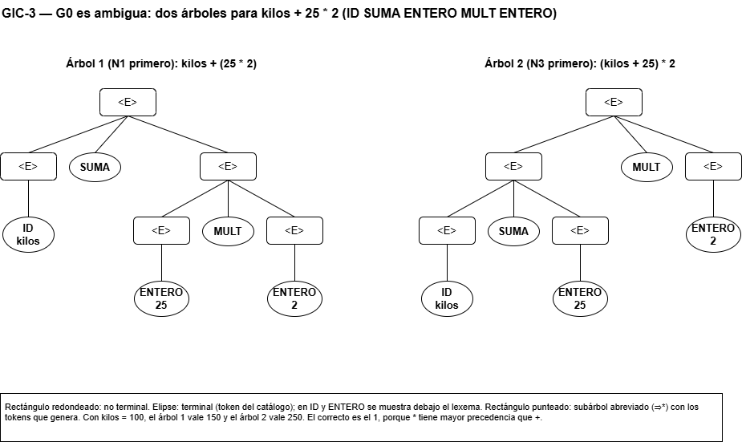
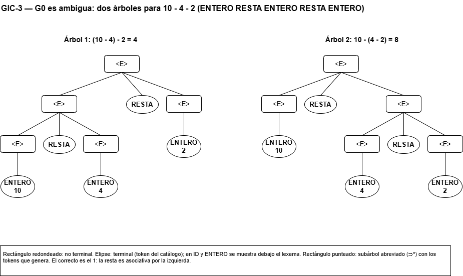
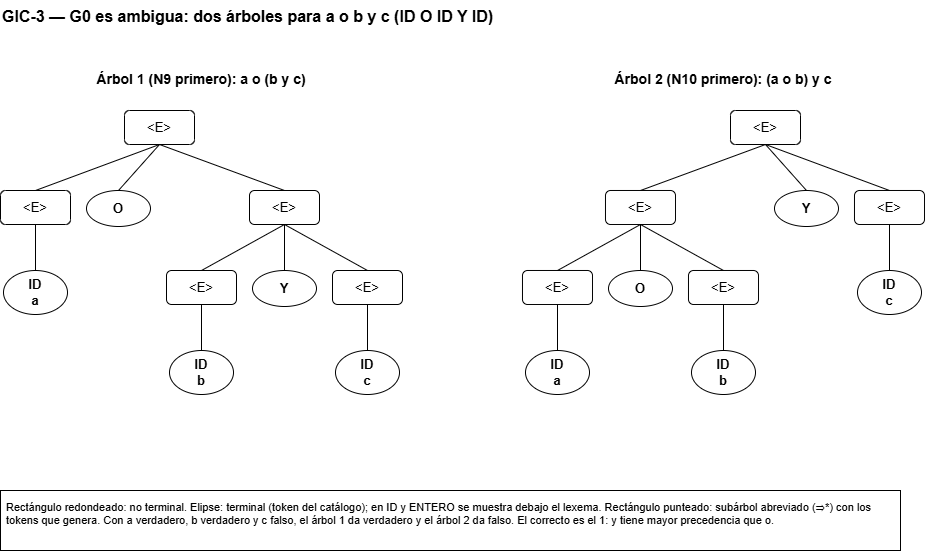
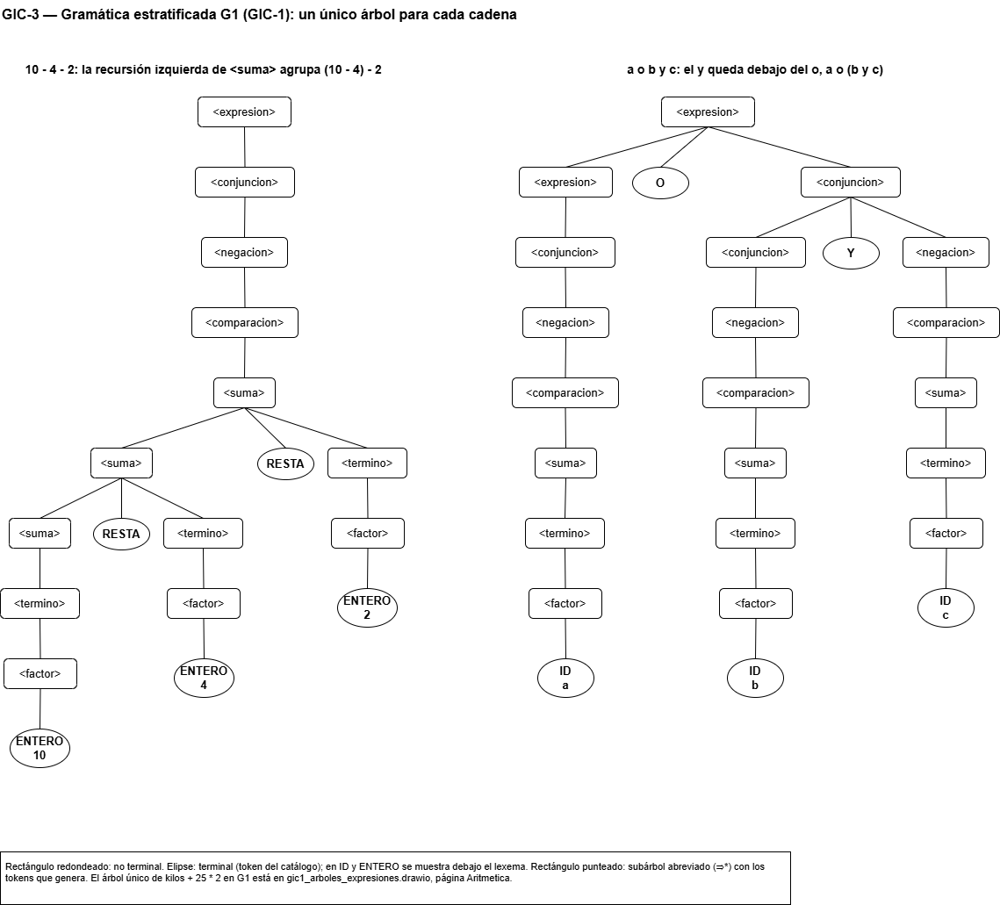
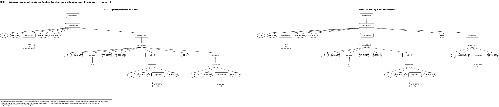

# Fase 2 — Demostración de ambigüedad y estratificación por precedencia

**Tarea Jira:** GIC-3 — Demostración de ambigüedad y estratificación por precedencia
**Responsable:** Daniel Josué Narváez Hincapié
**Insumos:** `gramatica_programa_expresiones.md` (GIC-1) y `gramatica_sentencias.md` (GIC-2)
**Figuras:** `arboles/gic3_ambiguedad.drawio` (páginas Precedencia, Asociatividad, Logicos, SinoIngenua y Estratificada)

---

## 1. Qué se demuestra

Una gramática independiente del contexto G es **ambigua** si existe al menos una cadena w ∈ L(G) que tiene dos árboles de derivación distintos o, lo que es equivalente, dos derivaciones más a la izquierda distintas (Hopcroft et al., 2007). Para probar que una gramática **es** ambigua basta con encontrar una sola cadena con dos árboles. Para probar que **no** lo es, hay que dar un argumento que valga para todas las cadenas.

Este documento hace las dos cosas:

1. Define una gramática **ingenua** G0 para las expresiones de Cafetal y prueba que es ambigua con tres cadenas, una por cada fuente de ambigüedad: precedencia, asociatividad y operadores lógicos (sección 3).
2. Transforma G0, paso a paso, en la gramática **estratificada** G1 de GIC-1 (sección 4) y demuestra que G1 asigna a cada cadena un único árbol (sección 5).
3. Hace lo mismo con el condicional: muestra el problema del *sino colgante* en una gramática sin delimitador de cierre y demuestra que el `fin` de Cafetal lo elimina (sección 6).

Se usa la misma notación de GIC-1 y GIC-2: no terminales en minúsculas entre `< >`, terminales con el nombre del token del catálogo en MAYÚSCULAS, `::=`, `|` y ε. En las derivaciones, el lexema de ID, ENTERO y DECIMAL se indica entre ⟨ ⟩.

## 2. La gramática ingenua G0

La forma más directa de escribir las expresiones es poner todos los operadores en un único no terminal `<E>`:

```
N1   <E> ::= <E> SUMA <E>
N2   <E> ::= <E> RESTA <E>
N3   <E> ::= <E> MULT <E>
N4   <E> ::= <E> DIV <E>
N5   <E> ::= PAR_ABRE <E> PAR_CIERRA
N6   <E> ::= ID
N7   <E> ::= ENTERO
N8   <E> ::= DECIMAL
N9   <E> ::= <E> O <E>
N10  <E> ::= <E> Y <E>
N11  <E> ::= NO <E>
N12  <E> ::= <E> <op_rel> <E>
N13  <op_rel> ::= MENOR | MAYOR | MENOR_IGUAL | MAYOR_IGUAL | IGUAL | DIFERENTE
```

G0 = ({`<E>`, `<op_rel>`}, T, {N1, …, N13}, `<E>`), con T igual a los tokens del catálogo.

G0 dice **qué** operadores existen, pero no dice **en qué orden** se aplican: ninguna regla distingue `*` de `+` ni la izquierda de la derecha. Las N1–N4, N9, N10 y N12 tienen la forma `<E> ::= <E> op <E>`, con `<E>` a ambos lados del operador. Cuando una cadena tiene dos operadores, cualquiera de los dos puede quedar en la raíz del árbol, y eso produce las ambigüedades de la sección 3.

## 3. Demostraciones de ambigüedad de G0

### 3.1 Precedencia: `kilos + 25 * 2`

Tokens: ID⟨kilos⟩ SUMA ENTERO⟨25⟩ MULT ENTERO⟨2⟩. Dos derivaciones más a la izquierda distintas:

```
Derivación 1 (N1 en la raíz)                 Derivación 2 (N3 en la raíz)
      <E>                                          <E>
⇒ N1  <E> SUMA <E>                           ⇒ N3  <E> MULT <E>
⇒ N6  ID⟨kilos⟩ SUMA <E>                     ⇒ N1  <E> SUMA <E> MULT <E>
⇒ N3  ID⟨kilos⟩ SUMA <E> MULT <E>            ⇒ N6  ID⟨kilos⟩ SUMA <E> MULT <E>
⇒ N7  ID⟨kilos⟩ SUMA ENTERO⟨25⟩ MULT <E>     ⇒ N7  ID⟨kilos⟩ SUMA ENTERO⟨25⟩ MULT <E>
⇒ N7  ID⟨kilos⟩ SUMA ENTERO⟨25⟩ MULT ENTERO⟨2⟩ ⇒ N7  ID⟨kilos⟩ SUMA ENTERO⟨25⟩ MULT ENTERO⟨2⟩
```

Las dos llegan a la misma cadena y ya difieren en el primer paso, así que son derivaciones distintas y producen árboles distintos.



*Fuente editable: `arboles/gic3_ambiguedad.drawio`, página Precedencia.*

La diferencia no es solo de forma. El árbol fija el orden de evaluación: con `kilos = 100`, el árbol 1 calcula `kilos + (25 * 2) = 150` y el árbol 2 calcula `(kilos + 25) * 2 = 250`. Solo el árbol 1 respeta la precedencia de Cafetal, en la que `*` va antes que `+`.

### 3.2 Asociatividad: `10 - 4 - 2`

Tokens: ENTERO⟨10⟩ RESTA ENTERO⟨4⟩ RESTA ENTERO⟨2⟩. Aquí los dos operadores son el mismo, así que el problema no es de precedencia sino de **agrupación**:

```
Derivación 1: (10 - 4) - 2                   Derivación 2: 10 - (4 - 2)
      <E>                                          <E>
⇒ N2  <E> RESTA <E>                          ⇒ N2  <E> RESTA <E>
⇒ N2  <E> RESTA <E> RESTA <E>                ⇒ N7  ENTERO⟨10⟩ RESTA <E>
⇒ N7  ENTERO⟨10⟩ RESTA <E> RESTA <E>         ⇒ N2  ENTERO⟨10⟩ RESTA <E> RESTA <E>
⇒ N7  ENTERO⟨10⟩ RESTA ENTERO⟨4⟩ RESTA <E>   ⇒ N7  ENTERO⟨10⟩ RESTA ENTERO⟨4⟩ RESTA <E>
⇒ N7  ENTERO⟨10⟩ RESTA ENTERO⟨4⟩ RESTA ENTERO⟨2⟩ ⇒ N7  ENTERO⟨10⟩ RESTA ENTERO⟨4⟩ RESTA ENTERO⟨2⟩
```

En el segundo paso, la derivación 1 vuelve a aplicar N2 sobre el `<E>` izquierdo y la derivación 2 lo convierte en ENTERO.



*Fuente editable: `arboles/gic3_ambiguedad.drawio`, página Asociatividad.*

El árbol 1 vale `(10 - 4) - 2 = 4` y el árbol 2 vale `10 - (4 - 2) = 8`. La resta y la división no son asociativas, así que la gramática tiene que fijar una agrupación. Cafetal, como la aritmética usual, agrupa por la izquierda: el resultado correcto es 4.

### 3.3 Operadores lógicos: `a o b y c`

Tokens: ID⟨a⟩ O ID⟨b⟩ Y ID⟨c⟩. Es el mismo problema de 3.1, pero en los niveles lógicos:

```
Derivación 1: a o (b y c)                    Derivación 2: (a o b) y c
      <E>                                          <E>
⇒ N9  <E> O <E>                              ⇒ N10 <E> Y <E>
⇒ N6  ID⟨a⟩ O <E>                            ⇒ N9  <E> O <E> Y <E>
⇒ N10 ID⟨a⟩ O <E> Y <E>                      ⇒ N6  ID⟨a⟩ O <E> Y <E>
⇒ N6  ID⟨a⟩ O ID⟨b⟩ Y <E>                    ⇒ N6  ID⟨a⟩ O ID⟨b⟩ Y <E>
⇒ N6  ID⟨a⟩ O ID⟨b⟩ Y ID⟨c⟩                  ⇒ N6  ID⟨a⟩ O ID⟨b⟩ Y ID⟨c⟩
```



*Fuente editable: `arboles/gic3_ambiguedad.drawio`, página Logicos.*

Con `a` verdadero, `b` verdadero y `c` falso, el árbol 1 da verdadero y el árbol 2 da falso. En Cafetal `y` tiene mayor precedencia que `o`, así que el correcto es el árbol 1.

G0 tiene otros dos defectos en los niveles lógicos:

- `no a y b` también tiene dos árboles: `(no a) y b` y `no (a y b)`. En Cafetal `no` va antes que `y`, así que el correcto es el primero.
- `a < b < c` tiene dos árboles en G0, pero según la especificación de Cafetal **no debería ser válida**: los relacionales no son asociativos. G0 no solo es ambigua, sino que además genera cadenas que el lenguaje debe rechazar.

### 3.4 El número de árboles crece con la longitud

En G0, una expresión con n operadores binarios seguidos y sin paréntesis tiene tantos árboles como formas de colocar los paréntesis, que es el número de Catalan Cₙ (1, 2, 5, 14, …). Se contaron los árboles de varias cadenas con un analizador general por programación dinámica, que prueba todas las particiones posibles de la cadena sin suponer nada sobre la forma de la gramática:

| Expresión | Tokens | Árboles en G0 | Árboles en G1 |
|---|---|---|---|
| `kilos + 25 * 2` | ID SUMA ENTERO MULT ENTERO | 2 | 1 |
| `10 - 4 - 2` | ENTERO RESTA ENTERO RESTA ENTERO | 2 | 1 |
| `a o b y c` | ID O ID Y ID | 2 | 1 |
| `no a y b` | NO ID Y ID | 2 | 1 |
| `a + b * c - d` | ID SUMA ID MULT ID RESTA ID | 5 | 1 |
| `a + b + c + d + e` | ID SUMA ID SUMA ID SUMA ID SUMA ID | 14 | 1 |
| `dia == 5 o no (humedad > 20)` | ID IGUAL ENTERO O NO PAR_ABRE ID MAYOR ENTERO PAR_CIERRA | 2 | 1 |
| `(a + b) * c` | PAR_ABRE ID SUMA ID PAR_CIERRA MULT ID | 1 | 1 |
| `a < b < c` | ID MENOR ID MENOR ID | 2 | **0** (rechazada) |

Los paréntesis explícitos sí quitan la ambigüedad en G0, como muestra `(a + b) * c`, pero no se puede exigir que el programador escriba todos los paréntesis. La gramática tiene que resolver por sí sola los casos sin paréntesis.

## 4. Estratificación: de G0 a G1

### 4.1 Idea

La ambigüedad de G0 viene de que todas sus reglas binarias tienen la forma `<E> ::= <E> op <E>`: el mismo no terminal a ambos lados permite elegir libremente qué operador queda en la raíz. La solución es **estratificar** la gramática:

1. **Un no terminal por nivel de precedencia.** Cada operador se introduce solo en su nivel.
2. **Cada nivel solo usa el nivel inmediatamente inferior como operando.** Así, un operador de mayor precedencia nunca puede quedar por encima de uno de menor precedencia en el árbol.
3. **La forma de la regla fija la asociatividad.** La recursión va solo hacia el lado por el que se agrupa.
4. **Los paréntesis vuelven al nivel superior.** El nivel más bajo, `<factor>`, es el único que permite reiniciar la jerarquía con `PAR_ABRE <expresion> PAR_CIERRA`.

### 4.2 Niveles de Cafetal

| Nivel (de menor a mayor precedencia) | No terminal | Operadores | Asociatividad | Patrón de la regla |
|---|---|---|---|---|
| 1 | `<expresion>` | `o` | Izquierda | `A ::= A op B \| B` |
| 2 | `<conjuncion>` | `y` | Izquierda | `A ::= A op B \| B` |
| 3 | `<negacion>` | `no` (prefijo) | Unario | `A ::= op A \| B` |
| 4 | `<comparacion>` | `< > <= >= == !=` | No asociativo | `A ::= B op B \| B` |
| 5 | `<suma>` | `+ -` | Izquierda | `A ::= A op B \| B` |
| 6 | `<termino>` | `* /` | Izquierda | `A ::= A op B \| B` |
| 7 | `<factor>` | `( )`, operandos | — | `A ::= PAR_ABRE <expresion> PAR_CIERRA \| operando` |

En cada patrón, A es el no terminal del nivel y B el del nivel siguiente (de mayor precedencia):

- **`A ::= A op B | B`** (asociativo por la izquierda). La recursión está a la izquierda, así que a la derecha del operador solo cabe un B, que no contiene `op` sin paréntesis. En `a op b op c`, el segundo `op` tiene que quedar en la raíz y el primero dentro del A izquierdo: `(a op b) op c`.
- **`A ::= op A | B`** (prefijo unario). El operador va delante y se puede repetir: `no no x` es `no (no x)`.
- **`A ::= B op B | B`** (no asociativo). No hay recursión: a cada lado solo cabe un B, que no contiene el operador. Por eso `a < b < c` no es derivable.

### 4.3 Transformación paso a paso

**Paso 1. Aritmética.** Se toman las reglas N1–N8 de G0. Los operadores `+ -` (nivel 5) y `* /` (nivel 6) reciben un no terminal cada uno, y los operandos y paréntesis pasan a `<factor>`:

```
G0 (N1–N8)                                    Estratificada
<E> ::= <E> SUMA <E>  | <E> RESTA <E>   ⇒    <suma>    ::= <suma> SUMA <termino> | <suma> RESTA <termino> | <termino>
<E> ::= <E> MULT <E>  | <E> DIV <E>     ⇒    <termino> ::= <termino> MULT <factor> | <termino> DIV <factor> | <factor>
<E> ::= PAR_ABRE <E> PAR_CIERRA         ⇒    <factor>  ::= PAR_ABRE <suma> PAR_CIERRA
<E> ::= ID | ENTERO | DECIMAL           ⇒    <factor>  ::= ID | ENTERO | DECIMAL
```

Esta es la gramática clásica de expresiones E–T–F (Aho et al., 2006).

**Paso 2. Relacionales (nivel 4, no asociativo).** N12 se reemplaza por el patrón `A ::= B op B | B` sobre `<suma>`:

```
<E> ::= <E> <op_rel> <E>               ⇒    <comparacion> ::= <suma> <op_rel> <suma> | <suma>
```

**Paso 3. Negación (nivel 3, prefijo).** N11 se reemplaza por el patrón `A ::= op A | B` sobre `<comparacion>`:

```
<E> ::= NO <E>                         ⇒    <negacion> ::= NO <negacion> | <comparacion>
```

**Paso 4. Conjunción y disyunción (niveles 2 y 1).** N10 y N9 se reemplazan por el patrón `A ::= A op B | B`:

```
<E> ::= <E> Y <E>                      ⇒    <conjuncion> ::= <conjuncion> Y <negacion> | <negacion>
<E> ::= <E> O <E>                      ⇒    <expresion>  ::= <expresion> O <conjuncion> | <conjuncion>
```

**Paso 5. Los paréntesis vuelven al nivel superior.** Como ahora `<expresion>` es el nivel más alto, la regla de paréntesis del paso 1 se cambia para que contenga una expresión completa, incluidos los operadores lógicos:

```
<factor> ::= PAR_ABRE <suma> PAR_CIERRA     ⇒    <factor> ::= PAR_ABRE <expresion> PAR_CIERRA
```

### 4.4 Resultado: G1

El resultado de los cinco pasos es exactamente la jerarquía de expresiones de GIC-1, con la numeración de GIC-2:

| Regla de G0 | Reglas de G1 que la reemplazan |
|---|---|
| N9 (`o`) | E1, E2 |
| N10 (`y`) | E3, E4 |
| N11 (`no`) | E5, E6 |
| N12, N13 (relacionales) | E7, E8, E9–E14 |
| N1, N2 (`+ -`) | E15, E16, E17 |
| N3, N4 (`* /`) | E18, E19, E20 |
| N5 (paréntesis) | E21 |
| N6, N7, N8 (operandos) | E22, E23, E24 |

```
E1   <expresion>   ::= <expresion> O <conjuncion>
E2   <expresion>   ::= <conjuncion>
E3   <conjuncion>  ::= <conjuncion> Y <negacion>
E4   <conjuncion>  ::= <negacion>
E5   <negacion>    ::= NO <negacion>
E6   <negacion>    ::= <comparacion>
E7   <comparacion> ::= <suma> <op_rel> <suma>
E8   <comparacion> ::= <suma>
E9–E14 <op_rel>    ::= MENOR | MAYOR | MENOR_IGUAL | MAYOR_IGUAL | IGUAL | DIFERENTE
E15  <suma>        ::= <suma> SUMA <termino>
E16  <suma>        ::= <suma> RESTA <termino>
E17  <suma>        ::= <termino>
E18  <termino>     ::= <termino> MULT <factor>
E19  <termino>     ::= <termino> DIV <factor>
E20  <termino>     ::= <factor>
E21  <factor>      ::= PAR_ABRE <expresion> PAR_CIERRA
E22  <factor>      ::= ID
E23  <factor>      ::= ENTERO
E24  <factor>      ::= DECIMAL
```

G1 no genera el mismo lenguaje que G0, sino uno más pequeño: L(G1) ⊂ L(G0). Toda cadena de G1 es también de G0, pero G0 acepta además cadenas como `a < b < c`, que la especificación de Cafetal prohíbe. La estratificación quita la ambigüedad y, a la vez, deja el lenguaje exactamente como lo pide la especificación.

Las mismas cadenas de la sección 3 tienen ahora un solo árbol. El de `kilos + 25 * 2` está en `gic1_arboles_expresiones.drawio` (página Aritmetica); los de `10 - 4 - 2` y `a o b y c` están en la siguiente figura:



*Fuente editable: `arboles/gic3_ambiguedad.drawio`, página Estratificada.*

En `10 - 4 - 2`, la recursión izquierda de E16 obliga a que el `<suma>` izquierdo genere `10 - 4`, porque el `<termino>` derecho no puede contener RESTA: el árbol agrupa `(10 - 4) - 2`. En `a o b y c`, el O solo puede aparecer en E1, en la raíz, y el Y queda dentro de la `<conjuncion>` derecha: el árbol agrupa `a o (b y c)`.

## 5. Por qué G1 no es ambigua

Una cadena con un solo árbol no prueba que la gramática no sea ambigua. Hace falta un argumento para todas las cadenas.

### 5.1 Operadores a nivel cero

Un token de una cadena está **a nivel cero** si no está encerrado entre un PAR_ABRE y su PAR_CIERRA correspondiente. En `(a + b) * c`, el MULT está a nivel cero y el SUMA no.

**Lema 1.** Una cadena derivada desde cada no terminal solo puede tener a nivel cero los operadores de su nivel y de los niveles de mayor precedencia:

| No terminal | Operadores que puede tener a nivel cero | Operadores que **no** puede tener a nivel cero |
|---|---|---|
| `<factor>` | ninguno | todos |
| `<termino>` | MULT, DIV | SUMA, RESTA, relacionales, NO, Y, O |
| `<suma>` | SUMA, RESTA, MULT, DIV | relacionales, NO, Y, O |
| `<comparacion>` | un solo relacional, más los anteriores | NO, Y, O |
| `<negacion>` | NO solo al comienzo, más los anteriores | Y, O |
| `<conjuncion>` | Y, más los anteriores | O |
| `<expresion>` | O, más los anteriores | — |

*Prueba.* Cada operador aparece en una sola familia de reglas (SUMA solo en E15, Y solo en E3, etc.), y desde un nivel solo se baja a niveles de mayor precedencia. La única forma de volver a un nivel superior es E21, que encierra la `<expresion>` entre paréntesis. Por eso un operador de menor precedencia solo aparece dentro de un no terminal de mayor precedencia si está entre paréntesis, es decir, fuera del nivel cero. ∎

### 5.2 Unicidad del árbol

**Proposición.** Para todo no terminal A de G1 y toda cadena w, existe a lo sumo un árbol de derivación con raíz A y frontera w.

*Prueba.* Por inducción sobre la longitud de w y, para la misma longitud, sobre el nivel de A (de `<factor>` hacia arriba). En cada caso se muestra que la primera regla y la forma de partir w están determinadas por w; las subcadenas resultantes son más cortas, o tienen la misma longitud y un nivel más bajo, así que por hipótesis de inducción tienen un único árbol.

- **`<expresion>`.** Si w no tiene O a nivel cero, E1 es imposible (pondría un O a nivel cero) y solo queda E2. Si w tiene O a nivel cero, E2 es imposible por el Lema 1, así que se aplica E1: w = u O v. Por el Lema 1, v, derivada desde `<conjuncion>`, no tiene O a nivel cero, así que el O de la regla es **el último O a nivel cero de w**. La partición es única.
- **`<conjuncion>`.** Igual, con el último Y a nivel cero (E3) o E4 si no hay ninguno.
- **`<negacion>`.** Si w empieza con NO, se aplica E5: una `<comparacion>` no puede empezar con NO, porque toda cadena de `<comparacion>` empieza como un `<factor>`, con PAR_ABRE, ID, ENTERO o DECIMAL. Si no empieza con NO, solo queda E6.
- **`<comparacion>`.** Si w no tiene relacionales a nivel cero, solo queda E8. Si tiene exactamente uno, E8 es imposible y E7 parte w justo en ese relacional. Si tiene dos o más, ninguna regla aplica, porque cada `<suma>` no puede contener relacionales a nivel cero: w no tiene árbol. Así se rechaza `a < b < c`.
- **`<suma>`.** Igual que `<expresion>`, con el último SUMA o RESTA a nivel cero (E15 o E16) o E17 si no hay ninguno.
- **`<termino>`.** Igual, con el último MULT o DIV a nivel cero (E18 o E19) o E20 si no hay ninguno.
- **`<factor>`.** El primer token decide: PAR_ABRE obliga a E21 (y el contenido, más corto, tiene un único árbol); ID, ENTERO o DECIMAL obligan a E22, E23 o E24.
- **`<op_rel>`.** Cada regla genera un token distinto.

En ningún caso hay dos reglas posibles ni dos formas de partir la cadena, así que el árbol es único. ∎

La prueba muestra además **por qué** el árbol es el correcto: en cada nivel, la raíz es el operador de menor precedencia y, entre varios iguales, el último. Eso es exactamente evaluar primero los de mayor precedencia y agrupar por la izquierda.

La demostración formal definitiva para la gramática que usará el parser es la tabla LL(1) de GIC-6: una gramática LL(1) no es ambigua, y una tabla sin celdas con dos producciones lo garantiza. Esa tabla se construye sobre la gramática final, después de eliminar la recursividad por la izquierda (GIC-4) y de factorizar (GIC-5).

## 6. El sino colgante

### 6.1 La gramática ingenua del condicional

Si el condicional no tuviera un delimitador de cierre, y cada rama fuera una sola sentencia, se escribiría así:

```
S1   <sentencia>   ::= <condicional>
S2   <sentencia>   ::= <asignacion>
K1   <condicional> ::= SI PAR_ABRE <expresion> PAR_CIERRA ENTONCES <sentencia>
K2   <condicional> ::= SI PAR_ABRE <expresion> PAR_CIERRA ENTONCES <sentencia> SINO <sentencia>
A1   <asignacion>  ::= ID ASIGNACION <expresion> PUNTO_COMA
```

Para la cadena `si (a) entonces si (b) entonces x = 1; sino x = 2;` se usan estas abreviaturas:

- α = SI PAR_ABRE ID⟨a⟩ PAR_CIERRA ENTONCES
- β = SI PAR_ABRE ID⟨b⟩ PAR_CIERRA ENTONCES
- x₁ = ID⟨x⟩ ASIGNACION ENTERO⟨1⟩ PUNTO_COMA
- x₂ = ID⟨x⟩ ASIGNACION ENTERO⟨2⟩ PUNTO_COMA

La cadena es w = α β x₁ SINO x₂. Cada `⇒*` deriva una expresión o una asignación completa con las reglas de G1 y A1.

```
Derivación 1: el sino es del si interno      Derivación 2: el sino es del si externo
      <sentencia>                                  <sentencia>
⇒ S1  <condicional>                          ⇒ S1  <condicional>
⇒ K1  SI PAR_ABRE <expresion> PAR_CIERRA     ⇒ K2  SI PAR_ABRE <expresion> PAR_CIERRA
      ENTONCES <sentencia>                         ENTONCES <sentencia> SINO <sentencia>
⇒*    α <sentencia>                          ⇒*    α <sentencia> SINO <sentencia>
⇒ S1  α <condicional>                        ⇒ S1  α <condicional> SINO <sentencia>
⇒ K2  α SI PAR_ABRE <expresion> PAR_CIERRA   ⇒ K1  α SI PAR_ABRE <expresion> PAR_CIERRA
      ENTONCES <sentencia> SINO <sentencia>        ENTONCES <sentencia> SINO <sentencia>
⇒*    α β <sentencia> SINO <sentencia>       ⇒*    α β <sentencia> SINO <sentencia>
⇒*    α β x₁ SINO <sentencia>                ⇒*    α β x₁ SINO <sentencia>
⇒*    α β x₁ SINO x₂                         ⇒*    α β x₁ SINO x₂
```

Las derivaciones difieren en el segundo paso (K1 frente a K2), así que la gramática es ambigua. Desde el cuarto paso las formas sentenciales vuelven a coincidir, pero el SINO ya quedó en un `<condicional>` distinto en cada una.



*Fuente editable: `arboles/gic3_ambiguedad.drawio`, página SinoIngenua.*

Las dos lecturas se comportan distinto: con `a` falso, el árbol 1 no ejecuta nada y el árbol 2 ejecuta `x = 2`. Lenguajes como C o Java resuelven este caso con una regla **externa** a la gramática ("el `else` pertenece al `if` más cercano"). Cafetal lo resuelve **dentro** de la gramática.

### 6.2 La solución: el delimitador de cierre `fin`

En Cafetal todo condicional y todo ciclo termina con `fin`, y cada rama es una lista `<sentencias>` (reglas de GIC-2):

```
C1   <condicional> ::= SI PAR_ABRE <expresion> PAR_CIERRA ENTONCES <sentencias> FIN
C2   <condicional> ::= SI PAR_ABRE <expresion> PAR_CIERRA ENTONCES <sentencias> SINO <sentencias> FIN
L1   <ciclo>       ::= MIENTRAS PAR_ABRE <expresion> PAR_CIERRA HACER <sentencias> FIN
```

Con `fin`, las dos lecturas de 6.1 ya no son dos árboles de la misma cadena, sino **dos cadenas distintas**, y el programador escribe la que quiere:

| Texto | Significado | Árboles |
|---|---|---|
| `si (a) entonces si (b) entonces x = 1; sino x = 2; fin fin` | El `sino` es del `si` interno | 1 |
| `si (a) entonces si (b) entonces x = 1; fin sino x = 2; fin` | El `sino` es del `si` externo | 1 |
| `si (a) entonces si (b) entonces x = 1; sino x = 2; fin` | Falta un `fin` | 0 (rechazada) |

Los árboles de las dos primeras cadenas están en `gic2_arboles_sentencias.drawio`, página SinoColgante.

### 6.3 Por qué el condicional con `fin` no es ambiguo

**Lema 2 (emparejamiento).** En toda cadena derivada desde `<sentencias>`, si cada SI y cada MIENTRAS se lee como un paréntesis que abre y cada FIN como uno que cierra, los tokens quedan **balanceados**, y cada SI o MIENTRAS tiene un único FIN correspondiente.

*Prueba.* C1, C2 y L1 producen exactamente un SI o MIENTRAS al comienzo y un FIN al final, y entre ellos solo hay `<sentencias>`, que por inducción están balanceadas. La declaración, la asignación y la salida no contienen SI, MIENTRAS ni FIN, porque las expresiones y las cadenas no los contienen. Una secuencia balanceada tiene un emparejamiento único, igual que una secuencia de paréntesis. ∎

Con el Lema 2, cada decisión del analizador queda determinada por la cadena:

- **¿Dónde termina un condicional o un ciclo?** En el FIN que corresponde a su SI o MIENTRAS, que es único.
- **¿C1 o C2?** Se usa C2 si y solo si hay un SINO **al nivel del bloque**, es decir, uno que no está dentro de otro par SI…FIN interno. En ese caso hay exactamente uno: dos SINO al nivel del mismo bloque no son derivables. Ese SINO parte el bloque en las dos listas `<sentencias>`.
- **¿Cómo se parte una lista `<sentencias>`?** Cada sentencia tiene un final determinado. La declaración, la asignación y la salida terminan en su primer PUNTO_COMA, porque las expresiones no contienen PUNTO_COMA; el condicional y el ciclo terminan en su FIN correspondiente. Por eso la lista se descompone en sentencias de una sola forma.

Por lo tanto, cada programa de Cafetal tiene a lo sumo un árbol de derivación. El analizador de conteo lo confirma con las tres cadenas de la tabla de 6.2: 1, 1 y 0 árboles. En cambio, la cadena de 6.1 tiene 2 árboles en la gramática ingenua.

C1 y C2 todavía comparten el prefijo `SI PAR_ABRE <expresion> PAR_CIERRA ENTONCES <sentencias>`. Eso no es ambigüedad, porque cada cadena tiene un solo árbol, sino un problema de **determinismo**: un parser descendente no puede elegir entre C1 y C2 mirando solo el primer token. Se resuelve con la factorización por la izquierda de GIC-5.

## 7. Resumen

| Fuente de ambigüedad | Ejemplo | Árboles en la gramática ingenua | Solución | Árboles en Cafetal |
|---|---|---|---|---|
| Precedencia | `kilos + 25 * 2` | 2 | Un no terminal por nivel (`<suma>`, `<termino>`) | 1 |
| Asociatividad | `10 - 4 - 2` | 2 | Recursión solo por la izquierda (E16) | 1 |
| Operadores lógicos | `a o b y c` | 2 | Niveles `<expresion>`, `<conjuncion>`, `<negacion>` | 1 |
| Relacionales encadenados | `a < b < c` | 2 | `<comparacion>` no asociativa (E7) | 0 (rechazada) |
| Sino colgante | `si (a) entonces si (b) entonces x = 1; sino x = 2;` | 2 | Delimitador de cierre `fin` (C1, C2, L1) | 1 por cada texto con `fin` |

## 8. Relación con las siguientes tareas

| Tarea | Qué toma de este documento |
|---|---|
| GIC-4 (Diego) | Elimina la recursividad por la izquierda de E1, E3, E15, E16, E18 y E19, que se introdujo aquí a propósito para fijar la asociatividad por la izquierda. La transformación conserva el lenguaje; cómo se refleja la agrupación por la izquierda en el árbol que genera el parser se define en la Fase 3 |
| GIC-5 (Daniel) | Factoriza `<comparacion>` (E7 y E8 empiezan con `<suma>`) y el condicional (C1 y C2 comparten prefijo) |
| GIC-6 (Diego) | La tabla LL(1) sin conflictos de la gramática final es la confirmación formal de que no es ambigua |

## Referencias

Aho, A. V., Lam, M. S., Sethi, R. y Ullman, J. D. (2006). *Compilers: Principles, techniques, and tools* (2.ª ed.). Addison-Wesley.

Hopcroft, J. E., Motwani, R. y Ullman, J. D. (2007). *Introduction to automata theory, languages, and computation* (3.ª ed.). Addison-Wesley.
