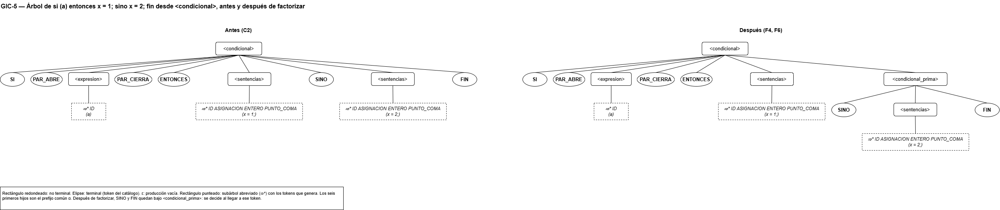
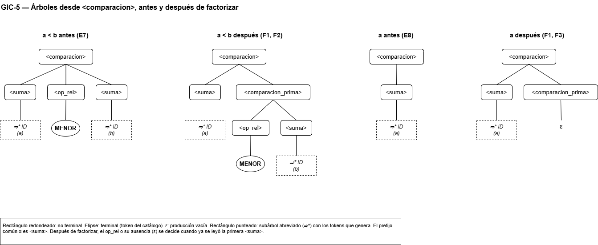

# Fase 2 — Factorización por la izquierda

**Tarea Jira:** GIC-5 — Factorización por la izquierda
**Responsable:** Daniel Josué Narváez Hincapié
**Insumos:** `recursividad.md` (GIC-4, gramática de la sección 6) y `ambiguedad.md` (GIC-3)
**Figuras:** `arboles/gic5_factorizacion.drawio` (páginas Condicional y Comparacion)
**Se complementa con:** GIC-6 (PRIMERO, SIGUIENTE y tabla LL(1))

---

## 1. Qué es la factorización por la izquierda y por qué se aplica

Después de GIC-4 la gramática ya no es recursiva por la izquierda, pero todavía no basta para un analizador descendente **predictivo**. Ese analizador tiene una función por no terminal y, cada vez que entra a un no terminal A, debe elegir **una** de sus reglas mirando solo el siguiente token, sin retroceder.

Eso falla cuando dos reglas de A empiezan igual:

```
A ::= α β₁
A ::= α β₂
```

Mientras el analizador lee α, las dos reglas siguen siendo posibles, y la diferencia solo aparece después de α. Si α es largo, como en el condicional de Cafetal, la elección depende de tokens que están muy adelante.

La **factorización por la izquierda** saca el prefijo común α a una sola regla y deja la decisión para el momento en que aparece la diferencia (Aho et al., 2006):

```
A ::= α β₁ | α β₂      ⇒      A  ::= α A'
                              A' ::= β₁ | β₂
```

La factorización **no quita ambigüedad**. GIC-3 ya demostró que la gramática no es ambigua: cada cadena tiene un solo árbol. Lo que resuelve es un problema de **determinismo**: con la gramática sin factorizar, el analizador no sabe qué regla aplicar al comienzo, aunque al final solo una funcione.

## 2. Notación

- Se usa la misma notación BNF de GIC-1 a GIC-4: no terminales en minúsculas entre `< >`, terminales con el nombre del token del catálogo en MAYÚSCULAS, `::=`, `|` y ε. En las derivaciones, el lexema de ID, ENTERO y DECIMAL se indica entre ⟨ ⟩.
- **El no terminal nuevo A'.** Se escribe agregando `_prima` al nombre, con la misma convención de GIC-4: el A' de `<condicional>` es `<condicional_prima>`. El nombre sirve directamente como nombre de la función de Python del analizador (`condicional_prima`).
- **Lenguajes con expresiones regulares primitivas.** Como en GIC-4, para comparar lo que genera un no terminal antes y después se usan solo unión con coma (`a,b`), concatenación por yuxtaposición o con paréntesis (`ab`, `(a)(b)`) y ε como expresión primitiva. Los símbolos son tokens y no terminales de la gramática; ningún nombre de token contiene coma ni paréntesis.
- **Numeración.** Las reglas que no cambian conservan su etiqueta de GIC-2 y GIC-4 (P, D, E, R, A, M, L). Las reglas que produce esta tarea se numeran F1 a F6.

## 3. Método

### 3.1 Regla básica

Si las reglas de A son

```
A ::= α β₁
A ::= α β₂
```

donde α ≠ ε es el **prefijo común más largo** de las dos alternativas, se reemplazan por

```
A  ::= α A'
A' ::= β₁
A' ::= β₂
```

donde A' es un no terminal nuevo. β₁ o β₂ pueden ser ε.

### 3.2 Por qué la transformación conserva el lenguaje

**Antes.** A genera α β₁ o α β₂, es decir, el conjunto de formas **α β₁ , α β₂**.

**Después.** La única regla de A es `A ::= α A'`, y A' genera β₁ o β₂, es decir, (β₁,β₂). Por lo tanto, A genera **(α)(β₁,β₂)**.

Como la concatenación se distribuye sobre la unión, (α)(β₁,β₂) = α β₁ , α β₂. Los dos conjuntos son iguales, así que la gramática factorizada genera exactamente el mismo lenguaje. ∎

Lo que cambia es **cuándo** se decide: antes había que elegir entre β₁ y β₂ al empezar A; ahora se elige al terminar α, que es justo donde las alternativas se separan.

### 3.3 Por qué el prefijo debe ser el más largo

Si se saca un prefijo más corto que el común, las nuevas reglas de A' siguen empezando igual y hay que factorizar otra vez. Por ejemplo, con `A ::= a b c | a b d`, sacar solo `a` deja `A' ::= b c | b d`, que todavía comparte `b`. Tomando el prefijo común más largo, `a b`, el resultado `A' ::= c | d` ya no tiene prefijo común, y la factorización se hace en un solo paso.

### 3.4 Más de dos alternativas

Si A tiene n alternativas con el mismo prefijo α, la regla es la misma con n alternativas en A': `A ::= α β₁ | … | α βₙ` ⇒ `A ::= α A'`, `A' ::= β₁ | … | βₙ`. Las alternativas de A que no empiezan con α se dejan como están. En Cafetal no se necesita este caso: los dos conflictos de la sección 4 tienen dos alternativas cada uno.

## 4. Detección de las reglas con prefijo común

### 4.1 Criterio

Hay que factorizar un no terminal cuando **dos de sus alternativas pueden empezar con el mismo token**. Puede pasar de dos formas:

- **Prefijo explícito:** las dos alternativas empiezan con el mismo símbolo, como `SI … | SI …`.
- **Prefijo oculto:** empiezan con símbolos distintos, pero ambos pueden generar el mismo primer token. Por ejemplo, `A ::= B … | C …` con B y C capaces de empezar con ID.

Para descartar el prefijo oculto hay que ver con qué tokens puede empezar cada alternativa. En la tabla de abajo, para las alternativas que empiezan con un no terminal, esos tokens se obtienen siguiendo la cadena de primeros símbolos de GIC-4 (sección 3.2 de `recursividad.md`). Por ejemplo, `<expresion>` empieza como una `<negacion>`, y esta con NO o como un `<factor>`: NO, PAR_ABRE, ID, ENTERO o DECIMAL. El cálculo formal de esos conjuntos es el conjunto PRIMERO de GIC-6.

Las alternativas ε no tienen prefijo, así que no entran en un conflicto de factorización. Cuándo se aplican se decide con el conjunto SIGUIENTE en GIC-6.

### 4.2 Revisión de la gramática de GIC-4

Se revisaron los 12 no terminales que tienen más de una alternativa en la gramática de la sección 6 de `recursividad.md`:

| No terminal | Alternativas | Tokens con que puede empezar cada una | ¿Prefijo común? |
|---|---|---|---|
| `<sentencias>` | R1 `<sentencia> <sentencias>` · R2 ε | R1: DATO, ID, MOSTRAR, SI, MIENTRAS · R2: ε | No |
| `<sentencia>` | P4 `<declaracion>` · P5 `<asignacion>` · P6 `<salida>` · P7 `<condicional>` · P8 `<ciclo>` | DATO · ID · MOSTRAR · SI · MIENTRAS | No |
| `<expresion_prima>` | R4 `O …` · R5 ε | O · ε | No |
| `<conjuncion_prima>` | R7 `Y …` · R8 ε | Y · ε | No |
| `<negacion>` | E5 `NO <negacion>` · E6 `<comparacion>` | NO · PAR_ABRE, ID, ENTERO, DECIMAL | No |
| **`<comparacion>`** | **E7 `<suma> <op_rel> <suma>` · E8 `<suma>`** | **E7: PAR_ABRE, ID, ENTERO, DECIMAL · E8: los mismos** | **Sí: `<suma>`** |
| `<op_rel>` | E9 a E14 | MENOR · MAYOR · MENOR_IGUAL · MAYOR_IGUAL · IGUAL · DIFERENTE | No |
| `<suma_prima>` | R10 `SUMA …` · R11 `RESTA …` · R12 ε | SUMA · RESTA · ε | No |
| `<termino_prima>` | R14 `MULT …` · R15 `DIV …` · R16 ε | MULT · DIV · ε | No |
| `<factor>` | E21 a E24 | PAR_ABRE · ID · ENTERO · DECIMAL | No |
| `<argumento>` | M2 `<expresion>` · M3 `CADENA` | NO, PAR_ABRE, ID, ENTERO, DECIMAL · CADENA | No |
| **`<condicional>`** | **C1 `SI … <sentencias> FIN` · C2 `SI … <sentencias> SINO <sentencias> FIN`** | **SI · SI** | **Sí: `SI PAR_ABRE <expresion> PAR_CIERRA ENTONCES <sentencias>`** |

Los otros 9 no terminales tienen una sola regla y no pueden tener conflicto.

**Resultado:** hay exactamente **dos** reglas con prefijo común, `<comparacion>` (E7, E8) y `<condicional>` (C1, C2). Las dos ya estaban señaladas como pendientes en GIC-1, GIC-2 y GIC-4. No hay prefijos ocultos. El caso más cercano sería `<negacion>` y `<argumento>`, pero NO y CADENA no pueden empezar una `<comparacion>` ni una `<expresion>`, respectivamente.

### 4.3 Un caso que no aparece en Cafetal: asignación frente a llamada

El ejemplo típico de factorización es una sentencia que empieza con un identificador y puede ser una **asignación** (`x = 5;`) o una **llamada** a un procedimiento (`x();`). Cafetal no tiene llamadas: no define procedimientos, y `mostrar` es una palabra reservada con su propio token, MOSTRAR, no un identificador. Por eso la única sentencia que empieza con ID es la asignación (P5, A1), y el conflicto no se presenta.

Si se agregara una llamada, la regla quedaría así, y se factorizaría con el mismo método:

```
Hipotético, no forma parte de Cafetal:
<sentencia_id> ::= ID ASIGNACION <expresion> PUNTO_COMA
<sentencia_id> ::= ID PAR_ABRE PAR_CIERRA PUNTO_COMA

α = ID,  β₁ = ASIGNACION <expresion> PUNTO_COMA,  β₂ = PAR_ABRE PAR_CIERRA PUNTO_COMA

<sentencia_id>       ::= ID <sentencia_id_prima>
<sentencia_id_prima> ::= ASIGNACION <expresion> PUNTO_COMA
<sentencia_id_prima> ::= PAR_ABRE PAR_CIERRA PUNTO_COMA
```

## 5. Aplicación paso a paso

### 5.1 `<condicional>` (C1 y C2): `si` con y sin `sino`

**Regla original:**

```
C1   <condicional> ::= SI PAR_ABRE <expresion> PAR_CIERRA ENTONCES <sentencias> FIN
C2   <condicional> ::= SI PAR_ABRE <expresion> PAR_CIERRA ENTONCES <sentencias> SINO <sentencias> FIN
```

**Búsqueda del prefijo común más largo.** Se comparan las dos alternativas símbolo por símbolo:

| Posición | C1 | C2 | ¿Iguales? |
|---|---|---|---|
| 1 | SI | SI | Sí |
| 2 | PAR_ABRE | PAR_ABRE | Sí |
| 3 | `<expresion>` | `<expresion>` | Sí |
| 4 | PAR_CIERRA | PAR_CIERRA | Sí |
| 5 | ENTONCES | ENTONCES | Sí |
| 6 | `<sentencias>` | `<sentencias>` | Sí |
| 7 | FIN | SINO | **No** |

El prefijo común más largo son las posiciones 1 a 6.

**Identificación de α, β₁ y β₂:**

| Símbolo de la fórmula | Valor |
|---|---|
| A | `<condicional>` |
| α | SI PAR_ABRE `<expresion>` PAR_CIERRA ENTONCES `<sentencias>` |
| β₁ | FIN |
| β₂ | SINO `<sentencias>` FIN |
| A' | `<condicional_prima>` |

**Sustitución en la fórmula:**

```
A  ::= α A'    ⇒   <condicional>       ::= SI PAR_ABRE <expresion> PAR_CIERRA ENTONCES <sentencias> <condicional_prima>
A' ::= β₁      ⇒   <condicional_prima> ::= FIN
A' ::= β₂      ⇒   <condicional_prima> ::= SINO <sentencias> FIN
```

**Regla resultante:**

```
F4   <condicional>       ::= SI PAR_ABRE <expresion> PAR_CIERRA ENTONCES <sentencias> <condicional_prima>
F5   <condicional_prima> ::= FIN
F6   <condicional_prima> ::= SINO <sentencias> FIN
```

**Lenguaje.** Antes: α FIN , α SINO `<sentencias>` FIN. Después: (α)(FIN , SINO `<sentencias>` FIN). Son iguales por la distribución de 3.2.

**Qué cambia para el analizador.** Antes había que elegir entre C1 y C2 al leer SI, sin saber si más adelante vendría un `sino`. Ahora F4 se aplica siempre al leer SI, y la elección entre F5 y F6 se hace al terminar el bloque `<sentencias>`, mirando un solo token: FIN o SINO.

**El sino colgante sigue resuelto.** Cada condicional sigue cerrando con su propio FIN, ahora dentro de F5 o de F6, así que el argumento de emparejamiento de GIC-3 (sección 6.3 de `ambiguedad.md`) se mantiene: cada SINO pertenece a un único `<condicional>`.

### 5.2 `<comparacion>` (E7 y E8)

**Regla original:**

```
E7   <comparacion> ::= <suma> <op_rel> <suma>
E8   <comparacion> ::= <suma>
```

**Búsqueda del prefijo común más largo:**

| Posición | E7 | E8 | ¿Iguales? |
|---|---|---|---|
| 1 | `<suma>` | `<suma>` | Sí |
| 2 | `<op_rel>` | (la alternativa terminó) | **No** |

El prefijo común más largo es `<suma>`, y después de él E8 ya no tiene nada: su resto es ε.

**Identificación de α, β₁ y β₂:**

| Símbolo de la fórmula | Valor |
|---|---|
| A | `<comparacion>` |
| α | `<suma>` |
| β₁ | `<op_rel>` `<suma>` |
| β₂ | ε |
| A' | `<comparacion_prima>` |

**Sustitución en la fórmula:**

```
A  ::= α A'    ⇒   <comparacion>       ::= <suma> <comparacion_prima>
A' ::= β₁      ⇒   <comparacion_prima> ::= <op_rel> <suma>
A' ::= β₂      ⇒   <comparacion_prima> ::= ε
```

**Regla resultante:**

```
F1   <comparacion>       ::= <suma> <comparacion_prima>
F2   <comparacion_prima> ::= <op_rel> <suma>
F3   <comparacion_prima> ::= ε
```

**Lenguaje.** Antes: `<suma>` `<op_rel>` `<suma>` , `<suma>`. Después: (`<suma>`)(`<op_rel>` `<suma>` , ε). Son iguales por la distribución de 3.2 y porque ε es el neutro de la concatenación (`<suma>` ε = `<suma>`).

**Qué cambia para el analizador.** Antes, al empezar una comparación había que decidir entre E7 y E8 viendo el primer token de la primera `<suma>`, que es el mismo en los dos casos. Ahora F1 se aplica siempre, y después de leer la primera `<suma>` el siguiente token decide: si es un relacional (MENOR, MAYOR, MENOR_IGUAL, MAYOR_IGUAL, IGUAL o DIFERENTE) se aplica F2; si no, F3. Los tokens exactos que justifican F3 son el conjunto SIGUIENTE de `<comparacion_prima>`, que se calcula en GIC-6.

**Los relacionales siguen siendo no asociativos.** `<comparacion_prima>` no es recursiva: genera a lo sumo un `<op_rel>` seguido de una `<suma>`, que no puede contener relacionales sin paréntesis. Por eso `a < b < c` sigue sin ser derivable, igual que en GIC-3.

### 5.3 Resumen

| No terminal | Reglas originales | α | β₁ | β₂ | Reglas nuevas | Lenguaje (igual antes y después) |
|---|---|---|---|---|---|---|
| `<comparacion>` | E7, E8 | `<suma>` | `<op_rel>` `<suma>` | ε | F1, F2, F3 | (`<suma>`)(`<op_rel>` `<suma>` , ε) |
| `<condicional>` | C1, C2 | SI PAR_ABRE `<expresion>` PAR_CIERRA ENTONCES `<sentencias>` | FIN | SINO `<sentencias>` FIN | F4, F5, F6 | (α)(FIN , SINO `<sentencias>` FIN) |

## 6. Gramática factorizada

Se eliminan 4 reglas (E7, E8, C1, C2) y se agregan 6 (F1–F6). La gramática pasa de 44 a 46 reglas y de 21 a 23 no terminales, con los dos nuevos `<comparacion_prima>` y `<condicional_prima>`.

```
P1   <programa> ::= INICIO <sentencias> FIN
R1   <sentencias> ::= <sentencia> <sentencias>
R2   <sentencias> ::= ε
P4   <sentencia> ::= <declaracion>
P5   <sentencia> ::= <asignacion>
P6   <sentencia> ::= <salida>
P7   <sentencia> ::= <condicional>
P8   <sentencia> ::= <ciclo>
D1   <declaracion> ::= DATO ID ASIGNACION <expresion> PUNTO_COMA
R3   <expresion> ::= <conjuncion> <expresion_prima>
R4   <expresion_prima> ::= O <conjuncion> <expresion_prima>
R5   <expresion_prima> ::= ε
R6   <conjuncion> ::= <negacion> <conjuncion_prima>
R7   <conjuncion_prima> ::= Y <negacion> <conjuncion_prima>
R8   <conjuncion_prima> ::= ε
E5   <negacion> ::= NO <negacion>
E6   <negacion> ::= <comparacion>
F1   <comparacion> ::= <suma> <comparacion_prima>
F2   <comparacion_prima> ::= <op_rel> <suma>
F3   <comparacion_prima> ::= ε
E9   <op_rel> ::= MENOR
E10  <op_rel> ::= MAYOR
E11  <op_rel> ::= MENOR_IGUAL
E12  <op_rel> ::= MAYOR_IGUAL
E13  <op_rel> ::= IGUAL
E14  <op_rel> ::= DIFERENTE
R9   <suma> ::= <termino> <suma_prima>
R10  <suma_prima> ::= SUMA <termino> <suma_prima>
R11  <suma_prima> ::= RESTA <termino> <suma_prima>
R12  <suma_prima> ::= ε
R13  <termino> ::= <factor> <termino_prima>
R14  <termino_prima> ::= MULT <factor> <termino_prima>
R15  <termino_prima> ::= DIV <factor> <termino_prima>
R16  <termino_prima> ::= ε
E21  <factor> ::= PAR_ABRE <expresion> PAR_CIERRA
E22  <factor> ::= ID
E23  <factor> ::= ENTERO
E24  <factor> ::= DECIMAL
A1   <asignacion> ::= ID ASIGNACION <expresion> PUNTO_COMA
M1   <salida> ::= MOSTRAR PAR_ABRE <argumento> PAR_CIERRA PUNTO_COMA
M2   <argumento> ::= <expresion>
M3   <argumento> ::= CADENA
F4   <condicional> ::= SI PAR_ABRE <expresion> PAR_CIERRA ENTONCES <sentencias> <condicional_prima>
F5   <condicional_prima> ::= FIN
F6   <condicional_prima> ::= SINO <sentencias> FIN
L1   <ciclo> ::= MIENTRAS PAR_ABRE <expresion> PAR_CIERRA HACER <sentencias> FIN
```

G3 = (N, T, P, S), donde:

- **N** = {`<programa>`, `<sentencias>`, `<sentencia>`, `<declaracion>`, `<expresion>`, `<expresion_prima>`, `<conjuncion>`, `<conjuncion_prima>`, `<negacion>`, `<comparacion>`, `<comparacion_prima>`, `<op_rel>`, `<suma>`, `<suma_prima>`, `<termino>`, `<termino_prima>`, `<factor>`, `<asignacion>`, `<salida>`, `<argumento>`, `<condicional>`, `<condicional_prima>`, `<ciclo>`}, |N| = 23.
- **T** = los 30 tokens del catálogo que llegan al analizador sintáctico, más `EOF`. No cambia.
- **P** = las 46 reglas anteriores.
- **S** = `<programa>`. No cambia.

### 6.1 Correspondencia con la gramática de GIC-4

| Reglas de GIC-4 | Reglas de esta gramática |
|---|---|
| Todas menos E7, E8, C1 y C2 | Las mismas, sin cambios (40 reglas) |
| E7, E8 | F1, F2, F3 |
| C1, C2 | F4, F5, F6 |

### 6.2 Comprobación

- **Ningún no terminal tiene dos alternativas que empiecen con el mismo token.** `<comparacion>` y `<condicional>` tienen ahora una sola regla cada uno. Las alternativas de los nuevos son FIN y SINO en `<condicional_prima>`, y un relacional o ε en `<comparacion_prima>`.
- **No se introdujo recursividad por la izquierda.** F1 empieza con `<suma>`, F2 con `<op_rel>` y F4 con SI. Ninguno de los dos no terminales nuevos aparece de primero en sus propias reglas, así que el análisis de la sección 6.2 de `recursividad.md` sigue valiendo.
- **Nuevos anulables.** `<comparacion_prima>` es anulable (F3). Queda en la regla F1 después de `<suma>`, que no es anulable, así que no crea caminos nuevos en el análisis de recursividad.

## 7. Efecto sobre la derivación y el árbol

### 7.1 Derivación de `si (a) entonces x = 1; sino x = 2; fin`

Tokens: SI PAR_ABRE ID⟨a⟩ PAR_CIERRA ENTONCES ID⟨x⟩ ASIGNACION ENTERO⟨1⟩ PUNTO_COMA SINO ID⟨x⟩ ASIGNACION ENTERO⟨2⟩ PUNTO_COMA FIN. Derivaciones más a la izquierda desde `<condicional>`. Las líneas con `⇒*` derivan una expresión o una lista de sentencias completa con las reglas sin cambios.

**Antes (C1 y C2):**

```
      <condicional>
⇒ C2  SI PAR_ABRE <expresion> PAR_CIERRA ENTONCES <sentencias> SINO <sentencias> FIN
⇒*    SI PAR_ABRE ID⟨a⟩ PAR_CIERRA ENTONCES <sentencias> SINO <sentencias> FIN
⇒*    SI PAR_ABRE ID⟨a⟩ PAR_CIERRA ENTONCES ID⟨x⟩ ASIGNACION ENTERO⟨1⟩ PUNTO_COMA SINO <sentencias> FIN
⇒*    SI PAR_ABRE ID⟨a⟩ PAR_CIERRA ENTONCES ID⟨x⟩ ASIGNACION ENTERO⟨1⟩ PUNTO_COMA SINO ID⟨x⟩ ASIGNACION ENTERO⟨2⟩ PUNTO_COMA FIN
```

**Después (F4 y F6):**

```
      <condicional>
⇒ F4  SI PAR_ABRE <expresion> PAR_CIERRA ENTONCES <sentencias> <condicional_prima>
⇒*    SI PAR_ABRE ID⟨a⟩ PAR_CIERRA ENTONCES <sentencias> <condicional_prima>
⇒*    SI PAR_ABRE ID⟨a⟩ PAR_CIERRA ENTONCES ID⟨x⟩ ASIGNACION ENTERO⟨1⟩ PUNTO_COMA <condicional_prima>
⇒ F6  SI PAR_ABRE ID⟨a⟩ PAR_CIERRA ENTONCES ID⟨x⟩ ASIGNACION ENTERO⟨1⟩ PUNTO_COMA SINO <sentencias> FIN
⇒*    SI PAR_ABRE ID⟨a⟩ PAR_CIERRA ENTONCES ID⟨x⟩ ASIGNACION ENTERO⟨1⟩ PUNTO_COMA SINO ID⟨x⟩ ASIGNACION ENTERO⟨2⟩ PUNTO_COMA FIN
```

En la primera, C2 se elige en el primer paso, cuando solo se ha visto SI, y el SINO que la justifica está 9 tokens más adelante. En la segunda, F4 se elige con SI, que es lo único que necesita, y F6 se elige justo cuando el siguiente token es SINO.

| Momento | Token siguiente | Antes | Después |
|---|---|---|---|
| Inicio del condicional | SI | C1 o C2: no se puede decidir | F4 |
| Fin del primer bloque | SINO | (ya se tuvo que decidir) | F6 |
| Fin del primer bloque | FIN | (ya se tuvo que decidir) | F5 |

### 7.2 Árboles



*Fuente editable: `arboles/gic5_factorizacion.drawio`, página Condicional.*



*Fuente editable: `arboles/gic5_factorizacion.drawio`, página Comparacion.*

La factorización agrega un nivel al árbol: los símbolos que estaban después del prefijo común quedan como hijos del no terminal nuevo. Las hojas del árbol, leídas de izquierda a derecha, son las mismas antes y después, porque la cadena no cambia.

## 8. Verificación

Se verificó la transformación con el mismo analizador general por programación dinámica de GIC-3, que cuenta los árboles de una cadena en cualquier gramática independiente del contexto. Se comparó la gramática de GIC-4 (sección 6 de `recursividad.md`) con la de la sección 6 de este documento.

| Prueba | Resultado |
|---|---|
| Búsqueda automática de alternativas de un mismo no terminal que puedan empezar con el mismo token | Gramática de GIC-4: 2 conflictos, `<comparacion>` (PAR_ABRE, ID, ENTERO, DECIMAL) y `<condicional>` (SI). Gramática factorizada: **0 conflictos** |
| Todas las cadenas de hasta 5 tokens desde `<expresion>`, sobre ID, SUMA, MULT, O, Y, NO, MENOR, IGUAL, PAR_ABRE y PAR_CIERRA | 111 111 cadenas, 86 aceptadas, **0 diferencias** entre las dos gramáticas y ninguna con más de un árbol |
| 1 000 programas generados al azar desde `<programa>` (hasta 67 tokens), más 2 variantes de cada uno con un token cambiado | 3 000 entradas, 1 118 aceptadas y 1 882 rechazadas, **0 diferencias** y ninguna con más de un árbol |

Las pruebas acotadas no reemplazan la demostración de 3.2, que vale para cadenas de cualquier longitud. Su papel es comprobar que las reglas se escribieron sin errores.

**Programas de ejemplo.** Se obtuvieron los tokens de los tres programas de `ejemplos/` recorriendo `src/lexer/tabla_afd.csv` con la regla del lexema más largo. Los tres siguen siendo derivables y tienen un único árbol:

| Programa | Tokens | Árboles antes | Árboles después |
|---|---|---|---|
| `ejemplo1_produccion.cft` | 66 | 1 | 1 |
| `ejemplo2_clasificacion.cft` | 62 | 1 | 1 |
| `ejemplo3_secado.cft` | 57 | 1 | 1 |

**Cadenas de GIC-3 y GIC-4.**

| Entrada | Desde | Árboles antes | Árboles después |
|---|---|---|---|
| `kilos + 25 * 2` | `<expresion>` | 1 | 1 |
| `10 - 4 - 2` | `<expresion>` | 1 | 1 |
| `a <= b` | `<expresion>` | 1 | 1 |
| `dia == 5 o no (humedad > 20)` | `<expresion>` | 1 | 1 |
| `a < b < c` | `<expresion>` | 0 (rechazada) | 0 (rechazada) |
| `inicio si (a) entonces si (b) entonces x = 1; sino x = 2; fin fin fin` | `<programa>` | 1 | 1 |
| `inicio si (a) entonces si (b) entonces x = 1; fin sino x = 2; fin fin` | `<programa>` | 1 | 1 |
| `inicio si (a) entonces si (b) entonces x = 1; sino x = 2; fin fin` | `<programa>` | 0 (falta un `fin`) | 0 (falta un `fin`) |
| `inicio si (a) entonces fin fin` | `<programa>` | 1 | 1 |
| `inicio si (a) entonces sino fin fin` | `<programa>` | 1 | 1 |
| `inicio fin` | `<programa>` | 1 | 1 |

## 9. Pendientes para las siguientes tareas

| Tarea | Qué toma de este documento |
|---|---|
| GIC-6 (Diego) | Calcular PRIMERO y SIGUIENTE y construir la tabla LL(1) sobre la gramática de la sección 6, que es la gramática final de la Fase 2. Las reglas ε (R2, R5, R8, R12, R16 y la nueva F3) son las que necesitan SIGUIENTE; F5 y F6 se distinguen por PRIMERO (FIN frente a SINO) |
| DOC-3 (Diego) | Presentar la gramática en orden de transformación: GIC-1 y GIC-2, estratificación (GIC-3), recursividad (GIC-4) y factorización (este documento) |
| PAR-2 y PAR-3 (Fase 3) | Una función por no terminal, incluidas `comparacion_prima` y `condicional_prima`. `condicional_prima` elige entre F5 y F6 mirando si el token actual es FIN o SINO |

## Referencias

Aho, A. V., Lam, M. S., Sethi, R. y Ullman, J. D. (2006). *Compilers: Principles, techniques, and tools* (2.ª ed.). Addison-Wesley.

Hopcroft, J. E., Motwani, R. y Ullman, J. D. (2007). *Introduction to automata theory, languages, and computation* (3.ª ed.). Addison-Wesley.
