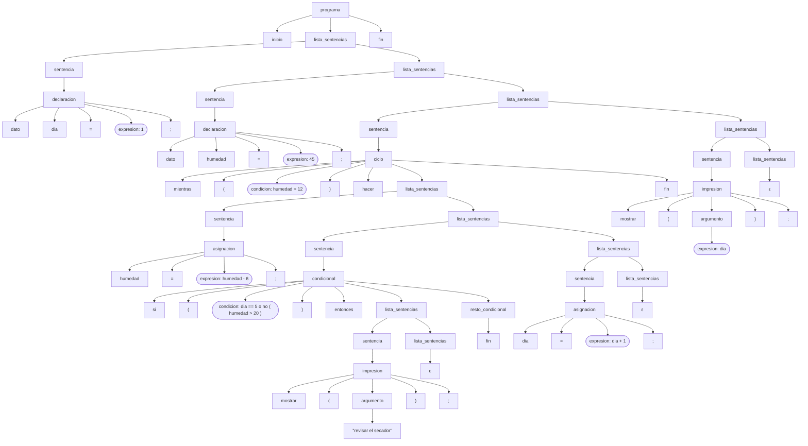

# Fase 2 — BNF de sentencias de control y entrada/salida

**Tarea Jira:** GIC-2 — BNF de sentencias de control y entrada/salida
**Responsable:** Juan Diego García Albarracín
**Insumos:** especificación informal (DSL-2), catálogo de tokens (LEX-1), programas de `ejemplos/`

## 1. Alcance

Este documento define, en formato Backus-Naur (BNF), las reglas de las sentencias de Cafetal:

| Construcción | Regla | Ejemplo |
|---|---|---|
| Lista de sentencias | `<lista_sentencias>` | cuerpo de `inicio … fin`, de `si` y de `mientras` |
| Asignación | `<asignacion>` | `humedad = humedad - 6;` |
| Condicional | `<condicional>`, `<resto_condicional>` | `si (…) entonces … sino … fin` |
| Ciclo | `<ciclo>` | `mientras (…) hacer … fin` |
| Impresión | `<impresion>`, `<argumento>` | `mostrar("revisar el secador");` |

**Lectura.** Cafetal no tiene instrucción de lectura: la especificación informal (DSL-2) solo define la salida con `mostrar`, y los datos de entrada se escriben en el programa con `dato`. Por eso esta tarea cubre únicamente la impresión.

Las reglas de la estructura del programa, la declaración, las condiciones y las expresiones se presentan en la sección 4 como **reglas de contexto**, porque se necesitan para derivar los programas completos. Si GIC-1 las define con otros nombres, se ajustan los nombres sin cambiar las reglas de este documento.

## 2. Convenciones

- `<nombre>` es un no terminal; `::=` separa el lado izquierdo del derecho; `|` separa alternativas; ε es la cadena vacía.
- Para facilitar las citas, cada alternativa se escribe como una regla con su propio identificador (S1, S2, …).
- Los **terminales son los tokens** del catálogo (LEX-1), escritos con su nombre. Así la gramática trabaja sobre la salida del analizador léxico, no sobre caracteres, y no hay choque entre los símbolos `<`, `>`, `(`, `)` del lenguaje y los metasímbolos de BNF.

| Token | Lexema | Token | Lexema | Token | Lexema |
|---|---|---|---|---|---|
| INICIO | `inicio` | MIENTRAS | `mientras` | PAR_ABRE | `(` |
| FIN | `fin` | HACER | `hacer` | PAR_CIERRA | `)` |
| DATO | `dato` | MOSTRAR | `mostrar` | PUNTO_COMA | `;` |
| SI | `si` | Y, O, NO | `y`, `o`, `no` | ASIGNACION | `=` |
| ENTONCES | `entonces` | SUMA, RESTA, MULT, DIV | `+ - * /` | MENOR, MAYOR | `<`, `>` |
| SINO | `sino` | ID, ENTERO, DECIMAL, CADENA | variables | MENOR_IGUAL, MAYOR_IGUAL, IGUAL, DIFERENTE | `<= >= == !=` |

En las derivaciones, los tokens variables se escriben con su lexema: ID⟨dia⟩, ENTERO⟨5⟩, CADENA⟨"secar de nuevo"⟩.

## 3. Reglas de GIC-2

```
S1   <lista_sentencias> ::= <sentencia> <lista_sentencias>
S2   <lista_sentencias> ::= ε
S3   <sentencia> ::= <declaracion>
S4   <sentencia> ::= <asignacion>
S5   <sentencia> ::= <condicional>
S6   <sentencia> ::= <ciclo>
S7   <sentencia> ::= <impresion>
A1   <asignacion> ::= ID ASIGNACION <expresion> PUNTO_COMA
C1   <condicional> ::= SI PAR_ABRE <condicion> PAR_CIERRA ENTONCES <lista_sentencias> <resto_condicional>
C2   <resto_condicional> ::= SINO <lista_sentencias> FIN
C3   <resto_condicional> ::= FIN
L1   <ciclo> ::= MIENTRAS PAR_ABRE <condicion> PAR_CIERRA HACER <lista_sentencias> FIN
I1   <impresion> ::= MOSTRAR PAR_ABRE <argumento> PAR_CIERRA PUNTO_COMA
I2   <argumento> ::= CADENA
I3   <argumento> ::= <expresion>
```
| Regla | Qué describe |
|---|---|
| S1, S2 | Una lista de sentencias es una sentencia seguida de otra lista, o nada. La recursión es **por la derecha**, así que la lista puede estar vacía y termina cuando aparece `fin` o `sino`. |
| S3–S7 | Las cinco clases de sentencia. Cada una empieza con un token distinto (DATO, ID, SI, MIENTRAS, MOSTRAR), así que la primera palabra decide la regla. |
| A1 | Asignación: identificador, `=`, expresión y `;`. Se diferencia de la declaración porque no empieza con `dato`. |
| C1–C3 | Condicional. La parte común `si ( c ) entonces <lista>` se escribe una sola vez (factorizada) y `<resto_condicional>` decide entre `sino <lista> fin` y `fin`. |
| L1 | Ciclo `mientras ( c ) hacer <lista> fin`. |
| I1–I3 | Impresión. El argumento es una cadena o una expresión; CADENA nunca puede empezar una expresión, así que no hay conflicto. |

## 4. Reglas de contexto (GIC-1)

Estas reglas completan la gramática para poder derivar los programas. La precedencia sigue la especificación: `( )`, luego `* /`, luego `+ -`, luego los relacionales (no asociativos), luego `no`, luego `y` y por último `o`. Cada nivel usa una regla "resto" con recursión por la derecha en lugar de recursión por la izquierda.

```
P1   <programa> ::= INICIO <lista_sentencias> FIN
D1   <declaracion> ::= DATO ID ASIGNACION <expresion> PUNTO_COMA
K1   <condicion> ::= <conjuncion> <resto_o>
K2   <resto_o> ::= O <conjuncion> <resto_o>
K3   <resto_o> ::= ε
K4   <conjuncion> ::= <negacion> <resto_y>
K5   <resto_y> ::= Y <negacion> <resto_y>
K6   <resto_y> ::= ε
K7   <negacion> ::= NO PAR_ABRE <condicion> PAR_CIERRA
K8   <negacion> ::= <comparacion>
K9   <comparacion> ::= <expresion> <op_rel> <expresion>
K10  <op_rel> ::= MENOR
K11  <op_rel> ::= MAYOR
K12  <op_rel> ::= MENOR_IGUAL
K13  <op_rel> ::= MAYOR_IGUAL
K14  <op_rel> ::= IGUAL
K15  <op_rel> ::= DIFERENTE
E1   <expresion> ::= <termino> <resto_expresion>
E2   <resto_expresion> ::= SUMA <termino> <resto_expresion>
E3   <resto_expresion> ::= RESTA <termino> <resto_expresion>
E4   <resto_expresion> ::= ε
E5   <termino> ::= <factor> <resto_termino>
E6   <resto_termino> ::= MULT <factor> <resto_termino>
E7   <resto_termino> ::= DIV <factor> <resto_termino>
E8   <resto_termino> ::= ε
E9   <factor> ::= ID
E10  <factor> ::= ENTERO
E11  <factor> ::= DECIMAL
E12  <factor> ::= PAR_ABRE <expresion> PAR_CIERRA
```
**Decisión sobre `no`.** `no` siempre va seguido de una condición entre paréntesis (K7), como en `no (humedad > 20)`. Si se permitiera `no` delante de una comparación sin paréntesis, o una condición entre paréntesis en cualquier lugar, el token `(` podría empezar tanto una condición agrupada como una expresión agrupada, como en `(a + b) > 2`, y el analizador no podría decidir con un solo token. Esta restricción mantiene la gramática sin conflictos.

## 5. Ausencia de ambigüedad y de recursividad por la izquierda

**Sin recursividad por la izquierda.** Ninguna regla tiene como primer símbolo de su lado derecho al mismo no terminal del lado izquierdo, ni directa ni indirectamente: todas las reglas recursivas (S1, C1, L1, K2, K5, K7, E2, E3, E6, E7, E12) empiezan con un terminal o con un no terminal distinto que consume al menos un token antes de volver a la recursión.

**Sin ambigüedad.** Para cada no terminal, los conjuntos PRIMERO de sus alternativas son disjuntos, y cuando una alternativa es ε, PRIMERO de las demás no se cruza con SIGUIENTE del no terminal. Es decir, la gramática es LL(1): en cada paso, el siguiente token determina una única regla, por lo que cada programa tiene un solo árbol de derivación. Se comprobó para todos los no terminales; estos son los de GIC-2:

| No terminal | PRIMERO | SIGUIENTE | ¿Anulable? |
|---|---|---|---|

| <lista_sentencias> | DATO, ID, MIENTRAS, MOSTRAR, SI | FIN, SINO | Sí |
| <sentencia> | DATO, ID, MIENTRAS, MOSTRAR, SI | DATO, FIN, ID, MIENTRAS, MOSTRAR, SI, SINO | No |
| <asignacion> | ID | DATO, FIN, ID, MIENTRAS, MOSTRAR, SI, SINO | No |
| <condicional> | SI | DATO, FIN, ID, MIENTRAS, MOSTRAR, SI, SINO | No |
| <resto_condicional> | FIN, SINO | DATO, FIN, ID, MIENTRAS, MOSTRAR, SI, SINO | No |
| <ciclo> | MIENTRAS | DATO, FIN, ID, MIENTRAS, MOSTRAR, SI, SINO | No |
| <impresion> | MOSTRAR | DATO, FIN, ID, MIENTRAS, MOSTRAR, SI, SINO | No |
| <argumento> | CADENA, DECIMAL, ENTERO, ID, PAR_ABRE | PAR_CIERRA | No |

Casos que podrían causar ambigüedad y cómo se evitan:

| Caso | Solución |
|---|---|
| "Else colgante": en `si a entonces si b entonces x sino y` no se sabe a qué `si` pertenece el `sino` | Todo `si` termina con su propio `fin` (C2, C3). El `sino` pertenece siempre al `si` cuya lista está abierta, y el `fin` cierra exactamente un bloque |
| Fin de la lista de sentencias | `<lista_sentencias>` es anulable y SIGUIENTE = {FIN, SINO}, que no se cruza con PRIMERO(<sentencia>) = {DATO, ID, MIENTRAS, MOSTRAR, SI} |
| Asignación frente a declaración | Empiezan con tokens distintos: ID (A1) y DATO (D1) |
| Cadena o expresión en `mostrar` | PRIMERO(CADENA) = {CADENA} y PRIMERO(<expresion>) = {ID, ENTERO, DECIMAL, PAR_ABRE} son disjuntos |
| Precedencia y asociatividad de los operadores | Un nivel de regla por nivel de precedencia (sección 4); `a - b - c` solo se puede leer como `(a - b) - c` |

## 6. Validación: derivación de los programas de ejemplo

Se derivó cada programa con **derivaciones más a la izquierda**: en cada paso se reemplaza el no terminal que está más a la izquierda, y la regla aplicada aparece al inicio de la línea. Para que las formas sentenciales se puedan leer:

- Cuando una sentencia queda completa, sus tokens se reemplazan por **wₖ** (línea "="), y su contenido se lista al final.
- Las expresiones y las condiciones se derivan en un solo paso **⇒\*** con la lista de reglas aplicadas, en orden, entre corchetes. Las condiciones se abrevian como **cₖ** una vez derivadas. La sección 6.4 muestra una condición derivada paso a paso.

La gramática genera los tres programas, cada uno con un único árbol de derivación:

| Programa | Tokens | Sentencias | Pasos de derivación | Resultado |
|---|---|---|---|---|

| `ejemplo1_produccion.cft` | 66 | 10 | 55 | Derivado completo |
| `ejemplo2_clasificacion.cft` | 62 | 9 | 55 | Derivado completo |
| `ejemplo3_secado.cft` | 57 | 8 | 46 | Derivado completo |

### 6.1 `ejemplo1_produccion.cft` — Producción de dos lotes

```
# calcula la produccion total de dos lotes
inicio
    dato lote_norte = 320;
    dato lote_sur = 275.5;
    dato precio_kilo = 12500;
    dato total_kilos = lote_norte + lote_sur;
    dato ingreso = total_kilos * precio_kilo - 150000 / 2;
    dato promedio_2lotes = (lote_norte + lote_sur) / 2;
    mostrar("kilos cosechados");
    mostrar(total_kilos);
    mostrar(ingreso);
    mostrar(promedio_2lotes);
fin
```
**Derivación más a la izquierda**

```
      <programa>
⇒ P1  INICIO <lista_sentencias> FIN
⇒ S1  INICIO <sentencia> <lista_sentencias> FIN
⇒ S3  INICIO <declaracion> <lista_sentencias> FIN
⇒ D1  INICIO DATO ID⟨lote_norte⟩ ASIGNACION <expresion> PUNTO_COMA <lista_sentencias> FIN
⇒*    INICIO DATO ID⟨lote_norte⟩ ASIGNACION ENTERO⟨320⟩ PUNTO_COMA <lista_sentencias> FIN   [E1 E5 E10 E8 E4]
=     INICIO w1 <lista_sentencias> FIN
⇒ S1  INICIO w1 <sentencia> <lista_sentencias> FIN
⇒ S3  INICIO w1 <declaracion> <lista_sentencias> FIN
⇒ D1  INICIO w1 DATO ID⟨lote_sur⟩ ASIGNACION <expresion> PUNTO_COMA <lista_sentencias> FIN
⇒*    INICIO w1 DATO ID⟨lote_sur⟩ ASIGNACION DECIMAL⟨275.5⟩ PUNTO_COMA <lista_sentencias> FIN   [E1 E5 E11 E8 E4]
=     INICIO w1 w2 <lista_sentencias> FIN
⇒ S1  INICIO w1 w2 <sentencia> <lista_sentencias> FIN
⇒ S3  INICIO w1 w2 <declaracion> <lista_sentencias> FIN
⇒ D1  INICIO w1 w2 DATO ID⟨precio_kilo⟩ ASIGNACION <expresion> PUNTO_COMA <lista_sentencias> FIN
⇒*    INICIO w1 w2 DATO ID⟨precio_kilo⟩ ASIGNACION ENTERO⟨12500⟩ PUNTO_COMA <lista_sentencias> FIN   [E1 E5 E10 E8 E4]
=     INICIO w1 w2 w3 <lista_sentencias> FIN
⇒ S1  INICIO w1 w2 w3 <sentencia> <lista_sentencias> FIN
⇒ S3  INICIO w1 w2 w3 <declaracion> <lista_sentencias> FIN
⇒ D1  INICIO w1 w2 w3 DATO ID⟨total_kilos⟩ ASIGNACION <expresion> PUNTO_COMA <lista_sentencias> FIN
⇒*    INICIO w1 w2 w3 DATO ID⟨total_kilos⟩ ASIGNACION ID⟨lote_norte⟩ SUMA ID⟨lote_sur⟩ PUNTO_COMA <lista_sentencias> FIN   [E1 E5 E9 E8 E2 E5 E9 E8 E4]
=     INICIO w1 w2 w3 w4 <lista_sentencias> FIN
⇒ S1  INICIO w1 w2 w3 w4 <sentencia> <lista_sentencias> FIN
⇒ S3  INICIO w1 w2 w3 w4 <declaracion> <lista_sentencias> FIN
⇒ D1  INICIO w1 w2 w3 w4 DATO ID⟨ingreso⟩ ASIGNACION <expresion> PUNTO_COMA <lista_sentencias> FIN
⇒*    INICIO w1 w2 w3 w4 DATO ID⟨ingreso⟩ ASIGNACION ID⟨total_kilos⟩ MULT ID⟨precio_kilo⟩ RESTA ENTERO⟨150000⟩ DIV ENTERO⟨2⟩ PUNTO_COMA <lista_sentencias> FIN   [E1 E5 E9 E6 E9 E8 E3 E5 E10 E7 E10 E8 E4]
=     INICIO w1 w2 w3 w4 w5 <lista_sentencias> FIN
⇒ S1  INICIO w1 w2 w3 w4 w5 <sentencia> <lista_sentencias> FIN
⇒ S3  INICIO w1 w2 w3 w4 w5 <declaracion> <lista_sentencias> FIN
⇒ D1  INICIO w1 w2 w3 w4 w5 DATO ID⟨promedio_2lotes⟩ ASIGNACION <expresion> PUNTO_COMA <lista_sentencias> FIN
⇒*    INICIO w1 w2 w3 w4 w5 DATO ID⟨promedio_2lotes⟩ ASIGNACION PAR_ABRE ID⟨lote_norte⟩ SUMA ID⟨lote_sur⟩ PAR_CIERRA DIV ENTERO⟨2⟩ PUNTO_COMA <lista_sentencias> FIN   [E1 E5 E12 E1 E5 E9 E8 E2 E5 E9 E8 E4 E7 E10 E8 E4]
=     INICIO w1 w2 w3 w4 w5 w6 <lista_sentencias> FIN
⇒ S1  INICIO w1 w2 w3 w4 w5 w6 <sentencia> <lista_sentencias> FIN
⇒ S7  INICIO w1 w2 w3 w4 w5 w6 <impresion> <lista_sentencias> FIN
⇒ I1  INICIO w1 w2 w3 w4 w5 w6 MOSTRAR PAR_ABRE <argumento> PAR_CIERRA PUNTO_COMA <lista_sentencias> FIN
⇒ I2  INICIO w1 w2 w3 w4 w5 w6 MOSTRAR PAR_ABRE CADENA⟨"kilos cosechados"⟩ PAR_CIERRA PUNTO_COMA <lista_sentencias> FIN
=     INICIO w1 w2 w3 w4 w5 w6 w7 <lista_sentencias> FIN
⇒ S1  INICIO w1 w2 w3 w4 w5 w6 w7 <sentencia> <lista_sentencias> FIN
⇒ S7  INICIO w1 w2 w3 w4 w5 w6 w7 <impresion> <lista_sentencias> FIN
⇒ I1  INICIO w1 w2 w3 w4 w5 w6 w7 MOSTRAR PAR_ABRE <argumento> PAR_CIERRA PUNTO_COMA <lista_sentencias> FIN
⇒ I3  INICIO w1 w2 w3 w4 w5 w6 w7 MOSTRAR PAR_ABRE <expresion> PAR_CIERRA PUNTO_COMA <lista_sentencias> FIN
⇒*    INICIO w1 w2 w3 w4 w5 w6 w7 MOSTRAR PAR_ABRE ID⟨total_kilos⟩ PAR_CIERRA PUNTO_COMA <lista_sentencias> FIN   [E1 E5 E9 E8 E4]
=     INICIO w1 w2 w3 w4 w5 w6 w7 w8 <lista_sentencias> FIN
⇒ S1  INICIO w1 w2 w3 w4 w5 w6 w7 w8 <sentencia> <lista_sentencias> FIN
⇒ S7  INICIO w1 w2 w3 w4 w5 w6 w7 w8 <impresion> <lista_sentencias> FIN
⇒ I1  INICIO w1 w2 w3 w4 w5 w6 w7 w8 MOSTRAR PAR_ABRE <argumento> PAR_CIERRA PUNTO_COMA <lista_sentencias> FIN
⇒ I3  INICIO w1 w2 w3 w4 w5 w6 w7 w8 MOSTRAR PAR_ABRE <expresion> PAR_CIERRA PUNTO_COMA <lista_sentencias> FIN
⇒*    INICIO w1 w2 w3 w4 w5 w6 w7 w8 MOSTRAR PAR_ABRE ID⟨ingreso⟩ PAR_CIERRA PUNTO_COMA <lista_sentencias> FIN   [E1 E5 E9 E8 E4]
=     INICIO w1 w2 w3 w4 w5 w6 w7 w8 w9 <lista_sentencias> FIN
⇒ S1  INICIO w1 w2 w3 w4 w5 w6 w7 w8 w9 <sentencia> <lista_sentencias> FIN
⇒ S7  INICIO w1 w2 w3 w4 w5 w6 w7 w8 w9 <impresion> <lista_sentencias> FIN
⇒ I1  INICIO w1 w2 w3 w4 w5 w6 w7 w8 w9 MOSTRAR PAR_ABRE <argumento> PAR_CIERRA PUNTO_COMA <lista_sentencias> FIN
⇒ I3  INICIO w1 w2 w3 w4 w5 w6 w7 w8 w9 MOSTRAR PAR_ABRE <expresion> PAR_CIERRA PUNTO_COMA <lista_sentencias> FIN
⇒*    INICIO w1 w2 w3 w4 w5 w6 w7 w8 w9 MOSTRAR PAR_ABRE ID⟨promedio_2lotes⟩ PAR_CIERRA PUNTO_COMA <lista_sentencias> FIN   [E1 E5 E9 E8 E4]
=     INICIO w1 w2 w3 w4 w5 w6 w7 w8 w9 w10 <lista_sentencias> FIN
⇒ S2  INICIO w1 w2 w3 w4 w5 w6 w7 w8 w9 w10 FIN
```
**Sentencias y condiciones abreviadas**

```
w1 = DATO ID⟨lote_norte⟩ ASIGNACION ENTERO⟨320⟩ PUNTO_COMA
w2 = DATO ID⟨lote_sur⟩ ASIGNACION DECIMAL⟨275.5⟩ PUNTO_COMA
w3 = DATO ID⟨precio_kilo⟩ ASIGNACION ENTERO⟨12500⟩ PUNTO_COMA
w4 = DATO ID⟨total_kilos⟩ ASIGNACION ID⟨lote_norte⟩ SUMA ID⟨lote_sur⟩ PUNTO_COMA
w5 = DATO ID⟨ingreso⟩ ASIGNACION ID⟨total_kilos⟩ MULT ID⟨precio_kilo⟩ RESTA ENTERO⟨150000⟩ DIV ENTERO⟨2⟩ PUNTO_COMA
w6 = DATO ID⟨promedio_2lotes⟩ ASIGNACION PAR_ABRE ID⟨lote_norte⟩ SUMA ID⟨lote_sur⟩ PAR_CIERRA DIV ENTERO⟨2⟩ PUNTO_COMA
w7 = MOSTRAR PAR_ABRE CADENA⟨"kilos cosechados"⟩ PAR_CIERRA PUNTO_COMA
w8 = MOSTRAR PAR_ABRE ID⟨total_kilos⟩ PAR_CIERRA PUNTO_COMA
w9 = MOSTRAR PAR_ABRE ID⟨ingreso⟩ PAR_CIERRA PUNTO_COMA
w10 = MOSTRAR PAR_ABRE ID⟨promedio_2lotes⟩ PAR_CIERRA PUNTO_COMA
```
### 6.2 `ejemplo2_clasificacion.cft` — Clasificación del café

```
# clasifica el cafe segun humedad y defectos
inicio
    dato humedad = 11.5;
    dato defectos = 4;
    si (humedad >= 10 y humedad <= 12) entonces
        si (defectos < 5) entonces
            mostrar("cafe tipo exportacion");
        sino
            mostrar("cafe para consumo interno");
        fin
    sino
        mostrar("secar de nuevo");
    fin
    si (defectos != 0) entonces
        mostrar("hay granos defectuosos");
    fin
fin
```
**Derivación más a la izquierda**

```
      <programa>
⇒ P1  INICIO <lista_sentencias> FIN
⇒ S1  INICIO <sentencia> <lista_sentencias> FIN
⇒ S3  INICIO <declaracion> <lista_sentencias> FIN
⇒ D1  INICIO DATO ID⟨humedad⟩ ASIGNACION <expresion> PUNTO_COMA <lista_sentencias> FIN
⇒*    INICIO DATO ID⟨humedad⟩ ASIGNACION DECIMAL⟨11.5⟩ PUNTO_COMA <lista_sentencias> FIN   [E1 E5 E11 E8 E4]
=     INICIO w1 <lista_sentencias> FIN
⇒ S1  INICIO w1 <sentencia> <lista_sentencias> FIN
⇒ S3  INICIO w1 <declaracion> <lista_sentencias> FIN
⇒ D1  INICIO w1 DATO ID⟨defectos⟩ ASIGNACION <expresion> PUNTO_COMA <lista_sentencias> FIN
⇒*    INICIO w1 DATO ID⟨defectos⟩ ASIGNACION ENTERO⟨4⟩ PUNTO_COMA <lista_sentencias> FIN   [E1 E5 E10 E8 E4]
=     INICIO w1 w2 <lista_sentencias> FIN
⇒ S1  INICIO w1 w2 <sentencia> <lista_sentencias> FIN
⇒ S5  INICIO w1 w2 <condicional> <lista_sentencias> FIN
⇒ C1  INICIO w1 w2 SI PAR_ABRE <condicion> PAR_CIERRA ENTONCES <lista_sentencias> <resto_condicional> <lista_sentencias> FIN
⇒*    INICIO w1 w2 SI PAR_ABRE ID⟨humedad⟩ MAYOR_IGUAL ENTERO⟨10⟩ Y ID⟨humedad⟩ MENOR_IGUAL ENTERO⟨12⟩ PAR_CIERRA ENTONCES <lista_sentencias> <resto_condicional> <lista_sentencias> FIN   [K1 K4 K8 K9 E1 E5 E9 E8 E4 K13 E1 E5 E10 E8 E4 K5 K8 K9 E1 E5 E9 E8 E4 K12 E1 E5 E10 E8 E4 K6 K3]
⇒ S1  INICIO w1 w2 SI PAR_ABRE c1 PAR_CIERRA ENTONCES <sentencia> <lista_sentencias> <resto_condicional> <lista_sentencias> FIN
⇒ S5  INICIO w1 w2 SI PAR_ABRE c1 PAR_CIERRA ENTONCES <condicional> <lista_sentencias> <resto_condicional> <lista_sentencias> FIN
⇒ C1  INICIO w1 w2 SI PAR_ABRE c1 PAR_CIERRA ENTONCES SI PAR_ABRE <condicion> PAR_CIERRA ENTONCES <lista_sentencias> <resto_condicional> <lista_sentencias> <resto_condicional> <lista_sentencias> FIN
⇒*    INICIO w1 w2 SI PAR_ABRE c1 PAR_CIERRA ENTONCES SI PAR_ABRE ID⟨defectos⟩ MENOR ENTERO⟨5⟩ PAR_CIERRA ENTONCES <lista_sentencias> <resto_condicional> <lista_sentencias> <resto_condicional> <lista_sentencias> FIN   [K1 K4 K8 K9 E1 E5 E9 E8 E4 K10 E1 E5 E10 E8 E4 K6 K3]
⇒ S1  INICIO w1 w2 SI PAR_ABRE c1 PAR_CIERRA ENTONCES SI PAR_ABRE c2 PAR_CIERRA ENTONCES <sentencia> <lista_sentencias> <resto_condicional> <lista_sentencias> <resto_condicional> <lista_sentencias> FIN
⇒ S7  INICIO w1 w2 SI PAR_ABRE c1 PAR_CIERRA ENTONCES SI PAR_ABRE c2 PAR_CIERRA ENTONCES <impresion> <lista_sentencias> <resto_condicional> <lista_sentencias> <resto_condicional> <lista_sentencias> FIN
⇒ I1  INICIO w1 w2 SI PAR_ABRE c1 PAR_CIERRA ENTONCES SI PAR_ABRE c2 PAR_CIERRA ENTONCES MOSTRAR PAR_ABRE <argumento> PAR_CIERRA PUNTO_COMA <lista_sentencias> <resto_condicional> <lista_sentencias> <resto_condicional> <lista_sentencias> FIN
⇒ I2  INICIO w1 w2 SI PAR_ABRE c1 PAR_CIERRA ENTONCES SI PAR_ABRE c2 PAR_CIERRA ENTONCES MOSTRAR PAR_ABRE CADENA⟨"cafe tipo exportacion"⟩ PAR_CIERRA PUNTO_COMA <lista_sentencias> <resto_condicional> <lista_sentencias> <resto_condicional> <lista_sentencias> FIN
=     INICIO w1 w2 SI PAR_ABRE c1 PAR_CIERRA ENTONCES SI PAR_ABRE c2 PAR_CIERRA ENTONCES w3 <lista_sentencias> <resto_condicional> <lista_sentencias> <resto_condicional> <lista_sentencias> FIN
⇒ S2  INICIO w1 w2 SI PAR_ABRE c1 PAR_CIERRA ENTONCES SI PAR_ABRE c2 PAR_CIERRA ENTONCES w3 <resto_condicional> <lista_sentencias> <resto_condicional> <lista_sentencias> FIN
⇒ C2  INICIO w1 w2 SI PAR_ABRE c1 PAR_CIERRA ENTONCES SI PAR_ABRE c2 PAR_CIERRA ENTONCES w3 SINO <lista_sentencias> FIN <lista_sentencias> <resto_condicional> <lista_sentencias> FIN
⇒ S1  INICIO w1 w2 SI PAR_ABRE c1 PAR_CIERRA ENTONCES SI PAR_ABRE c2 PAR_CIERRA ENTONCES w3 SINO <sentencia> <lista_sentencias> FIN <lista_sentencias> <resto_condicional> <lista_sentencias> FIN
⇒ S7  INICIO w1 w2 SI PAR_ABRE c1 PAR_CIERRA ENTONCES SI PAR_ABRE c2 PAR_CIERRA ENTONCES w3 SINO <impresion> <lista_sentencias> FIN <lista_sentencias> <resto_condicional> <lista_sentencias> FIN
⇒ I1  INICIO w1 w2 SI PAR_ABRE c1 PAR_CIERRA ENTONCES SI PAR_ABRE c2 PAR_CIERRA ENTONCES w3 SINO MOSTRAR PAR_ABRE <argumento> PAR_CIERRA PUNTO_COMA <lista_sentencias> FIN <lista_sentencias> <resto_condicional> <lista_sentencias> FIN
⇒ I2  INICIO w1 w2 SI PAR_ABRE c1 PAR_CIERRA ENTONCES SI PAR_ABRE c2 PAR_CIERRA ENTONCES w3 SINO MOSTRAR PAR_ABRE CADENA⟨"cafe para consumo interno"⟩ PAR_CIERRA PUNTO_COMA <lista_sentencias> FIN <lista_sentencias> <resto_condicional> <lista_sentencias> FIN
=     INICIO w1 w2 SI PAR_ABRE c1 PAR_CIERRA ENTONCES SI PAR_ABRE c2 PAR_CIERRA ENTONCES w3 SINO w4 <lista_sentencias> FIN <lista_sentencias> <resto_condicional> <lista_sentencias> FIN
⇒ S2  INICIO w1 w2 SI PAR_ABRE c1 PAR_CIERRA ENTONCES SI PAR_ABRE c2 PAR_CIERRA ENTONCES w3 SINO w4 FIN <lista_sentencias> <resto_condicional> <lista_sentencias> FIN
=     INICIO w1 w2 SI PAR_ABRE c1 PAR_CIERRA ENTONCES w5 <lista_sentencias> <resto_condicional> <lista_sentencias> FIN
⇒ S2  INICIO w1 w2 SI PAR_ABRE c1 PAR_CIERRA ENTONCES w5 <resto_condicional> <lista_sentencias> FIN
⇒ C2  INICIO w1 w2 SI PAR_ABRE c1 PAR_CIERRA ENTONCES w5 SINO <lista_sentencias> FIN <lista_sentencias> FIN
⇒ S1  INICIO w1 w2 SI PAR_ABRE c1 PAR_CIERRA ENTONCES w5 SINO <sentencia> <lista_sentencias> FIN <lista_sentencias> FIN
⇒ S7  INICIO w1 w2 SI PAR_ABRE c1 PAR_CIERRA ENTONCES w5 SINO <impresion> <lista_sentencias> FIN <lista_sentencias> FIN
⇒ I1  INICIO w1 w2 SI PAR_ABRE c1 PAR_CIERRA ENTONCES w5 SINO MOSTRAR PAR_ABRE <argumento> PAR_CIERRA PUNTO_COMA <lista_sentencias> FIN <lista_sentencias> FIN
⇒ I2  INICIO w1 w2 SI PAR_ABRE c1 PAR_CIERRA ENTONCES w5 SINO MOSTRAR PAR_ABRE CADENA⟨"secar de nuevo"⟩ PAR_CIERRA PUNTO_COMA <lista_sentencias> FIN <lista_sentencias> FIN
=     INICIO w1 w2 SI PAR_ABRE c1 PAR_CIERRA ENTONCES w5 SINO w6 <lista_sentencias> FIN <lista_sentencias> FIN
⇒ S2  INICIO w1 w2 SI PAR_ABRE c1 PAR_CIERRA ENTONCES w5 SINO w6 FIN <lista_sentencias> FIN
=     INICIO w1 w2 w7 <lista_sentencias> FIN
⇒ S1  INICIO w1 w2 w7 <sentencia> <lista_sentencias> FIN
⇒ S5  INICIO w1 w2 w7 <condicional> <lista_sentencias> FIN
⇒ C1  INICIO w1 w2 w7 SI PAR_ABRE <condicion> PAR_CIERRA ENTONCES <lista_sentencias> <resto_condicional> <lista_sentencias> FIN
⇒*    INICIO w1 w2 w7 SI PAR_ABRE ID⟨defectos⟩ DIFERENTE ENTERO⟨0⟩ PAR_CIERRA ENTONCES <lista_sentencias> <resto_condicional> <lista_sentencias> FIN   [K1 K4 K8 K9 E1 E5 E9 E8 E4 K15 E1 E5 E10 E8 E4 K6 K3]
⇒ S1  INICIO w1 w2 w7 SI PAR_ABRE c3 PAR_CIERRA ENTONCES <sentencia> <lista_sentencias> <resto_condicional> <lista_sentencias> FIN
⇒ S7  INICIO w1 w2 w7 SI PAR_ABRE c3 PAR_CIERRA ENTONCES <impresion> <lista_sentencias> <resto_condicional> <lista_sentencias> FIN
⇒ I1  INICIO w1 w2 w7 SI PAR_ABRE c3 PAR_CIERRA ENTONCES MOSTRAR PAR_ABRE <argumento> PAR_CIERRA PUNTO_COMA <lista_sentencias> <resto_condicional> <lista_sentencias> FIN
⇒ I2  INICIO w1 w2 w7 SI PAR_ABRE c3 PAR_CIERRA ENTONCES MOSTRAR PAR_ABRE CADENA⟨"hay granos defectuosos"⟩ PAR_CIERRA PUNTO_COMA <lista_sentencias> <resto_condicional> <lista_sentencias> FIN
=     INICIO w1 w2 w7 SI PAR_ABRE c3 PAR_CIERRA ENTONCES w8 <lista_sentencias> <resto_condicional> <lista_sentencias> FIN
⇒ S2  INICIO w1 w2 w7 SI PAR_ABRE c3 PAR_CIERRA ENTONCES w8 <resto_condicional> <lista_sentencias> FIN
⇒ C3  INICIO w1 w2 w7 SI PAR_ABRE c3 PAR_CIERRA ENTONCES w8 FIN <lista_sentencias> FIN
=     INICIO w1 w2 w7 w9 <lista_sentencias> FIN
⇒ S2  INICIO w1 w2 w7 w9 FIN
```
**Sentencias y condiciones abreviadas**

```
w1 = DATO ID⟨humedad⟩ ASIGNACION DECIMAL⟨11.5⟩ PUNTO_COMA
w2 = DATO ID⟨defectos⟩ ASIGNACION ENTERO⟨4⟩ PUNTO_COMA
w3 = MOSTRAR PAR_ABRE CADENA⟨"cafe tipo exportacion"⟩ PAR_CIERRA PUNTO_COMA
w4 = MOSTRAR PAR_ABRE CADENA⟨"cafe para consumo interno"⟩ PAR_CIERRA PUNTO_COMA
w5 = SI PAR_ABRE c2 PAR_CIERRA ENTONCES w3 SINO w4 FIN
w6 = MOSTRAR PAR_ABRE CADENA⟨"secar de nuevo"⟩ PAR_CIERRA PUNTO_COMA
w7 = SI PAR_ABRE c1 PAR_CIERRA ENTONCES w5 SINO w6 FIN
w8 = MOSTRAR PAR_ABRE CADENA⟨"hay granos defectuosos"⟩ PAR_CIERRA PUNTO_COMA
w9 = SI PAR_ABRE c3 PAR_CIERRA ENTONCES w8 FIN
c1 = ID⟨humedad⟩ MAYOR_IGUAL ENTERO⟨10⟩ Y ID⟨humedad⟩ MENOR_IGUAL ENTERO⟨12⟩
c2 = ID⟨defectos⟩ MENOR ENTERO⟨5⟩
c3 = ID⟨defectos⟩ DIFERENTE ENTERO⟨0⟩
```
### 6.3 `ejemplo3_secado.cft` — Días de secado

```
# simula los dias de secado del grano
inicio
    dato dia = 1;
    dato humedad = 45;
    mientras (humedad > 12) hacer
        humedad = humedad - 6;   # pierde 6 puntos por dia
        si (dia == 5 o no (humedad > 20)) entonces
            mostrar("revisar el secador");
        fin
        dia = dia + 1;
    fin
    mostrar(dia);
fin
```
**Derivación más a la izquierda**

```
      <programa>
⇒ P1  INICIO <lista_sentencias> FIN
⇒ S1  INICIO <sentencia> <lista_sentencias> FIN
⇒ S3  INICIO <declaracion> <lista_sentencias> FIN
⇒ D1  INICIO DATO ID⟨dia⟩ ASIGNACION <expresion> PUNTO_COMA <lista_sentencias> FIN
⇒*    INICIO DATO ID⟨dia⟩ ASIGNACION ENTERO⟨1⟩ PUNTO_COMA <lista_sentencias> FIN   [E1 E5 E10 E8 E4]
=     INICIO w1 <lista_sentencias> FIN
⇒ S1  INICIO w1 <sentencia> <lista_sentencias> FIN
⇒ S3  INICIO w1 <declaracion> <lista_sentencias> FIN
⇒ D1  INICIO w1 DATO ID⟨humedad⟩ ASIGNACION <expresion> PUNTO_COMA <lista_sentencias> FIN
⇒*    INICIO w1 DATO ID⟨humedad⟩ ASIGNACION ENTERO⟨45⟩ PUNTO_COMA <lista_sentencias> FIN   [E1 E5 E10 E8 E4]
=     INICIO w1 w2 <lista_sentencias> FIN
⇒ S1  INICIO w1 w2 <sentencia> <lista_sentencias> FIN
⇒ S6  INICIO w1 w2 <ciclo> <lista_sentencias> FIN
⇒ L1  INICIO w1 w2 MIENTRAS PAR_ABRE <condicion> PAR_CIERRA HACER <lista_sentencias> FIN <lista_sentencias> FIN
⇒*    INICIO w1 w2 MIENTRAS PAR_ABRE ID⟨humedad⟩ MAYOR ENTERO⟨12⟩ PAR_CIERRA HACER <lista_sentencias> FIN <lista_sentencias> FIN   [K1 K4 K8 K9 E1 E5 E9 E8 E4 K11 E1 E5 E10 E8 E4 K6 K3]
⇒ S1  INICIO w1 w2 MIENTRAS PAR_ABRE c1 PAR_CIERRA HACER <sentencia> <lista_sentencias> FIN <lista_sentencias> FIN
⇒ S4  INICIO w1 w2 MIENTRAS PAR_ABRE c1 PAR_CIERRA HACER <asignacion> <lista_sentencias> FIN <lista_sentencias> FIN
⇒ A1  INICIO w1 w2 MIENTRAS PAR_ABRE c1 PAR_CIERRA HACER ID⟨humedad⟩ ASIGNACION <expresion> PUNTO_COMA <lista_sentencias> FIN <lista_sentencias> FIN
⇒*    INICIO w1 w2 MIENTRAS PAR_ABRE c1 PAR_CIERRA HACER ID⟨humedad⟩ ASIGNACION ID⟨humedad⟩ RESTA ENTERO⟨6⟩ PUNTO_COMA <lista_sentencias> FIN <lista_sentencias> FIN   [E1 E5 E9 E8 E3 E5 E10 E8 E4]
=     INICIO w1 w2 MIENTRAS PAR_ABRE c1 PAR_CIERRA HACER w3 <lista_sentencias> FIN <lista_sentencias> FIN
⇒ S1  INICIO w1 w2 MIENTRAS PAR_ABRE c1 PAR_CIERRA HACER w3 <sentencia> <lista_sentencias> FIN <lista_sentencias> FIN
⇒ S5  INICIO w1 w2 MIENTRAS PAR_ABRE c1 PAR_CIERRA HACER w3 <condicional> <lista_sentencias> FIN <lista_sentencias> FIN
⇒ C1  INICIO w1 w2 MIENTRAS PAR_ABRE c1 PAR_CIERRA HACER w3 SI PAR_ABRE <condicion> PAR_CIERRA ENTONCES <lista_sentencias> <resto_condicional> <lista_sentencias> FIN <lista_sentencias> FIN
⇒*    INICIO w1 w2 MIENTRAS PAR_ABRE c1 PAR_CIERRA HACER w3 SI PAR_ABRE ID⟨dia⟩ IGUAL ENTERO⟨5⟩ O NO PAR_ABRE ID⟨humedad⟩ MAYOR ENTERO⟨20⟩ PAR_CIERRA PAR_CIERRA ENTONCES <lista_sentencias> <resto_condicional> <lista_sentencias> FIN <lista_sentencias> FIN   [K1 K4 K8 K9 E1 E5 E9 E8 E4 K14 E1 E5 E10 E8 E4 K6 K2 K4 K7 K1 K4 K8 K9 E1 E5 E9 E8 E4 K11 E1 E5 E10 E8 E4 K6 K3 K6 K3]
⇒ S1  INICIO w1 w2 MIENTRAS PAR_ABRE c1 PAR_CIERRA HACER w3 SI PAR_ABRE c2 PAR_CIERRA ENTONCES <sentencia> <lista_sentencias> <resto_condicional> <lista_sentencias> FIN <lista_sentencias> FIN
⇒ S7  INICIO w1 w2 MIENTRAS PAR_ABRE c1 PAR_CIERRA HACER w3 SI PAR_ABRE c2 PAR_CIERRA ENTONCES <impresion> <lista_sentencias> <resto_condicional> <lista_sentencias> FIN <lista_sentencias> FIN
⇒ I1  INICIO w1 w2 MIENTRAS PAR_ABRE c1 PAR_CIERRA HACER w3 SI PAR_ABRE c2 PAR_CIERRA ENTONCES MOSTRAR PAR_ABRE <argumento> PAR_CIERRA PUNTO_COMA <lista_sentencias> <resto_condicional> <lista_sentencias> FIN <lista_sentencias> FIN
⇒ I2  INICIO w1 w2 MIENTRAS PAR_ABRE c1 PAR_CIERRA HACER w3 SI PAR_ABRE c2 PAR_CIERRA ENTONCES MOSTRAR PAR_ABRE CADENA⟨"revisar el secador"⟩ PAR_CIERRA PUNTO_COMA <lista_sentencias> <resto_condicional> <lista_sentencias> FIN <lista_sentencias> FIN
=     INICIO w1 w2 MIENTRAS PAR_ABRE c1 PAR_CIERRA HACER w3 SI PAR_ABRE c2 PAR_CIERRA ENTONCES w4 <lista_sentencias> <resto_condicional> <lista_sentencias> FIN <lista_sentencias> FIN
⇒ S2  INICIO w1 w2 MIENTRAS PAR_ABRE c1 PAR_CIERRA HACER w3 SI PAR_ABRE c2 PAR_CIERRA ENTONCES w4 <resto_condicional> <lista_sentencias> FIN <lista_sentencias> FIN
⇒ C3  INICIO w1 w2 MIENTRAS PAR_ABRE c1 PAR_CIERRA HACER w3 SI PAR_ABRE c2 PAR_CIERRA ENTONCES w4 FIN <lista_sentencias> FIN <lista_sentencias> FIN
=     INICIO w1 w2 MIENTRAS PAR_ABRE c1 PAR_CIERRA HACER w3 w5 <lista_sentencias> FIN <lista_sentencias> FIN
⇒ S1  INICIO w1 w2 MIENTRAS PAR_ABRE c1 PAR_CIERRA HACER w3 w5 <sentencia> <lista_sentencias> FIN <lista_sentencias> FIN
⇒ S4  INICIO w1 w2 MIENTRAS PAR_ABRE c1 PAR_CIERRA HACER w3 w5 <asignacion> <lista_sentencias> FIN <lista_sentencias> FIN
⇒ A1  INICIO w1 w2 MIENTRAS PAR_ABRE c1 PAR_CIERRA HACER w3 w5 ID⟨dia⟩ ASIGNACION <expresion> PUNTO_COMA <lista_sentencias> FIN <lista_sentencias> FIN
⇒*    INICIO w1 w2 MIENTRAS PAR_ABRE c1 PAR_CIERRA HACER w3 w5 ID⟨dia⟩ ASIGNACION ID⟨dia⟩ SUMA ENTERO⟨1⟩ PUNTO_COMA <lista_sentencias> FIN <lista_sentencias> FIN   [E1 E5 E9 E8 E2 E5 E10 E8 E4]
=     INICIO w1 w2 MIENTRAS PAR_ABRE c1 PAR_CIERRA HACER w3 w5 w6 <lista_sentencias> FIN <lista_sentencias> FIN
⇒ S2  INICIO w1 w2 MIENTRAS PAR_ABRE c1 PAR_CIERRA HACER w3 w5 w6 FIN <lista_sentencias> FIN
=     INICIO w1 w2 w7 <lista_sentencias> FIN
⇒ S1  INICIO w1 w2 w7 <sentencia> <lista_sentencias> FIN
⇒ S7  INICIO w1 w2 w7 <impresion> <lista_sentencias> FIN
⇒ I1  INICIO w1 w2 w7 MOSTRAR PAR_ABRE <argumento> PAR_CIERRA PUNTO_COMA <lista_sentencias> FIN
⇒ I3  INICIO w1 w2 w7 MOSTRAR PAR_ABRE <expresion> PAR_CIERRA PUNTO_COMA <lista_sentencias> FIN
⇒*    INICIO w1 w2 w7 MOSTRAR PAR_ABRE ID⟨dia⟩ PAR_CIERRA PUNTO_COMA <lista_sentencias> FIN   [E1 E5 E9 E8 E4]
=     INICIO w1 w2 w7 w8 <lista_sentencias> FIN
⇒ S2  INICIO w1 w2 w7 w8 FIN
```
**Sentencias y condiciones abreviadas**

```
w1 = DATO ID⟨dia⟩ ASIGNACION ENTERO⟨1⟩ PUNTO_COMA
w2 = DATO ID⟨humedad⟩ ASIGNACION ENTERO⟨45⟩ PUNTO_COMA
w3 = ID⟨humedad⟩ ASIGNACION ID⟨humedad⟩ RESTA ENTERO⟨6⟩ PUNTO_COMA
w4 = MOSTRAR PAR_ABRE CADENA⟨"revisar el secador"⟩ PAR_CIERRA PUNTO_COMA
w5 = SI PAR_ABRE c2 PAR_CIERRA ENTONCES w4 FIN
w6 = ID⟨dia⟩ ASIGNACION ID⟨dia⟩ SUMA ENTERO⟨1⟩ PUNTO_COMA
w7 = MIENTRAS PAR_ABRE c1 PAR_CIERRA HACER w3 w5 w6 FIN
w8 = MOSTRAR PAR_ABRE ID⟨dia⟩ PAR_CIERRA PUNTO_COMA
c1 = ID⟨humedad⟩ MAYOR ENTERO⟨12⟩
c2 = ID⟨dia⟩ IGUAL ENTERO⟨5⟩ O NO PAR_ABRE ID⟨humedad⟩ MAYOR ENTERO⟨20⟩ PAR_CIERRA
```
### 6.4 Derivación completa de una condición

Condición c2 de `ejemplo3_secado.cft`: `dia == 5 o no (humedad > 20)`. Se deriva sin abreviar, mostrando cómo actúan la precedencia de `o` sobre `no` y la regla K7.

```
      <condicion>
⇒ K1  <conjuncion> <resto_o>
⇒ K4  <negacion> <resto_y> <resto_o>
⇒ K8  <comparacion> <resto_y> <resto_o>
⇒ K9  <expresion> <op_rel> <expresion> <resto_y> <resto_o>
⇒ E1  <termino> <resto_expresion> <op_rel> <expresion> <resto_y> <resto_o>
⇒ E5  <factor> <resto_termino> <resto_expresion> <op_rel> <expresion> <resto_y> <resto_o>
⇒ E9  ID⟨dia⟩ <resto_termino> <resto_expresion> <op_rel> <expresion> <resto_y> <resto_o>
⇒ E8  ID⟨dia⟩ <resto_expresion> <op_rel> <expresion> <resto_y> <resto_o>
⇒ E4  ID⟨dia⟩ <op_rel> <expresion> <resto_y> <resto_o>
⇒ K14 ID⟨dia⟩ IGUAL <expresion> <resto_y> <resto_o>
⇒ E1  ID⟨dia⟩ IGUAL <termino> <resto_expresion> <resto_y> <resto_o>
⇒ E5  ID⟨dia⟩ IGUAL <factor> <resto_termino> <resto_expresion> <resto_y> <resto_o>
⇒ E10 ID⟨dia⟩ IGUAL ENTERO⟨5⟩ <resto_termino> <resto_expresion> <resto_y> <resto_o>
⇒ E8  ID⟨dia⟩ IGUAL ENTERO⟨5⟩ <resto_expresion> <resto_y> <resto_o>
⇒ E4  ID⟨dia⟩ IGUAL ENTERO⟨5⟩ <resto_y> <resto_o>
⇒ K6  ID⟨dia⟩ IGUAL ENTERO⟨5⟩ <resto_o>
⇒ K2  ID⟨dia⟩ IGUAL ENTERO⟨5⟩ O <conjuncion> <resto_o>
⇒ K4  ID⟨dia⟩ IGUAL ENTERO⟨5⟩ O <negacion> <resto_y> <resto_o>
⇒ K7  ID⟨dia⟩ IGUAL ENTERO⟨5⟩ O NO PAR_ABRE <condicion> PAR_CIERRA <resto_y> <resto_o>
⇒ K1  ID⟨dia⟩ IGUAL ENTERO⟨5⟩ O NO PAR_ABRE <conjuncion> <resto_o> PAR_CIERRA <resto_y> <resto_o>
⇒ K4  ID⟨dia⟩ IGUAL ENTERO⟨5⟩ O NO PAR_ABRE <negacion> <resto_y> <resto_o> PAR_CIERRA <resto_y> <resto_o>
⇒ K8  ID⟨dia⟩ IGUAL ENTERO⟨5⟩ O NO PAR_ABRE <comparacion> <resto_y> <resto_o> PAR_CIERRA <resto_y> <resto_o>
⇒ K9  ID⟨dia⟩ IGUAL ENTERO⟨5⟩ O NO PAR_ABRE <expresion> <op_rel> <expresion> <resto_y> <resto_o> PAR_CIERRA <resto_y> <resto_o>
⇒ E1  ID⟨dia⟩ IGUAL ENTERO⟨5⟩ O NO PAR_ABRE <termino> <resto_expresion> <op_rel> <expresion> <resto_y> <resto_o> PAR_CIERRA <resto_y> <resto_o>
⇒ E5  ID⟨dia⟩ IGUAL ENTERO⟨5⟩ O NO PAR_ABRE <factor> <resto_termino> <resto_expresion> <op_rel> <expresion> <resto_y> <resto_o> PAR_CIERRA <resto_y> <resto_o>
⇒ E9  ID⟨dia⟩ IGUAL ENTERO⟨5⟩ O NO PAR_ABRE ID⟨humedad⟩ <resto_termino> <resto_expresion> <op_rel> <expresion> <resto_y> <resto_o> PAR_CIERRA <resto_y> <resto_o>
⇒ E8  ID⟨dia⟩ IGUAL ENTERO⟨5⟩ O NO PAR_ABRE ID⟨humedad⟩ <resto_expresion> <op_rel> <expresion> <resto_y> <resto_o> PAR_CIERRA <resto_y> <resto_o>
⇒ E4  ID⟨dia⟩ IGUAL ENTERO⟨5⟩ O NO PAR_ABRE ID⟨humedad⟩ <op_rel> <expresion> <resto_y> <resto_o> PAR_CIERRA <resto_y> <resto_o>
⇒ K11 ID⟨dia⟩ IGUAL ENTERO⟨5⟩ O NO PAR_ABRE ID⟨humedad⟩ MAYOR <expresion> <resto_y> <resto_o> PAR_CIERRA <resto_y> <resto_o>
⇒ E1  ID⟨dia⟩ IGUAL ENTERO⟨5⟩ O NO PAR_ABRE ID⟨humedad⟩ MAYOR <termino> <resto_expresion> <resto_y> <resto_o> PAR_CIERRA <resto_y> <resto_o>
⇒ E5  ID⟨dia⟩ IGUAL ENTERO⟨5⟩ O NO PAR_ABRE ID⟨humedad⟩ MAYOR <factor> <resto_termino> <resto_expresion> <resto_y> <resto_o> PAR_CIERRA <resto_y> <resto_o>
⇒ E10 ID⟨dia⟩ IGUAL ENTERO⟨5⟩ O NO PAR_ABRE ID⟨humedad⟩ MAYOR ENTERO⟨20⟩ <resto_termino> <resto_expresion> <resto_y> <resto_o> PAR_CIERRA <resto_y> <resto_o>
⇒ E8  ID⟨dia⟩ IGUAL ENTERO⟨5⟩ O NO PAR_ABRE ID⟨humedad⟩ MAYOR ENTERO⟨20⟩ <resto_expresion> <resto_y> <resto_o> PAR_CIERRA <resto_y> <resto_o>
⇒ E4  ID⟨dia⟩ IGUAL ENTERO⟨5⟩ O NO PAR_ABRE ID⟨humedad⟩ MAYOR ENTERO⟨20⟩ <resto_y> <resto_o> PAR_CIERRA <resto_y> <resto_o>
⇒ K6  ID⟨dia⟩ IGUAL ENTERO⟨5⟩ O NO PAR_ABRE ID⟨humedad⟩ MAYOR ENTERO⟨20⟩ <resto_o> PAR_CIERRA <resto_y> <resto_o>
⇒ K3  ID⟨dia⟩ IGUAL ENTERO⟨5⟩ O NO PAR_ABRE ID⟨humedad⟩ MAYOR ENTERO⟨20⟩ PAR_CIERRA <resto_y> <resto_o>
⇒ K6  ID⟨dia⟩ IGUAL ENTERO⟨5⟩ O NO PAR_ABRE ID⟨humedad⟩ MAYOR ENTERO⟨20⟩ PAR_CIERRA <resto_o>
⇒ K3  ID⟨dia⟩ IGUAL ENTERO⟨5⟩ O NO PAR_ABRE ID⟨humedad⟩ MAYOR ENTERO⟨20⟩ PAR_CIERRA
```
### 6.5 Árbol de derivación de `ejemplo3_secado.cft`

Las expresiones y las condiciones se muestran como hojas con su texto. El resto del árbol corresponde exactamente a las reglas de la derivación de la sección 6.3.


## 7. Conclusión

Las reglas de GIC-2 describen la asignación, el condicional con y sin `sino`, el ciclo `mientras` y la impresión con `mostrar`. No tienen recursividad por la izquierda, la parte común del condicional está factorizada y todos los bloques se cierran con `fin`, lo que elimina el else colgante. Junto con las reglas de contexto, la gramática es LL(1), así que no es ambigua, y genera los tres programas de ejemplo con un único árbol cada uno.
