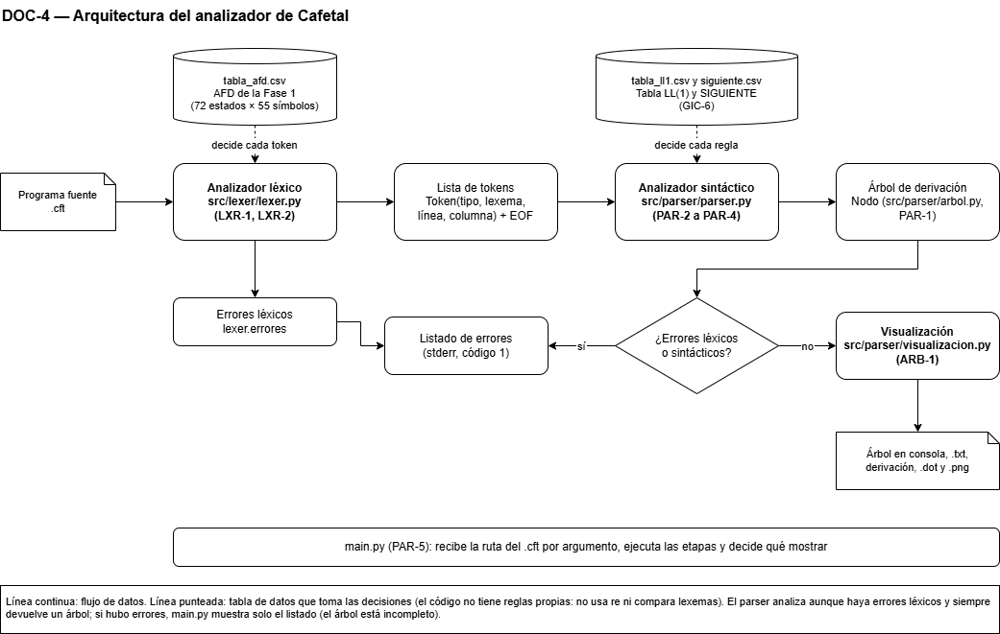
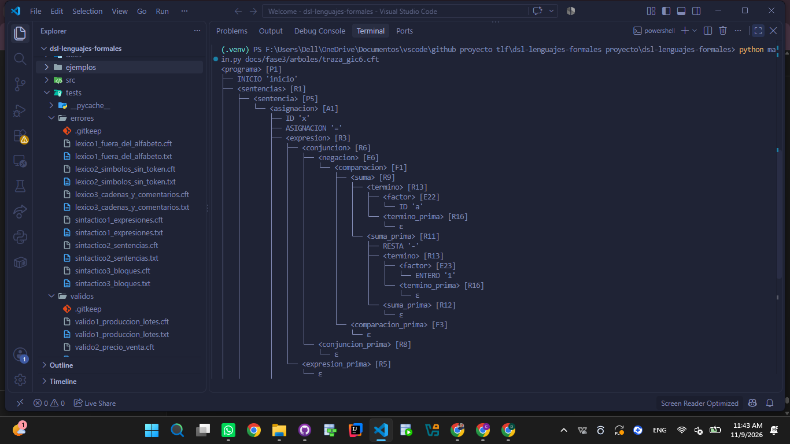
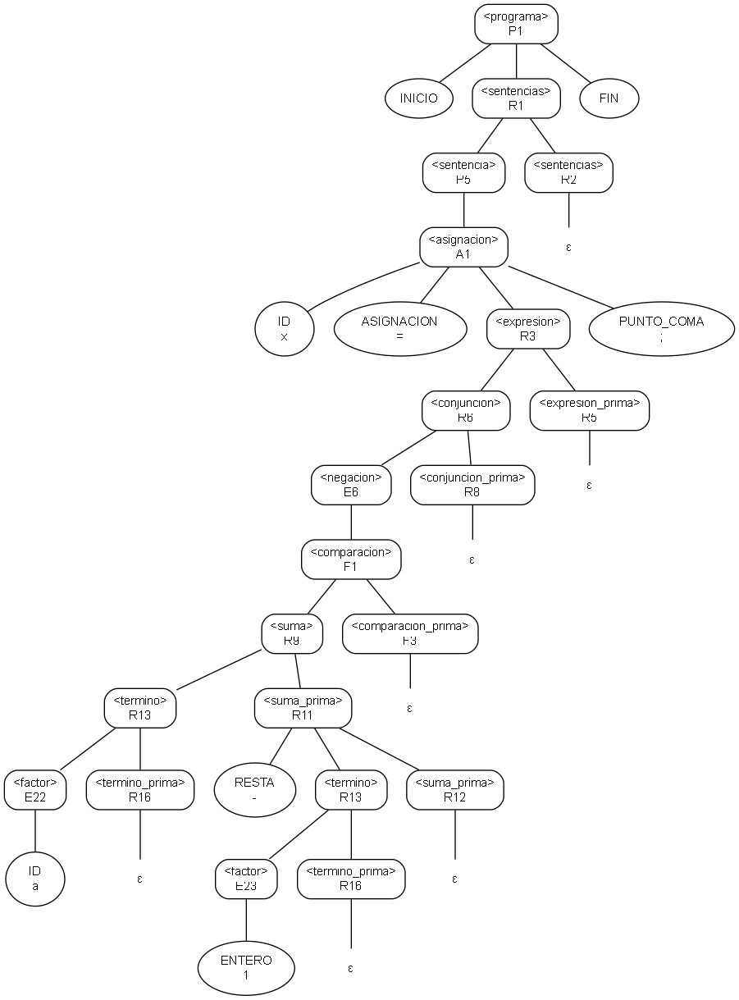
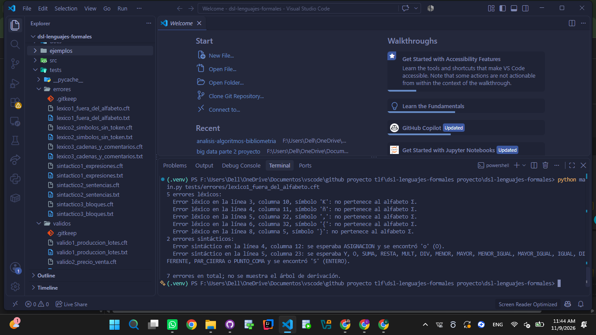
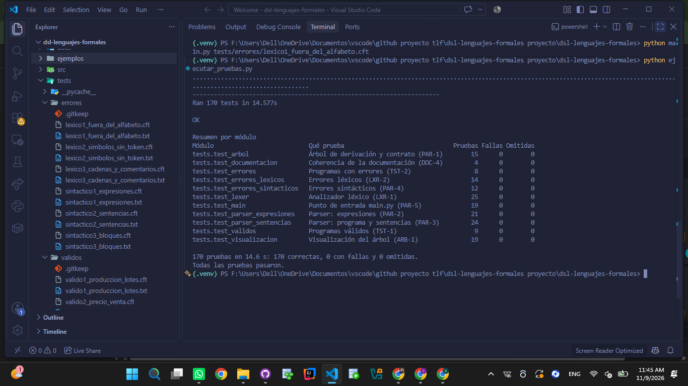

# Fase 3: Implementación y parser

**Tarea Jira:** DOC-4 — Documento de la Fase 3 y README
**Responsable:** Daniel Josué Narváez Hincapié
**Equipo:** Daniel Josué Narváez Hincapié y Juan Diego García Albarracín
**Curso:** Teoría de Lenguajes Formales, Universidad del Quindío, 2026-2. Profesora Ana María Tamayo Ocampo

---

## 1. Introducción

La Fase 3 pide el desarrollo del analizador sintáctico en Python: un código fuente que tome un archivo de texto con código del mini-lenguaje y genere el árbol de derivación sintáctica o el listado de errores.

Este documento integra el trabajo de las tareas de la Fase 3, cuyos detalles están en los documentos de cada una (sección 10). Describe la arquitectura del analizador (sección 2), cómo cada etapa usa los resultados de las fases anteriores (secciones 3 a 5), la relación entre cada regla de la gramática y la función de Python que la implementa (sección 4.2), la guía de ejecución (sección 7) y las pruebas (sección 8).

El lenguaje es **Cafetal**, un DSL para registrar y calcular la producción de una finca cafetera, con archivos de extensión `.cft`. Su alfabeto, sus tokens y su AFD se definieron en la Fase 1 (`docs/fase1/documento_fase1.md`), y su gramática en la Fase 2 (`docs/fase2/`).

## 2. Arquitectura

### 2.1 Visión general

El analizador tiene tres etapas en cadena: **lexer → parser → árbol**. `main.py` las ejecuta en orden y decide qué mostrar.



*Fuente editable: `diagramas/doc4_arquitectura.drawio`.*

| Etapa | Entrada | Salida | Decide con |
|---|---|---|---|
| Analizador léxico | El texto del archivo `.cft` | La lista de tokens, terminada en EOF, y la lista de errores léxicos | `src/lexer/tabla_afd.csv`: la matriz de transiciones del AFD de la Fase 1 |
| Analizador sintáctico | La lista de tokens | El árbol de derivación y la lista de errores sintácticos | `src/parser/tabla_ll1.csv` y `src/parser/siguiente.csv`: la tabla LL(1) y los conjuntos SIGUIENTE de la Fase 2 |
| Visualización | El árbol | El árbol con sangría en la consola o en un `.txt`, la derivación más a la izquierda y, opcionalmente, el árbol en DOT y PNG | — |

### 2.2 Principio de diseño: las tablas deciden

Ni el lexer ni el parser tienen reglas propias escritas en el código. El lexer recorre la matriz del AFD y el parser consulta la tabla LL(1): si cambia el lenguaje, cambian las tablas y no el código. En concreto:

- **El lexer no usa el módulo `re` ni compara lexemas.** La prioridad de las palabras reservadas sobre los identificadores ya está en el AFD: el estado q15 devuelve SI y q64 devuelve ID.
- **Ninguna función del parser pregunta por el tipo del token.** Solo compara la etiqueta de regla que devolvió la tabla (`if regla == "R4"`).
- **Una celda vacía es rechazo en las dos tablas.** El AFD no tiene estado sumidero, por indicación de la profesora.

Tres pruebas revisan el código fuente con el módulo `ast` para garantizarlo: el lexer, el parser y la visualización no importan `re`, el lexer no compara con nombres de tokens ni palabras reservadas, y el parser solo compara con etiquetas de reglas de la tabla.

### 2.3 Módulos

| Archivo | Tareas | Contenido |
|---|---|---|
| `src/lexer/tokens.py` | LXR-1 | Datos del catálogo de tokens: códigos, categorías descartables y EOF |
| `src/lexer/lexer.py` | LXR-1, LXR-2 | `TablaAFD`, `Token`, `ErrorLexico` y `AnalizadorLexico` |
| `src/parser/arbol.py` | PAR-1 | `Nodo` del árbol de derivación y el contrato entre el lexer y el parser |
| `src/parser/parser.py` | PAR-2, PAR-3, PAR-4 | `TablaLL1`, `ErrorSintactico` y `Parser`, con una función por no terminal y la recuperación de errores |
| `src/parser/visualizacion.py` | ARB-1 | Impresión y exportación del árbol y de la derivación |
| `main.py` | PAR-5 | Punto de entrada por línea de comandos |
| `ejecutar_pruebas.py` | TST-2 | Ejecución de toda la suite de pruebas con un resumen por módulo |

### 2.4 Contratos entre etapas

- **Lexer → parser:** una lista de `Token(tipo, lexema, linea, columna)`. El `tipo` es el nombre del token del catálogo, que es exactamente el nombre del terminal en la BNF. Según el contrato de PAR-1, el lexer garantiza que la lista termina en un único EOF, que no trae comentarios ni blancos y que los errores léxicos quedan aparte, en `lexer.errores`.
- **Parser → visualización:** la raíz de un árbol de `Nodo`. Hay tres tipos de nodo: no terminal con la regla que se le aplicó, terminal con su token y hoja ε.

### 2.5 Flujo de errores

Las dos etapas de análisis **registran sus errores y continúan**, para listar todos los problemas del archivo en una sola ejecución:

1. El lexer registra el error en el primer símbolo que no forma un token y sigue con el siguiente (LXR-2).
2. El parser analiza los tokens aunque haya habido errores léxicos, y se recupera de sus propios errores en modo pánico, sincronizando con el conjunto SIGUIENTE (PAR-4).
3. Si hubo algún error, `main.py` muestra el listado (primero los léxicos y después los sintácticos) y no muestra el árbol, que estaría incompleto. Si no hubo errores, muestra el árbol.

## 3. Analizador léxico

Implementa el AFD de la Fase 1 sin reescribirlo: carga `tabla_afd.csv` y la recorre con la **regla del lexema más largo**. Avanza mientras la celda δ(q, a) no esté vacía, recuerda el último estado de aceptación y, al detenerse, retrocede a él y emite su token. Los tres casos de la Tabla 17 de la Fase 1 quedan cubiertos así:

| Situación al detenerse | Resultado | Ejemplo |
|---|---|---|
| δ(q, a) vacía y q ∈ F | Se emite el token de q | `si(`: SI y después PAR_ABRE |
| δ(q, a) vacía, q ∉ F, con aceptación anterior | Retroceso al último estado de aceptación | `12.x`: ENTERO `12`; el `.` queda como error |
| δ(q, a) vacía, q ∉ F, sin aceptación | Error léxico en el primer símbolo, y se sigue con el siguiente | `!x`: error en `!` y después ID `x` |

COMENTARIO y BLANCO se reconocen para llevar la línea y la columna, pero no se entregan al parser. Detalle: `lexer.md` y `errores_lexicos.md`.

## 4. Analizador sintáctico

### 4.1 Descendente recursivo dirigido por la tabla LL(1)

El parser implementa la gramática final de la Fase 2 (sección 6 de `factorizacion.md`), sin recursividad por la izquierda y factorizada: 46 reglas y 23 no terminales. Hay **una función de Python por no terminal**, con el mismo nombre sin `< >`. Cada función:

1. **predice:** consulta M[A, token actual] en la tabla LL(1) para saber qué regla aplicar;
2. **crea su nodo:** `Nodo.no_terminal("<A>", regla)`;
3. **recorre el lado derecho de la regla:** empareja los terminales, llama a la función de cada no terminal y agrega una hoja ε en las reglas vacías;
4. **devuelve el nodo.**

Encima de cada función está la regla BNF que implementa, como comentario y en su docstring.

### 4.2 Tabla regla BNF ↔ función de Python

Todas las funciones están en la clase `Parser` de `src/parser/parser.py`. Cuando un no terminal tiene varias reglas, su función elige con la tabla cuál aplicar y escribe el lado derecho de cada una.

| Regla | Producción | Función de Python |
|---|---|---|
| P1 | `<programa> ::= INICIO <sentencias> FIN` | `programa` |
| R1 | `<sentencias> ::= <sentencia> <sentencias>` | `sentencias` |
| R2 | `<sentencias> ::= ε` | `sentencias` |
| P4 | `<sentencia> ::= <declaracion>` | `sentencia` |
| P5 | `<sentencia> ::= <asignacion>` | `sentencia` |
| P6 | `<sentencia> ::= <salida>` | `sentencia` |
| P7 | `<sentencia> ::= <condicional>` | `sentencia` |
| P8 | `<sentencia> ::= <ciclo>` | `sentencia` |
| D1 | `<declaracion> ::= DATO ID ASIGNACION <expresion> PUNTO_COMA` | `declaracion` |
| R3 | `<expresion> ::= <conjuncion> <expresion_prima>` | `expresion` |
| R4 | `<expresion_prima> ::= O <conjuncion> <expresion_prima>` | `expresion_prima` |
| R5 | `<expresion_prima> ::= ε` | `expresion_prima` |
| R6 | `<conjuncion> ::= <negacion> <conjuncion_prima>` | `conjuncion` |
| R7 | `<conjuncion_prima> ::= Y <negacion> <conjuncion_prima>` | `conjuncion_prima` |
| R8 | `<conjuncion_prima> ::= ε` | `conjuncion_prima` |
| E5 | `<negacion> ::= NO <negacion>` | `negacion` |
| E6 | `<negacion> ::= <comparacion>` | `negacion` |
| F1 | `<comparacion> ::= <suma> <comparacion_prima>` | `comparacion` |
| F2 | `<comparacion_prima> ::= <op_rel> <suma>` | `comparacion_prima` |
| F3 | `<comparacion_prima> ::= ε` | `comparacion_prima` |
| E9 | `<op_rel> ::= MENOR` | `op_rel` |
| E10 | `<op_rel> ::= MAYOR` | `op_rel` |
| E11 | `<op_rel> ::= MENOR_IGUAL` | `op_rel` |
| E12 | `<op_rel> ::= MAYOR_IGUAL` | `op_rel` |
| E13 | `<op_rel> ::= IGUAL` | `op_rel` |
| E14 | `<op_rel> ::= DIFERENTE` | `op_rel` |
| R9 | `<suma> ::= <termino> <suma_prima>` | `suma` |
| R10 | `<suma_prima> ::= SUMA <termino> <suma_prima>` | `suma_prima` |
| R11 | `<suma_prima> ::= RESTA <termino> <suma_prima>` | `suma_prima` |
| R12 | `<suma_prima> ::= ε` | `suma_prima` |
| R13 | `<termino> ::= <factor> <termino_prima>` | `termino` |
| R14 | `<termino_prima> ::= MULT <factor> <termino_prima>` | `termino_prima` |
| R15 | `<termino_prima> ::= DIV <factor> <termino_prima>` | `termino_prima` |
| R16 | `<termino_prima> ::= ε` | `termino_prima` |
| E21 | `<factor> ::= PAR_ABRE <expresion> PAR_CIERRA` | `factor` |
| E22 | `<factor> ::= ID` | `factor` |
| E23 | `<factor> ::= ENTERO` | `factor` |
| E24 | `<factor> ::= DECIMAL` | `factor` |
| A1 | `<asignacion> ::= ID ASIGNACION <expresion> PUNTO_COMA` | `asignacion` |
| M1 | `<salida> ::= MOSTRAR PAR_ABRE <argumento> PAR_CIERRA PUNTO_COMA` | `salida` |
| M2 | `<argumento> ::= <expresion>` | `argumento` |
| M3 | `<argumento> ::= CADENA` | `argumento` |
| F4 | `<condicional> ::= SI PAR_ABRE <expresion> PAR_CIERRA ENTONCES <sentencias> <condicional_prima>` | `condicional` |
| F5 | `<condicional_prima> ::= FIN` | `condicional_prima` |
| F6 | `<condicional_prima> ::= SINO <sentencias> FIN` | `condicional_prima` |
| L1 | `<ciclo> ::= MIENTRAS PAR_ABRE <expresion> PAR_CIERRA HACER <sentencias> FIN` | `ciclo` |

Son 46 reglas y 23 funciones: cada regla tiene su función y cada función implementa exactamente las reglas de su no terminal. La prueba `tests/test_documentacion.py` comprueba que esta tabla coincide con la tabla LL(1) y con el código: si se agrega o cambia una regla, la prueba lo detecta.

### 4.3 Recuperación de errores

Cuando la celda M[A, token] está vacía, el parser registra el error («se esperaba … y se encontró …», con línea y columna) y se recupera en **modo pánico**. Descarta tokens hasta uno con el que A pueda empezar, uno de SIGUIENTE(A) o una palabra de anclaje (`dato`, `si`, `mientras`, `mostrar`, `sino`, `fin`). Cuando el terminal que pide una regla no coincide, descarta el token si sobra o supone el terminal si falta. Después de un error no se registra otro hasta emparejar algún token, para evitar los errores en cascada. Detalle: secciones 11 a 14 de `parser.md`.

## 5. Árbol de derivación

El árbol conserva todo lo que exige un árbol de derivación: cada no terminal con su regla, los no terminales `_prima` de la Fase 2, las hojas ε y los terminales con su lexema. EOF no forma parte del árbol, porque la gramática no lo genera.

`src/parser/visualizacion.py` lo muestra con sangría, una línea por nodo en preorden, y reconstruye la derivación más a la izquierda forma sentencial por forma sentencial. Opcionalmente, con Graphviz instalado, lo dibuja como imagen. La salida se verificó contra la traza a mano de GIC-6, una derivación a mano, el árbol de `arbol.md` y el árbol dibujado en GIC-4 (sección 4 de `visualizacion.md`).

### 5.1 Captura: árbol de derivación

Árbol del programa `inicio x = a - 1; fin` (`docs/fase3/arboles/traza_gic6.cft`), que es el de la traza a mano de GIC-6:



*Comando: `python main.py docs/fase3/arboles/traza_gic6.cft`.*

El mismo árbol, en texto:

```
<programa> [P1]
├── INICIO 'inicio'
├── <sentencias> [R1]
│   ├── <sentencia> [P5]
│   │   └── <asignacion> [A1]
│   │       ├── ID 'x'
│   │       ├── ASIGNACION '='
│   │       ├── <expresion> [R3]
│   │       │   ├── <conjuncion> [R6]
│   │       │   │   ├── <negacion> [E6]
│   │       │   │   │   └── <comparacion> [F1]
│   │       │   │   │       ├── <suma> [R9]
│   │       │   │   │       │   ├── <termino> [R13]
│   │       │   │   │       │   │   ├── <factor> [E22]
│   │       │   │   │       │   │   │   └── ID 'a'
│   │       │   │   │       │   │   └── <termino_prima> [R16]
│   │       │   │   │       │   │       └── ε
│   │       │   │   │       │   └── <suma_prima> [R11]
│   │       │   │   │       │       ├── RESTA '-'
│   │       │   │   │       │       ├── <termino> [R13]
│   │       │   │   │       │       │   ├── <factor> [E23]
│   │       │   │   │       │       │   │   └── ENTERO '1'
│   │       │   │   │       │       │   └── <termino_prima> [R16]
│   │       │   │   │       │       │       └── ε
│   │       │   │   │       │       └── <suma_prima> [R12]
│   │       │   │   │       │           └── ε
│   │       │   │   │       └── <comparacion_prima> [F3]
│   │       │   │   │           └── ε
│   │       │   │   └── <conjuncion_prima> [R8]
│   │       │   │       └── ε
│   │       │   └── <expresion_prima> [R5]
│   │       │       └── ε
│   │       └── PUNTO_COMA ';'
│   └── <sentencias> [R2]
│       └── ε
└── FIN 'fin'
```

Y dibujado con Graphviz:



## 6. Listado de errores

### 6.1 Captura: listado de errores

Programa `tests/errores/lexico1_fuera_del_alfabeto.cft`, que tiene errores léxicos y, como consecuencia, también sintácticos:



*Comando: `python main.py tests/errores/lexico1_fuera_del_alfabeto.cft`.*

En texto:

```
5 errores léxicos:
  Error léxico en la línea 3, columna 10, símbolo 'K': no pertenece al alfabeto Σ.
  Error léxico en la línea 4, columna 11, símbolo 'ñ': no pertenece al alfabeto Σ.
  Error léxico en la línea 5, columna 22, símbolo ',': no pertenece al alfabeto Σ.
  Error léxico en la línea 6, columna 32, símbolo '{': no pertenece al alfabeto Σ.
  Error léxico en la línea 8, columna 5, símbolo '}': no pertenece al alfabeto Σ.
2 errores sintácticos:
  Error sintáctico en la línea 4, columna 12: se esperaba ASIGNACION y se encontró 'o' (O).
  Error sintáctico en la línea 5, columna 23: se esperaba Y, O, SUMA, RESTA, MULT, DIV, MENOR, MAYOR, MENOR_IGUAL, MAYOR_IGUAL, IGUAL, DIFERENTE, PAR_CIERRA o PUNTO_COMA y se encontró '5' (ENTERO).

7 errores en total; no se muestra el árbol de derivación.
```

Los dos errores sintácticos son consecuencia de los léxicos. Al quitar la `ñ`, `dato año = 2026;` se convierte en `dato a o = 2026;`, y `o` es una palabra reservada. Al quitar la coma, `11,5` se convierte en `11 5`, dos operandos seguidos. Por eso los errores léxicos se listan primero (sección 3.3 de `pruebas_errores.md`).

## 7. Guía de ejecución

### 7.1 Requisitos

- **Python 3.9 o superior.** El proyecto usa solo la biblioteca estándar y no hay que instalar ninguna librería: `requirements.txt` está vacío a propósito.
- **Opcional: Graphviz,** solo para dibujar el árbol como imagen (`--png`). Sin él, todo lo demás funciona y las pruebas de la imagen se omiten.

### 7.2 Ejecutar el analizador

Desde la carpeta del proyecto (`dsl-lenguajes-formales`):

```
python main.py ejemplos/ejemplo3_secado.cft
python main.py ejemplos/ejemplo3_secado.cft --tokens --derivacion
python main.py ejemplos/ejemplo3_secado.cft --salida arbol.txt --png arbol.png
python main.py tests/errores/sintactico2_sentencias.cft
```

| Opción | Efecto |
|---|---|
| `archivo` | Ruta del programa `.cft` (obligatoria) |
| `--tokens` | Muestra la lista de tokens antes del árbol |
| `--derivacion` | Muestra la derivación más a la izquierda |
| `--posiciones` | Agrega línea:columna a cada terminal del árbol |
| `--ascii` | Dibuja las ramas del árbol solo con caracteres ASCII |
| `--salida RUTA` | Guarda el árbol en un archivo de texto |
| `--salida-derivacion RUTA` | Guarda la derivación en un archivo de texto |
| `--dot RUTA` | Guarda el árbol en formato DOT |
| `--png RUTA` | Dibuja el árbol como imagen (requiere Graphviz) |

| Código de salida | Significado |
|---|---|
| 0 | Sin errores: se mostró el árbol |
| 1 | El programa tiene errores léxicos o sintácticos: se mostró el listado |
| 2 | No se pudo leer el archivo o los argumentos no son válidos |

No hay rutas fijas: el programa y las salidas se reciben como argumentos, y las tablas se buscan junto al código que las usa, así que `main.py` funciona desde cualquier carpeta. Detalle: `main.md`.

### 7.3 Ejecutar las pruebas

```
python ejecutar_pruebas.py
python ejecutar_pruebas.py -v
python ejecutar_pruebas.py lexer parser_expresiones
```

## 8. Pruebas

La suite tiene **170 pruebas**, en 11 módulos, y todas pasan:

| Módulo | Qué prueba | Pruebas |
|---|---|---|
| `tests.test_lexer` | Analizador léxico (LXR-1) | 25 |
| `tests.test_errores_lexicos` | Errores léxicos (LXR-2) | 14 |
| `tests.test_arbol` | Árbol de derivación y contrato (PAR-1) | 15 |
| `tests.test_parser_expresiones` | Parser: expresiones (PAR-2) | 21 |
| `tests.test_parser_sentencias` | Parser: programa y sentencias (PAR-3) | 24 |
| `tests.test_errores_sintacticos` | Errores sintácticos (PAR-4) | 12 |
| `tests.test_visualizacion` | Visualización del árbol (ARB-1) | 19 |
| `tests.test_main` | Punto de entrada `main.py` (PAR-5) | 19 |
| `tests.test_validos` | Programas válidos (TST-1) | 9 |
| `tests.test_errores` | Programas con errores (TST-2) | 8 |
| `tests.test_documentacion` | Coherencia de este documento con el código (DOC-4) | 4 |



*Comando: `python ejecutar_pruebas.py`.*

Hay tres clases de pruebas que conviene distinguir:

- **Contra lo hecho a mano en las fases anteriores.** Las trazas del AFD de la Fase 1, la traza LL(1) y las derivaciones de la Fase 2, y los árboles dibujados en draw.io.
- **Contra un analizador de referencia independiente.** Un analizador LL(1) con pila, igual al de las trazas de GIC-6, se comparó con el parser en todas las cadenas cortas de varios alfabetos de tokens y en programas generados al azar: aceptan y rechazan lo mismo y aplican las mismas reglas.
- **Programas de prueba con salida esperada.** Hay 6 programas válidos con su árbol esperado (TST-1) y 6 programas con errores con su listado esperado (TST-2). Las salidas esperadas también se validan sin usar el analizador, para que la prueba no sea circular.

## 9. Correspondencia con la rúbrica

Criterio «Arquitectura de software» (20 %), nivel superior: *el parser procesa el código fuente de prueba, maneja errores léxicos y sintácticos y genera el árbol de derivación de forma óptima*.

| Exigencia | Dónde se cumple |
|---|---|
| Procesa el código fuente de prueba | `main.py` sobre los 3 programas de `ejemplos/` y los 6 de `tests/validos/` (secciones 7 y 8) |
| Maneja errores léxicos | LXR-2: registra cada error y continúa (sección 3) |
| Maneja errores sintácticos | PAR-4: modo pánico con SIGUIENTE, sin errores en cascada (sección 4.3) |
| Genera el árbol de derivación | PAR-1 a PAR-3 y ARB-1 (sección 5) |
| Sin hardcodeo ni validaciones manuales | Las tablas deciden (sección 2.2) y no hay rutas fijas (sección 7.2); hay pruebas para ambas cosas |
| Se acopla a la gramática entregada | Una función por no terminal, con la tabla regla ↔ función de la sección 4.2, comprobada por una prueba |

## 10. Documentos de detalle

| Documento | Tarea | Contenido |
|---|---|---|
| `lexer.md` | LXR-1 | Analizador léxico dirigido por la matriz del AFD |
| `errores_lexicos.md` | LXR-2 | Manejo de errores léxicos |
| `arbol.md` | PAR-1 | Estructura del árbol y contrato lexer–parser |
| `parser.md` | PAR-2, PAR-3, PAR-4 | Funciones del parser y recuperación de errores |
| `visualizacion.md` | ARB-1 | Visualización del árbol y verificación con la derivación a mano |
| `main.md` | PAR-5 | Punto de entrada por línea de comandos |
| `pruebas_validos.md` | TST-1 | Suite de programas válidos |
| `pruebas_errores.md` | TST-2 | Programas con errores y `ejecutar_pruebas.py` |

## Referencias

Aho, A. V., Lam, M. S., Sethi, R. y Ullman, J. D. (2006). *Compilers: Principles, techniques, and tools* (2.ª ed.). Addison-Wesley.

Hopcroft, J. E., Motwani, R. y Ullman, J. D. (2007). *Introduction to automata theory, languages, and computation* (3.ª ed.). Addison-Wesley.

Narváez Hincapié, D. J. y García Albarracín, J. D. (2026). *dsl-lenguajes-formales-proyecto* [Software]. GitHub. https://github.com/DanielJNarvaezH/dsl-lenguajes-formales-proyecto
