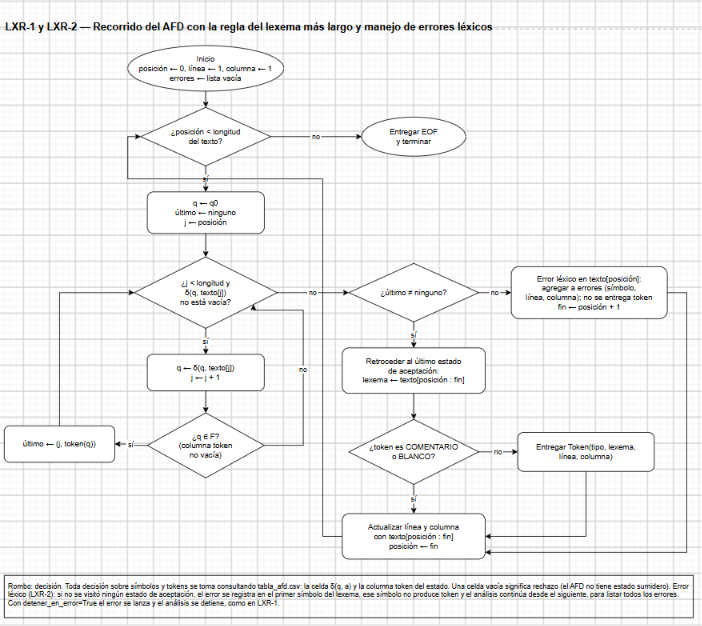

# Fase 3 — Manejo de errores léxicos

**Tarea Jira:** LXR-2 — Manejo de errores léxicos
**Responsable:** Juan Diego García Albarracín
**Insumos:** `lexer.md` y `src/lexer/lexer.py` (LXR-1), `docs/fase1/documento_fase1.md` (Tabla 17 y Traza 5) y `src/lexer/tabla_afd.csv`
**Archivos:** `src/lexer/lexer.py` (modificado), `tests/test_errores_lexicos.py` (nuevo), `tests/test_lexer.py` (ajuste de una línea) y `tests/errores/lexico1_fuera_del_alfabeto.cft`, `lexico2_simbolos_sin_token.cft` y `lexico3_cadenas_y_comentarios.cft`, y `docs/fase3/diagramas/lxr1_flujo_lexer.drawio` (actualizado)
**Se complementa con:** PAR-4 y PAR-5 (errores sintácticos y punto de entrada) y TST-2 (suite de programas con errores)

---

## 1. Qué cambia respecto a LXR-1

En LXR-1, el primer error léxico detenía el análisis con la excepción `ErrorLexico`. Con LXR-2, el analizador **registra el error, sigue analizando y al final lista todos los errores del archivo**, cada uno con su símbolo, línea y columna.

El recorrido del AFD no cambia: el cambio está concentrado en el método `AnalizadorLexico._manejar_error`, como lo había previsto LXR-1 (sección 4 de `lexer.md`). El analizador sigue sin reglas propias: no usa `re`, no compara lexemas ni nombres de tokens, y toda decisión sale de `tabla_afd.csv`.

## 2. Cuándo hay un error léxico

La descripción de la tarea habla de "caer en el sumidero". El AFD de la Fase 1 **no tiene estado sumidero**, por indicación de la profesora: una celda vacía de la matriz significa que δ(q, a) no está definida, es decir, rechazo. Ese es el equivalente del sumidero en este proyecto.

Una celda vacía no siempre es un error. Según la Tabla 17 de la Fase 1, depende del estado en que se detiene el AFD:

| Situación al detenerse | ¿Error? | Qué hace el analizador | Ejemplo |
|---|---|---|---|
| δ(q, a) vacía y q ∈ F | No | Emite el token de q y sigue desde a | `si(`: emite SI y sigue con `(` |
| δ(q, a) vacía, q ∉ F, pero antes se visitó un estado de aceptación | No | Retrocede al último estado de aceptación y emite su token | `12.x`: emite ENTERO `12`; el `.` se analiza después |
| δ(q, a) vacía, q ∉ F y no se visitó ningún estado de aceptación | **Sí** | Registra el error en el primer símbolo del lexema y continúa | `!x`: error en `!` |

Solo el tercer caso es un error léxico. Un símbolo que no pertenece a Σ, como `K` o `ñ`, no tiene columna en la matriz, así que desde q0 no hay transición y cae directamente en ese caso.

## 3. Qué se reporta

Cada error es un objeto `ErrorLexico` con estos datos:

| Atributo | Contenido |
|---|---|
| `simbolo` | El primer símbolo del lexema, donde se reporta el error |
| `linea`, `columna` | Posición de ese símbolo, desde 1, con la misma convención de LXR-1: la tabulación cuenta como una columna y `\r\n` como un solo salto de línea |
| `leido` | Lo que el AFD alcanzó a recorrer antes de quedarse sin transición |
| `en_alfabeto` | Si el símbolo pertenece a Σ |

El mensaje tiene tres formas, según el caso:

| Caso | Mensaje |
|---|---|
| Símbolo fuera de Σ | `Error léxico en la línea 3, columna 10, símbolo 'K': no pertenece al alfabeto Σ.` |
| Símbolo de Σ que solo no forma un token | `Error léxico en la línea 6, columna 9, símbolo '!': no forma ningún token.` |
| El AFD avanzó varios símbolos sin llegar a un estado de aceptación | `Error léxico en la línea 4, columna 13, símbolo '"': '"secar de nuevo' no forma ningún token.` |

El tercer caso es el de la Traza 5 de la Fase 1, la cadena sin cerrar. El error se ubica en la comilla inicial, como indica la Fase 1, y el mensaje muestra hasta dónde llegó el AFD.

## 4. Cómo continúa el análisis

Después de registrar el error, el análisis **continúa desde el símbolo siguiente al del error**, vuelve a q0 y recorre el AFD normalmente. El símbolo del error no produce ningún token.



*Fuente editable: `diagramas/lxr1_flujo_lexer.drawio`. La caja de la derecha es el cambio de LXR-2: el error se agrega a la lista y el análisis sigue en posición + 1.*

```
!x       →  error en '!'  y  ID 'x'
12.x     →  ENTERO '12' (retroceso),  error en '.'  y  ID 'x'
año      →  ID 'a',  error en 'ñ'  y  O 'o'
```

### 4.1 Por qué desde el símbolo siguiente y no desde otro punto

Se consideró otra estrategia: cuando una cadena no se cierra, reportar un solo error y saltar hasta el fin de línea. Se descartó porque, para hacerlo, el analizador tendría que saber que el estado donde se detuvo (q68) **significa** "cadena abierta". Esa sería una regla propia escrita en el código, por fuera de la matriz, que es exactamente lo que el proyecto evita y lo que la rúbrica sanciona como validación manual.

Con la estrategia elegida, el analizador sigue sin saber nada de los estados: solo sabe que el AFD no aceptó nada y que el primer símbolo no sirve. Además es la lectura directa de la Tabla 17: el error está en el primer símbolo del lexema, y el resto del texto se analiza con el mismo AFD.

### 4.2 Consecuencia: errores en cadena dentro de una cadena

Como el texto que sigue al error se vuelve a analizar desde q0, una cadena con un símbolo que no pertenece a C puede producir más de un error. Por ejemplo, en `mostrar("lote: norte");`:

| Columna | Símbolo | Por qué |
|---|---|---|
| 13 | `"` | La cadena se abre, pero `:` no está en C, así que el AFD se detiene en q68 sin aceptar |
| 18 | `:` | `lote` se reconoce como ID, y `:` no pertenece a Σ |
| 25 | `"` | `norte` es ID, y la comilla de cierre abre una cadena nueva que se detiene en `)` |

Cada uno de los tres es un error real en el punto donde se reporta: en ninguna de esas posiciones el texto forma un token. Se reportan todos porque el analizador no puede saber, sin reglas propias, que los tres vienen de un solo descuido del programador. Así lo muestra el archivo `lexico3_cadenas_y_comentarios.cft` (sección 6.3).

También se reporta **un error por símbolo**: `CAFE` produce cuatro errores, uno por letra, cada uno con su columna.

## 5. Cambios en el código

### 5.1 `src/lexer/lexer.py`

| Parte | Cambio |
|---|---|
| `AnalizadorLexico.__init__` | Nuevo parámetro `detener_en_error` (por defecto `False`) y nueva lista `self.errores` |
| `AnalizadorLexico.tokens` | Reinicia `self.errores` en cada análisis. Si `_manejar_error` devuelve una posición, actualiza línea y columna con el símbolo saltado y continúa |
| `AnalizadorLexico._manejar_error` | Construye el `ErrorLexico`. Si `detener_en_error` es `True`, lo lanza como en LXR-1; si no, lo agrega a `self.errores` y devuelve la posición siguiente |
| `ErrorLexico.mensaje` | Incluye el símbolo de forma explícita, con los tres formatos de la sección 3 |
| `main` | Muestra la tabla de tokens y después todos los errores en la salida de error. Termina con código 1 si hubo errores y con 0 si no |

`_lexema_mas_largo`, `TablaAFD`, `Token`, `_avanzar` y `tokens.py` no cambian.

### 5.2 Uso

```python
from src.lexer.lexer import AnalizadorLexico

lexer = AnalizadorLexico()
tokens = lexer.analizar_archivo("tests/errores/lexico2_simbolos_sin_token.cft")
for error in lexer.errores:
    print(error)
```

Desde la terminal, en la raíz del repositorio:

```
python -m src.lexer.lexer tests/errores/lexico2_simbolos_sin_token.cft
```

Salida de error del ejemplo anterior:

```
5 errores léxicos:
  Error léxico en la línea 3, columna 10, símbolo '_': no forma ningún token.
  Error léxico en la línea 4, columna 19, símbolo '.': no forma ningún token.
  Error léxico en la línea 5, columna 20, símbolo '.': no forma ningún token.
  Error léxico en la línea 6, columna 9, símbolo '!': no forma ningún token.
  Error léxico en la línea 9, columna 15, símbolo '.': no forma ningún token.
```

La lista de tokens que recibe el analizador sintáctico **no incluye** los símbolos con error. Si `main.py` (PAR-5) debe analizar sintácticamente un archivo con errores léxicos, o detenerse antes, se decide en esa tarea; el analizador léxico entrega las dos cosas por separado: los tokens y `errores`.

### 5.3 `tests/test_lexer.py`

Las cuatro pruebas de `PruebaErrores` de LXR-1 esperan que el primer error lance `ErrorLexico`. Como ahora el analizador continúa por defecto, esa clase crea el analizador con `detener_en_error=True`. Es el único cambio: las 25 pruebas de LXR-1 siguen pasando sin modificar ninguna aserción.

## 6. Archivos de prueba

Los tres archivos están en `tests/errores/`, la carpeta que el cronograma asigna a TST-2 para los programas con errores. Cada uno es un programa de Cafetal con errores de un tipo, repartidos en varias líneas.

### 6.1 `lexico1_fuera_del_alfabeto.cft`

Símbolos que no pertenecen a Σ: mayúsculas, ñ, coma y llaves.

| Línea | Columna | Símbolo | Explicación |
|---|---|---|---|
| 3 | 10 | `K` | Mayúscula en `Kilos`. Después, `ilos` se reconoce como ID |
| 4 | 11 | `ñ` | En `año`. Quedan ID `a` y la palabra reservada `o` (token O) |
| 5 | 22 | `,` | Decimal escrito con coma: `11` y `5` quedan como dos ENTERO |
| 6 | 32 | `{` | Cafetal no usa llaves: los bloques se cierran con `fin` |
| 8 | 5 | `}` | Igual que la anterior |

### 6.2 `lexico2_simbolos_sin_token.cft`

Símbolos que sí pertenecen a Σ pero no forman ningún token en esa posición.

| Línea | Columna | Símbolo | Explicación |
|---|---|---|---|
| 3 | 10 | `_` | `_lote`: desde q0 no hay transición con `_`, porque un ID empieza con letra |
| 4 | 19 | `.` | `.5`: desde q0 no hay transición con `.`; después, `5` es ENTERO |
| 5 | 20 | `.` | `12.`: el AFD llega a q66 ∉ F, retrocede a q65 y emite ENTERO `12`; luego el `.` solo es error |
| 6 | 9 | `!` | `!(`: q59 no tiene transición con `(` y no es de aceptación. La negación en Cafetal es `no` |
| 9 | 15 | `.` | `3.x`: mismo caso que `12.x` |

### 6.3 `lexico3_cadenas_y_comentarios.cft`

Cadenas y comentarios con errores, y un símbolo fuera de Σ al final de una línea.

| Línea | Columna | Símbolo | Explicación |
|---|---|---|---|
| 4 | 13 | `"` | `"secar de nuevo);`: falta la comilla de cierre. El AFD recorre la cadena hasta `)`, que no está en C, y se detiene en q68 sin aceptar (Traza 5 de la Fase 1). Las palabras se reconocen después como ID |
| 5 | 7 | `R` | `# Revisar el secador`: el comentario `# ` sí se reconoce (q70 acepta), pero `R` no pertenece a Σ y lo corta. Las palabras siguientes quedan como ID |
| 6 | 13 | `"` | `"lote: norte"`: `:` no está en C (sección 4.2) |
| 6 | 18 | `:` | No pertenece a Σ |
| 6 | 25 | `"` | La comilla de cierre abre una cadena nueva que se detiene en `)` |
| 7 | 21 | `@` | No pertenece a Σ |

En los tres archivos, el análisis llega hasta el final y entrega `EOF`, así que ningún error deja sin revisar el resto del archivo.

## 7. Pruebas

```
python -m unittest tests.test_lexer tests.test_errores_lexicos -v
```

| Grupo | Qué comprueba |
|---|---|
| Continuar después de un error | Varios errores en una línea y en varias líneas, archivos con `\r\n`, símbolos seguidos fuera de Σ (uno por símbolo), posiciones correctas de los tokens que siguen a un error, retroceso en `12.x`, cadena sin cerrar (Traza 5), reinicio de la lista en cada análisis, texto de los tres tipos de mensaje y el modo `detener_en_error` |
| Archivos con errores | Los tres archivos de `tests/errores/` producen exactamente los errores de la sección 6, en orden, y el análisis llega a `EOF`. La línea de comandos termina con código 1 y lista los errores |
| Sin errores | Los tres programas de `ejemplos/` siguen sin errores léxicos, y la línea de comandos termina con código 0 |

Resultado: **39 pruebas, todas correctas** (25 de LXR-1 y 14 de LXR-2).

## 8. Relación con las siguientes tareas

| Tarea | Qué toma de este documento |
|---|---|
| PAR-4 | El mismo formato de reporte (línea, columna y qué se encontró) para los errores sintácticos |
| PAR-5 | `main.py` recibe los tokens y `errores` por separado y decide si analiza sintácticamente cuando hay errores léxicos |
| TST-2 | Los tres archivos de `tests/errores/` son los programas con errores léxicos de la suite; faltan los de errores sintácticos |
