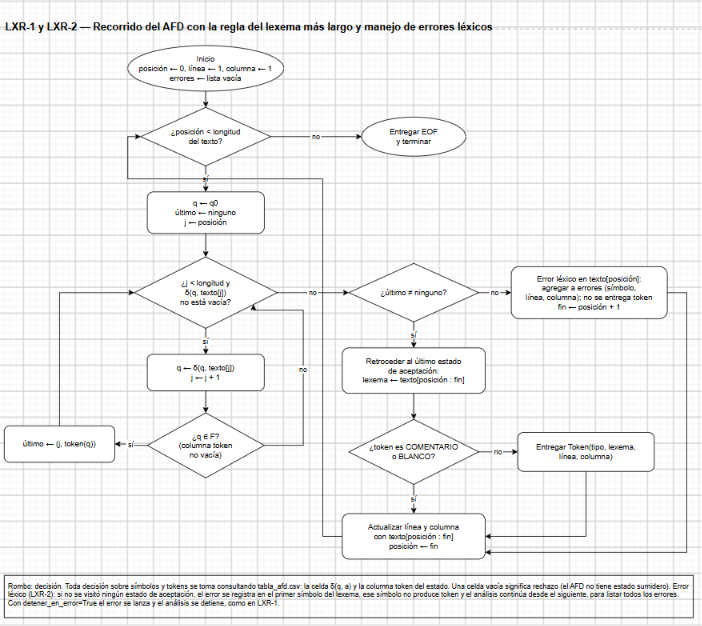

# Fase 3 — Analizador léxico dirigido por la matriz de transiciones

**Tarea Jira:** LXR-1 — Lexer en Python dirigido por la matriz de transiciones
**Responsable:** Daniel Josué Narváez Hincapié
**Insumos:** `src/lexer/tabla_afd.csv` (AFD-5), `docs/fase1/documento_fase1.md` (reglas de reconocimiento y Tabla 17) y `docs/fase1/catalogo_tokens.md`
**Archivos:** `src/lexer/lexer.py`, `src/lexer/tokens.py`, `tests/test_lexer.py` y `docs/fase3/diagramas/lxr1_flujo_lexer.drawio`
**Se complementa con:** LXR-2 (manejo de errores léxicos) y PAR-1 (contrato entre lexer y parser)

---

## 1. Idea

El analizador léxico **no tiene reglas propias** para reconocer tokens. Carga la matriz del AFD global de la Fase 1 (72 estados × 55 símbolos) y la recorre símbolo por símbolo. Todas las decisiones salen de la tabla:

| Pregunta | Dónde se responde |
|---|---|
| ¿A qué estado se pasa con el símbolo a desde q? | Celda δ(q, a) de `tabla_afd.csv` |
| ¿El estado es de aceptación? ¿Qué token devuelve? | Columna `token` de la fila del estado |
| ¿Cuándo se rechaza? | Celda vacía: δ(q, a) no está definida (el AFD no tiene estado sumidero) |
| ¿`si` es palabra reservada o ID? | El AFD: q15 devuelve SI y q64 devuelve ID |

Por eso el código no usa el módulo `re`, no compara lexemas con palabras reservadas y no tiene un `if` por token. Si se cambia el lenguaje, basta con cambiar la matriz: el código del analizador no cambia.

## 2. Estructura

| Archivo | Contenido |
|---|---|
| `src/lexer/tokens.py` | Datos del catálogo: el código de cada categoría (`CODIGOS`), las categorías descartables (`DESCARTABLES`) y `EOF` |
| `src/lexer/lexer.py` | `TablaAFD` (carga y consulta de la matriz), `Token` (contrato con el parser), `ErrorLexico` y `AnalizadorLexico` (recorrido), más la línea de comandos |
| `tests/test_lexer.py` | 25 pruebas con `unittest` |

### 2.1 `TablaAFD`

Lee el CSV con el módulo `csv` de la biblioteca estándar. La ruta por defecto es la del archivo junto a `lexer.py`, así que no hay rutas fijas. En la cabecera, los blancos tienen nombre (`ESP`, `TAB`, `LF`, `CR`) y se traducen a su carácter al cargar. Solo se guardan las celdas no vacías: una celda vacía no se representa, y consultarla devuelve `None`, que significa rechazo.

Al cargar se valida el formato: que la cabecera empiece con `estado` y termine con `token`, que todas las filas tengan las mismas columnas, que todo destino sea un estado de la tabla y que todo token esté en el catálogo.

### 2.2 `Token`

Es el contrato con el analizador sintáctico (PAR-1): `tipo` (nombre del token del catálogo), `lexema`, `linea` y `columna` del primer carácter, y la propiedad `codigo`. El último token siempre es `EOF` (código 99), con la posición que sigue al último carácter.

## 3. Algoritmo: lexema más largo con retroceso



*Fuente editable: `diagramas/lxr1_flujo_lexer.drawio`.*

Desde la posición actual:

1. Se parte de q0 y se avanza mientras la celda δ(q, a) del siguiente símbolo no esté vacía.
2. Cada vez que se llega a un estado de aceptación, se recuerda la posición y el token de ese estado.
3. Cuando el AFD ya no puede avanzar, o se acaba el texto, se **retrocede al último estado de aceptación visitado** y se emite su token con el lexema leído hasta ahí.
4. Si `COMENTARIO` o `BLANCO` son el token, el lexema se usa para actualizar línea y columna, pero no se entrega (regla 3 de la Fase 1).
5. Se repite desde el final del lexema.

Los tres casos de la Tabla 17 de la Fase 1 quedan cubiertos así:

| Situación al detenerse | Qué hace el analizador | Ejemplo |
|---|---|---|
| δ(q, a) vacía y q ∈ F | El último estado de aceptación es q: emite su token y sigue desde a | `si(`: emite SI en q15 y sigue con `(` |
| δ(q, a) vacía, q ∉ F, pero antes hubo aceptación | Retrocede al último estado de aceptación | `12.x`: llega a q66, retrocede a q65 y emite ENTERO `12`; el `.` queda como error |
| δ(q, a) vacía, q ∉ F y no hubo aceptación | Error léxico en el primer símbolo del lexema | `!x`: q59 ∉ F, error en `!` |

Un símbolo que no pertenece a Σ, como `K` o `ñ`, no tiene columna en la matriz, así que ninguna celda lo acepta: cae en el tercer caso. El mensaje distingue si el símbolo está fuera de Σ.

**Línea y columna.** Las dos empiezan en 1. Cada carácter avanza una columna (la tabulación también cuenta como una), y `\n`, `\r` o la pareja `\r\n` pasan a la línea siguiente. Así funciona igual con archivos guardados en Windows y en Linux.

## 4. Errores léxicos y LXR-2

En esta tarea, el primer error léxico detiene el análisis con la excepción `ErrorLexico`, que lleva el símbolo, la línea, la columna y lo que se alcanzó a leer. Todo el manejo está concentrado en el método `AnalizadorLexico._manejar_error`. LXR-2 lo reemplaza para registrar el error, avanzar y continuar, de modo que se listen todos los errores del archivo sin tocar el recorrido del AFD.

## 5. Uso

Desde la raíz del repositorio, con Python 3 y sin librerías externas:

```
python -m src.lexer.lexer ejemplos/ejemplo3_secado.cft
python -m src.lexer.lexer ejemplos/ejemplo3_secado.cft --todos
```

La primera muestra los tokens que recibe el parser, con línea, columna, código y lexema. La segunda incluye también comentarios y blancos. Si hay un error léxico, se muestra en la salida de error y el programa termina con código 1.

Desde Python:

```python
from src.lexer.lexer import AnalizadorLexico

tokens = AnalizadorLexico().analizar_archivo("ejemplos/ejemplo3_secado.cft")
```

## 6. Pruebas

```
python -m unittest tests.test_lexer -v
```

| Grupo | Qué comprueba |
|---|---|
| Tabla | 72 estados, 55 símbolos, 68 estados de aceptación (no aceptan q0, q59, q66 y q68) y 1 997 transiciones, como en la Fase 1 |
| Reconocimiento | Trazas 1 a 3 de la Fase 1 (`sino`, `lote_2`, `11.5`), lexema más largo en operadores de dos símbolos, texto sin espacios, las 12 palabras reservadas, prefijos y extensiones de palabras reservadas como ID (`dat`, `datos`, `siembra`, `entonces2`…), descarte de comentarios y blancos, y cadenas |
| Posiciones | Línea y columna de cada token, fines de línea de Windows y `EOF` en un archivo vacío |
| Errores | Trazas 4 y 5 de la Fase 1 (`!x` y cadena sin cerrar), símbolo fuera de Σ y retroceso en `12.x` |
| Programas de ejemplo | 66, 62 y 57 tokens sin errores (Tabla 20 de la Fase 1), las 32 categorías léxicas presentes y la tokenización de la línea 7 de `ejemplo3_secado.cft` |
| Restricciones | `lexer.py` y `tokens.py` no importan `re`, y ninguna comparación del código usa un nombre de token ni una palabra reservada |

Resultado: **25 pruebas, todas correctas.**
