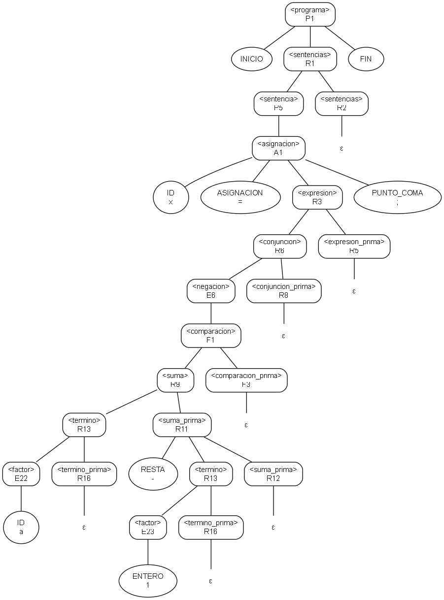

# Fase 3 — Visualización del árbol de derivación

**Tarea Jira:** ARB-1 — Visualización del árbol de derivación
**Responsable:** Daniel Josué Narváez Hincapié
**Insumos:** `src/parser/arbol.py` y `docs/fase3/arbol.md` (PAR-1), `src/parser/parser.py` y `docs/fase3/parser.md` (PAR-2 a PAR-4) y la traza a mano de la sección 11.1 de `docs/fase2/primero_siguiente_ll1.md` (GIC-6)
**Archivos:** `src/parser/visualizacion.py`, `tests/test_visualizacion.py` y los ejemplos de salida de `docs/fase3/arboles/`
**Se complementa con:** PAR-5 (`main.py`), que puede usar estas funciones para mostrar el árbol

---

## 1. Qué hace

`src/parser/visualizacion.py` toma el árbol que construye el parser y lo muestra de tres formas:

| Salida | Funciones | Para qué |
|---|---|---|
| Árbol con sangría, en la consola o en un archivo de texto | `texto_arbol`, `imprimir_arbol`, `exportar_texto` | Ver el árbol completo, con la regla de cada no terminal y el lexema de cada terminal |
| Derivación más a la izquierda, forma sentencial por forma sentencial | `derivacion`, `texto_derivacion`, `exportar_derivacion` | Compararla con una derivación hecha a mano (sección 4) |
| Árbol en lenguaje DOT de Graphviz e imagen PNG (opcional) | `a_dot`, `exportar_dot`, `exportar_imagen` | Ver el árbol dibujado, con la misma convención visual de los árboles de la Fase 2 |

Todos los recorridos son iterativos, como `recorrer()` de PAR-1, así que funcionan con árboles de cualquier profundidad. Las pruebas lo verifican con un árbol de 5 000 niveles. El módulo usa solo la biblioteca estándar de Python. Graphviz es un programa externo y opcional: solo hace falta para la imagen.

## 2. Árbol con sangría

Cada nodo ocupa una línea, en preorden: primero el nodo y después sus hijos, de izquierda a derecha. La sangría muestra la profundidad, y las ramas `├──`, `└──` y `│` unen cada nodo con su padre.

| Nodo | Cómo se muestra | Ejemplo |
|---|---|---|
| No terminal | Símbolo y regla aplicada entre corchetes | `<suma> [R9]` |
| Terminal | Tipo del token y lexema entre comillas; con `posiciones=True`, también línea:columna | `ID 'x'` · `ID 'x' 2:3` |
| Hoja vacía | ε | `ε` |
| No terminal omitido por un error (PAR-4) | Regla ERROR | `<termino> [ERROR]` |
| Terminal que faltaba (PAR-4) | «faltante» en lugar del lexema | `PAR_CIERRA (faltante)` |

Es el mismo formato que la sección 5 de `arbol.md` mostraba como ilustración. Con `ascii=True`, las ramas se dibujan con `|--`, `` `-- `` y `|`, para las consolas que no muestran los caracteres de recuadro. En la consola de Windows, si las ramas aparecen como símbolos raros, conviene usar `--ascii` o ejecutar antes `chcp 65001`.

Ejemplo: el árbol de `inicio x = a - 1; fin`, el programa de la traza de GIC-6.

```
<programa> [P1]
├── INICIO 'inicio'
├── <sentencias> [R1]
│   ├── <sentencia> [P5]
│   │   └── <asignacion> [A1]
│   │       ├── ID 'x'
│   │       ├── ASIGNACION '='
│   │       ├── <expresion> [R3]
│   │       │   ├── <conjuncion> [R6]
│   │       │   │   ├── <negacion> [E6]
│   │       │   │   │   └── <comparacion> [F1]
│   │       │   │   │       ├── <suma> [R9]
│   │       │   │   │       │   ├── <termino> [R13]
│   │       │   │   │       │   │   ├── <factor> [E22]
│   │       │   │   │       │   │   │   └── ID 'a'
│   │       │   │   │       │   │   └── <termino_prima> [R16]
│   │       │   │   │       │   │       └── ε
│   │       │   │   │       │   └── <suma_prima> [R11]
│   │       │   │   │       │       ├── RESTA '-'
│   │       │   │   │       │       ├── <termino> [R13]
│   │       │   │   │       │       │   ├── <factor> [E23]
│   │       │   │   │       │       │   │   └── ENTERO '1'
│   │       │   │   │       │       │   └── <termino_prima> [R16]
│   │       │   │   │       │       │       └── ε
│   │       │   │   │       │       └── <suma_prima> [R12]
│   │       │   │   │       │           └── ε
│   │       │   │   │       └── <comparacion_prima> [F3]
│   │       │   │   │           └── ε
│   │       │   │   └── <conjuncion_prima> [R8]
│   │       │   │       └── ε
│   │       │   └── <expresion_prima> [R5]
│   │       │       └── ε
│   │       └── PUNTO_COMA ';'
│   └── <sentencias> [R2]
│       └── ε
└── FIN 'fin'
```

## 3. Derivación más a la izquierda

`derivacion(raiz)` reconstruye, a partir del árbol, la derivación más a la izquierda que lo genera. Empieza con `<programa>` y en cada paso reemplaza el no terminal de más a la izquierda por los hijos de su nodo, y anota la regla de ese nodo. Una hoja ε no deja nada en la forma sentencial. Como en la Fase 2, el lexema de ID, ENTERO, DECIMAL y CADENA se escribe entre ⟨ ⟩.

Hay un paso por cada no terminal del árbol, en el mismo orden de `derivacion_izquierda()` (PAR-1), que es el orden en que el analizador predictivo aplica las reglas (sección 11 de GIC-6). La última forma sentencial es el programa: sus tokens, sin EOF.

## 4. Verificación con lo hecho a mano

La tarea pide verificar que la salida coincide con la derivación a mano de un ejemplo. Se tomó el programa de la traza de GIC-6, `inicio x = a - 1; fin`, y se hicieron dos comprobaciones.

**1. Las reglas coinciden con la traza a mano de GIC-6.** La columna Acción de la tabla de la sección 11.1 de `primero_siguiente_ll1.md`, hecha a mano con la pila del analizador predictivo, aplica estas 21 reglas: P1, R1, P5, A1, R3, R6, E6, F1, R9, R13, E22, R16, R11, R13, E23, R16, R12, F3, R8, R5, R2. Son exactamente las reglas de los nodos del árbol en preorden.

**2. Las formas sentenciales coinciden con la derivación a mano.** Esta es la derivación más a la izquierda de la entrada, escrita a mano aplicando cada regla de la gramática final al no terminal de más a la izquierda:

```
       <programa>
⇒ P1   INICIO <sentencias> FIN
⇒ R1   INICIO <sentencia> <sentencias> FIN
⇒ P5   INICIO <asignacion> <sentencias> FIN
⇒ A1   INICIO ID⟨x⟩ ASIGNACION <expresion> PUNTO_COMA <sentencias> FIN
⇒ R3   INICIO ID⟨x⟩ ASIGNACION <conjuncion> <expresion_prima> PUNTO_COMA <sentencias> FIN
⇒ R6   INICIO ID⟨x⟩ ASIGNACION <negacion> <conjuncion_prima> <expresion_prima> PUNTO_COMA <sentencias> FIN
⇒ E6   INICIO ID⟨x⟩ ASIGNACION <comparacion> <conjuncion_prima> <expresion_prima> PUNTO_COMA <sentencias> FIN
⇒ F1   INICIO ID⟨x⟩ ASIGNACION <suma> <comparacion_prima> <conjuncion_prima> <expresion_prima> PUNTO_COMA <sentencias> FIN
⇒ R9   INICIO ID⟨x⟩ ASIGNACION <termino> <suma_prima> <comparacion_prima> <conjuncion_prima> <expresion_prima> PUNTO_COMA <sentencias> FIN
⇒ R13  INICIO ID⟨x⟩ ASIGNACION <factor> <termino_prima> <suma_prima> <comparacion_prima> <conjuncion_prima> <expresion_prima> PUNTO_COMA <sentencias> FIN
⇒ E22  INICIO ID⟨x⟩ ASIGNACION ID⟨a⟩ <termino_prima> <suma_prima> <comparacion_prima> <conjuncion_prima> <expresion_prima> PUNTO_COMA <sentencias> FIN
⇒ R16  INICIO ID⟨x⟩ ASIGNACION ID⟨a⟩ <suma_prima> <comparacion_prima> <conjuncion_prima> <expresion_prima> PUNTO_COMA <sentencias> FIN
⇒ R11  INICIO ID⟨x⟩ ASIGNACION ID⟨a⟩ RESTA <termino> <suma_prima> <comparacion_prima> <conjuncion_prima> <expresion_prima> PUNTO_COMA <sentencias> FIN
⇒ R13  INICIO ID⟨x⟩ ASIGNACION ID⟨a⟩ RESTA <factor> <termino_prima> <suma_prima> <comparacion_prima> <conjuncion_prima> <expresion_prima> PUNTO_COMA <sentencias> FIN
⇒ E23  INICIO ID⟨x⟩ ASIGNACION ID⟨a⟩ RESTA ENTERO⟨1⟩ <termino_prima> <suma_prima> <comparacion_prima> <conjuncion_prima> <expresion_prima> PUNTO_COMA <sentencias> FIN
⇒ R16  INICIO ID⟨x⟩ ASIGNACION ID⟨a⟩ RESTA ENTERO⟨1⟩ <suma_prima> <comparacion_prima> <conjuncion_prima> <expresion_prima> PUNTO_COMA <sentencias> FIN
⇒ R12  INICIO ID⟨x⟩ ASIGNACION ID⟨a⟩ RESTA ENTERO⟨1⟩ <comparacion_prima> <conjuncion_prima> <expresion_prima> PUNTO_COMA <sentencias> FIN
⇒ F3   INICIO ID⟨x⟩ ASIGNACION ID⟨a⟩ RESTA ENTERO⟨1⟩ <conjuncion_prima> <expresion_prima> PUNTO_COMA <sentencias> FIN
⇒ R8   INICIO ID⟨x⟩ ASIGNACION ID⟨a⟩ RESTA ENTERO⟨1⟩ <expresion_prima> PUNTO_COMA <sentencias> FIN
⇒ R5   INICIO ID⟨x⟩ ASIGNACION ID⟨a⟩ RESTA ENTERO⟨1⟩ PUNTO_COMA <sentencias> FIN
⇒ R2   INICIO ID⟨x⟩ ASIGNACION ID⟨a⟩ RESTA ENTERO⟨1⟩ PUNTO_COMA FIN
```

`texto_derivacion` produce exactamente estas 22 líneas a partir del árbol del parser. La prueba `test_coincide_con_la_derivacion_a_mano` las compara una por una.

**Otras dos comparaciones con árboles hechos a mano:**

| Árbol hecho a mano | Comparación |
|---|---|
| Sección 5 de `arbol.md` (PAR-1): árbol de `inicio x = 1; fin` armado regla por regla | `texto_arbol` lo produce carácter por carácter |
| `docs/fase2/arboles/gic4_recursividad.drawio`, página Comparacion (GIC-4): árbol de `10 - 4 - 2` desde `<suma>` en la gramática sin recursividad por la izquierda | El subárbol `<suma>` de `inicio x = 10 - 4 - 2; fin` tiene los mismos nodos, reglas y hojas |

## 5. Graphviz (opcional)

`a_dot(raiz)` escribe el árbol en lenguaje DOT. Los no terminales van en rectángulos redondeados con su regla debajo, los terminales en elipses con su lexema y ε como texto: es el mismo código visual de los árboles de la Fase 2 en draw.io. Los nodos ERROR van con borde punteado. `ordering=out` mantiene a los hijos en el orden de la regla.

`exportar_imagen(raiz, ruta)` llama al programa `dot` de Graphviz para generar la imagen. Si Graphviz no está instalado, lanza un error que indica usar el `.dot`. El archivo `.dot` se puede abrir en cualquier visor de Graphviz, en línea o local. Para instalar Graphviz en Windows, se descarga desde graphviz.org y se agrega su carpeta `bin` al PATH.



*Generado con `python -m src.parser.visualizacion` y la opción `--png`. Fuente: `arboles/traza_gic6.dot`.*

## 6. Uso

### 6.1 Desde la terminal

En la raíz del repositorio:

```
python -m src.parser.visualizacion ejemplos/ejemplo3_secado.cft
python -m src.parser.visualizacion ejemplos/ejemplo3_secado.cft --salida arbol.txt
python -m src.parser.visualizacion ejemplos/ejemplo3_secado.cft --derivacion --posiciones
python -m src.parser.visualizacion ejemplos/ejemplo3_secado.cft --dot arbol.dot --png arbol.png
```

| Opción | Efecto |
|---|---|
| `--salida RUTA` | Guarda el árbol con sangría en un archivo de texto UTF-8 |
| `--derivacion` | Muestra también la derivación más a la izquierda |
| `--salida-derivacion RUTA` | Guarda la derivación más a la izquierda en un archivo de texto UTF-8 |
| `--posiciones` | Agrega línea:columna a cada terminal |
| `--ascii` | Dibuja las ramas solo con caracteres ASCII |
| `--dot RUTA` | Guarda el árbol en formato DOT |
| `--png RUTA` | Dibuja el árbol como imagen (requiere Graphviz) |

Ninguna ruta es fija: todas se reciben como argumento. Si el programa tiene errores léxicos o sintácticos, se listan en la salida de error, no se muestra el árbol y el programa termina con código 1, porque el enunciado pide «el árbol de derivación sintáctica o el listado de errores» y con errores el árbol está incompleto (PAR-4).

Esta línea de comandos es una herramienta para ver el árbol. El punto de entrada oficial del proyecto es `main.py` (PAR-5).

### 6.2 Desde Python (para PAR-5)

```python
from src.lexer.lexer import AnalizadorLexico
from src.parser.parser import Parser
from src.parser.visualizacion import imprimir_arbol, exportar_texto

lexer = AnalizadorLexico()
parser = Parser(lexer.analizar_archivo("ejemplos/ejemplo3_secado.cft"))
arbol = parser.analizar()
if not lexer.errores and not parser.errores:
    imprimir_arbol(arbol)
    exportar_texto(arbol, "arbol.txt")
```

## 7. Ejemplos de salida

En `docs/fase3/arboles/` quedan las salidas de dos programas, generadas con la línea de comandos. El programa de la traza está en `traza_gic6.cft`:

```
python -m src.parser.visualizacion docs/fase3/arboles/traza_gic6.cft --salida docs/fase3/arboles/traza_gic6.txt --salida-derivacion docs/fase3/arboles/traza_gic6_derivacion.txt --dot docs/fase3/arboles/traza_gic6.dot --png docs/fase3/arboles/traza_gic6.png
python -m src.parser.visualizacion ejemplos/ejemplo3_secado.cft --salida docs/fase3/arboles/ejemplo3_secado.txt --dot docs/fase3/arboles/ejemplo3_secado.dot --png docs/fase3/arboles/ejemplo3_secado.png
```

| Archivo | Contenido |
|---|---|
| `traza_gic6.cft` | El programa `inicio x = a - 1; fin` |
| `traza_gic6.txt`, `traza_gic6_derivacion.txt` | Árbol y derivación de ese programa (sección 4) |
| `traza_gic6.dot`, `traza_gic6.png` | El mismo árbol para Graphviz y su imagen |
| `ejemplo3_secado.txt` | Árbol completo de `ejemplos/ejemplo3_secado.cft`, con sus 165 reglas |
| `ejemplo3_secado.dot`, `ejemplo3_secado.png` | El mismo árbol para Graphviz y su imagen |

## 8. Pruebas

```
python -m unittest tests.test_visualizacion -v
```

| Grupo | Qué comprueba |
|---|---|
| Texto | El árbol de `inicio x = 1; fin` es idéntico al de la sección 5 de `arbol.md`, y el subárbol de `10 - 4 - 2` al dibujado en GIC-4; una línea por nodo, con la sangría de su profundidad; ramas ASCII; posiciones; nodos ERROR y terminales faltantes; un árbol de 5 000 niveles; exportación a archivo |
| Derivación | Las reglas coinciden con la traza a mano de GIC-6 y las formas sentenciales con la derivación a mano de la sección 4; en los tres programas de ejemplo, una forma por regla y la última es el programa |
| Graphviz | El DOT tiene un nodo por cada nodo del árbol y una arista por cada relación padre-hijo, con las comillas de las cadenas escapadas; exportación del `.dot`; si Graphviz está instalado, la imagen es un PNG válido (si no, la prueba se omite) |
| Línea de comandos | Un programa válido muestra el árbol, la derivación y guarda el archivo; un programa con errores los lista y no muestra el árbol; un archivo que no existe |
| Restricciones | `visualizacion.py` no importa `re` |

Resultado: **19 pruebas, todas correctas** (la de la imagen se omite si Graphviz no está instalado). Con las anteriores, la suite tiene 130 pruebas:

```
python -m unittest discover -s tests -t . -v
```
